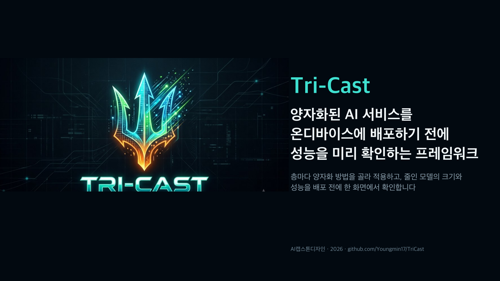
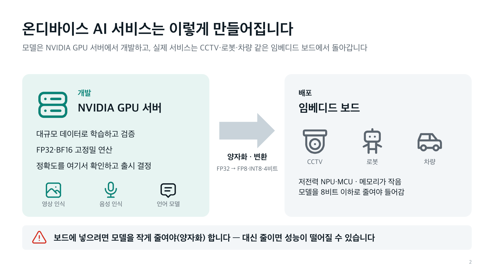
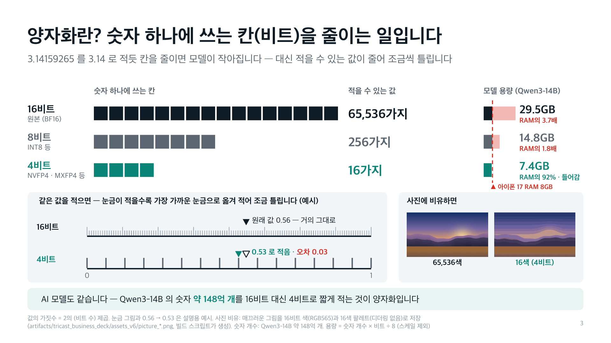
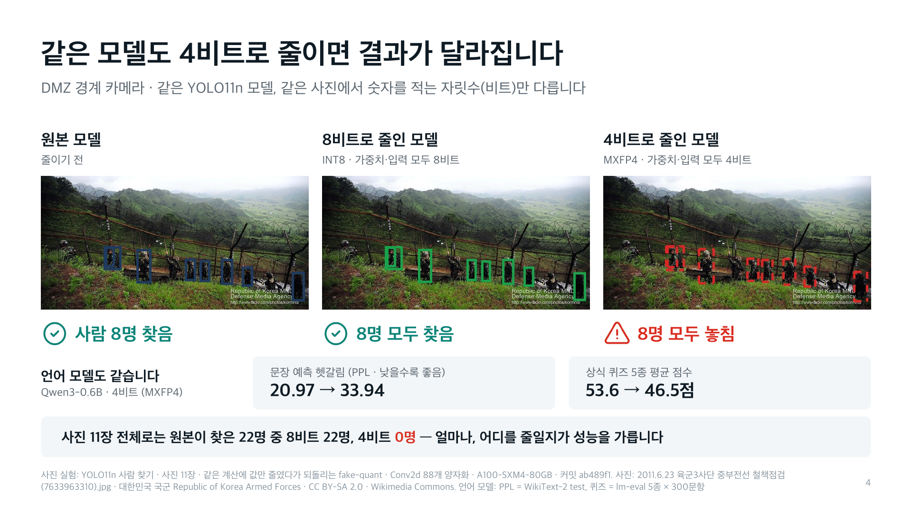
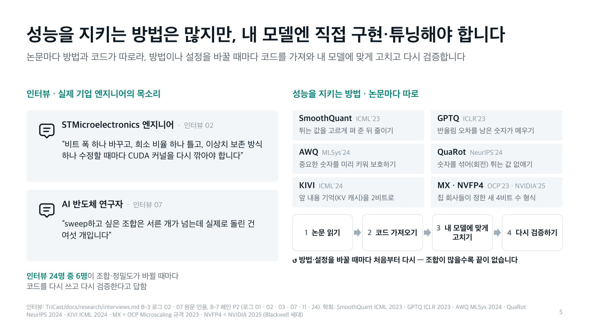
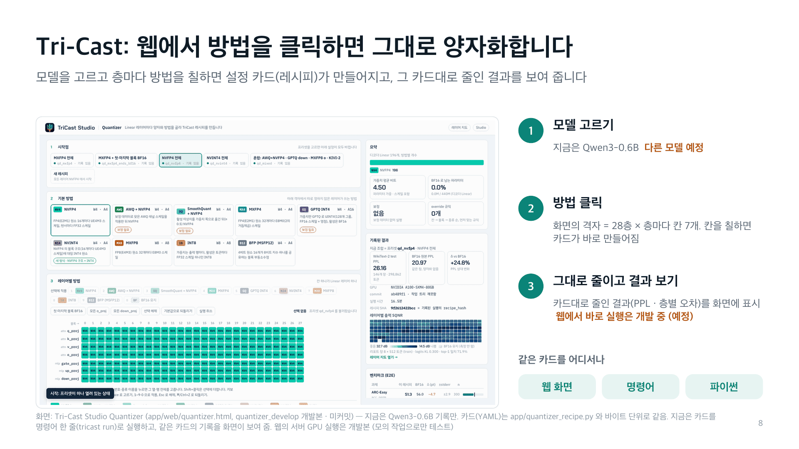
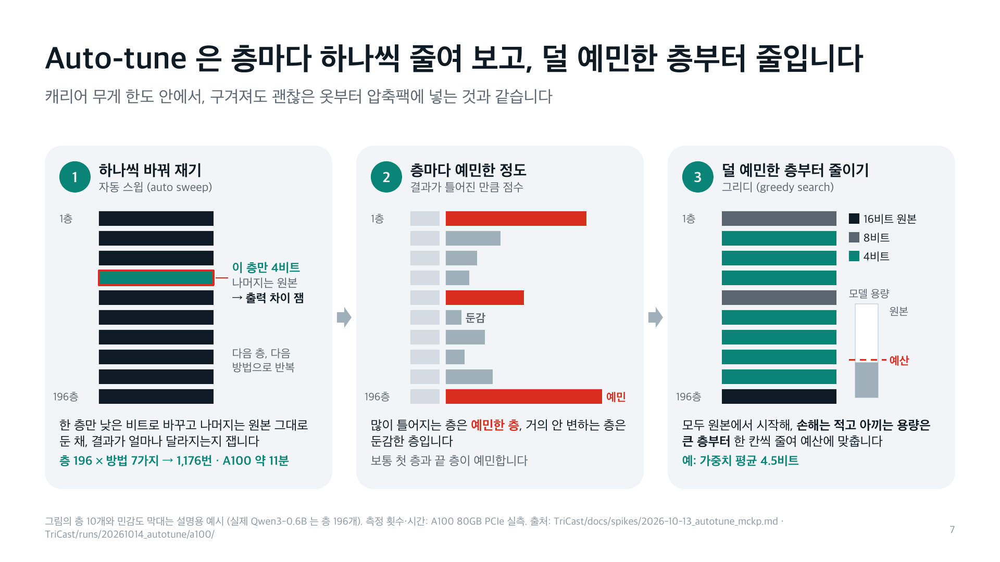
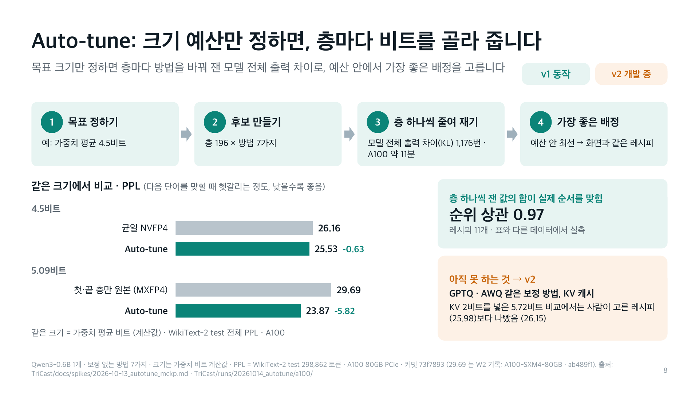
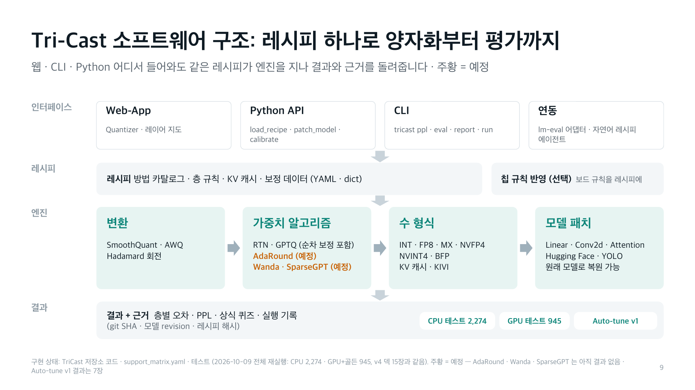
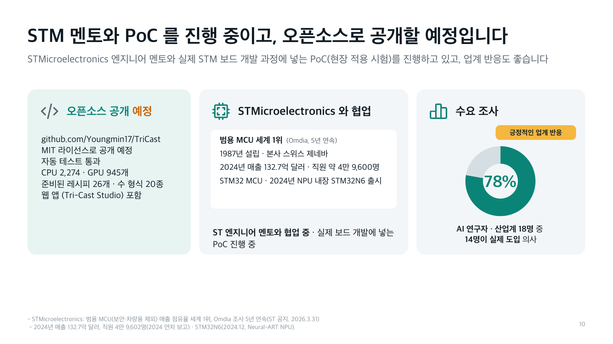

<p align="center"></p>

<p align="center"></p>

<p align="center"></p>

<p align="center"></p>

<p align="center"></p>

<p align="center"></p>

<p align="center"></p>

<p align="center"></p>

<p align="center"></p>

<p align="center"></p>

---

## TriCast 한눈에

**v2.0 — Quantizer.** 레이어마다 양자화 방법(GPTQ · AWQ · SmoothQuant · MXFP4/8 · NVFP4 · NVINT4 · INT8 · BFP)을
웹 격자에서 클릭하거나 YAML 로 적으면, TriCast 가 레시피 한 장으로 모델에 적용하고 레이어별 오차(MSE · SQNR · 코사인)와
모델 품질(PPL · lm-eval 과제별)을 실행 환경 기록(git SHA · 모델 revision · 레시피 해시)과 함께 돌려준다.

**Auto-tune — 휴리스틱과 AI 를 함께 쓴다.** 크기 예산(가중치 평균 비트)을 주면 ① 층 하나만 양자화한 KL 표 위에서 정확
배낭(휴리스틱)이 층마다 방법을 즉시 고르고, ② Claude 에이전트가 ledger 에서 RAG 로 불러온 레이어 카드(방법별 KL · 레이어
오차 · 가중치/활성 분포 · 희소화 민감도, 숫자마다 레코드 id)를 인용해 그 배정을 고칠 제안을 내며, ③ 코드 검사(예산 · 인용
실존 · 수치 근거)를 통과한 제안만 GPU 로 측정한다. 요청은 문장으로도 받는다 ("Qwen3-0.6B 를 3.2비트 안에서, 첫 블록은
BF16 으로"). 저비트 방법 16종(GPTQ · RHT+GPTQ · AWQ(+clip) · HQQ 2–4비트 · NF4 · INT8)을 층마다 섞는다.

칩(NPU·GPU 세대)의 수 형식 · 반올림 · MMA 누산 규칙은 같은 레시피의 선택 축이다 — TriCast 가 그 산술을 GPU 의 CUDA
core 에서 **비트 단위로 똑같이** 에뮬레이트한다. 누산 모델(CoFDA · GDFS)은 NADPE 논문(MICRO'26)의 정의를 따르고,
레퍼런스는 그 독립 구현의 골든 벡터와 대조한다. 위 슬라이드는 v2(Quantizer · Auto-tune) 발표 자료다 (v7 덱, 6장은 Quantizer 화면 녹화).

## 설치와 빠른 시작

```bash
pip install -e ".[eval,dev,app]"        # Linux + CUDA GPU 에서는 ".[triton,eval,dev,app]" — 그 외에는 레퍼런스 백엔드
tricast formats && tricast presets      # 등록된 수 형식 20종 · 하드웨어 프리셋 8종 (출처 포함)
tricast cast --format fp8_e4m3 --rounding rne 464 465     # → 448 448 (포화)
tricast recipe-check hopper_fp8_w8a8                      # 스키마 검증 + 레시피 SHA-256
tricast ppl --model Qwen/Qwen3-0.6B --recipe hopper_fp8_w8a8
python -m app.server --demo             # TriCast Studio — GPU 없이 기록된 실행을 탐색 (fastapi, uvicorn)
                                        #   Quantizer 격자: /quantizer.html · 레이어 지도: /layers.html
python -m app.quantizer_recipe --preset qd_mixed           # 화면과 바이트 동일한 레시피 YAML
python -m app.autotune solve --table table.json --budget-bits 9/2 --name auto_4.50 --out out/   # Auto-tune
make check                              # ruff + CPU 테스트
```

## MVP 사용자 가이드

처음 보는 분이 **GPU · 계정 · API 키 없이 5분 안에** 핵심 기능을 실행해 보는 안내다. 리뷰 기간(11월 11일–18일) 동안 이 안내대로 실행되며, 실행 방법이 바뀌면 이 절을 고친다.

### 서비스 소개

| | |
|---|---|
| 팀 이름 | **OAB(13팀)** |
| 서비스 이름 | **TriCast** |
| 대상 사용자 | 큰 언어 모델을 작게 줄여(양자화) 칩이나 서버에 올려야 하는 엔지니어 |

- **해결하려는 문제**: 모델을 줄이려면 층마다 어떤 방법으로 줄일지 정해야 한다. 예시 모델(Qwen3-0.6B)만 해도 층 196개 × 방법 16종이라 손으로는 다 볼 수 없고, 조합을 바꿀 때마다 코드를 다시 짜고 모델 전체를 다시 평가해야 해서 배정을 정하는 데 3주~3개월이 걸린다 ([문제 정의](docs/PROBLEM.md)).
- **이번 MVP 에서 쓸 수 있는 핵심 기능** — 화면 하나에서 순서대로:
  1. **모델** 넣기
  2. **Auto-tune (AI 추천)**: 목표 크기만 고르면 층마다 방법을 골라 주고, AI 가 GPU 로 재서 찾은 세부 설정을 더한다
  3. **직접 편집**: 추천을 사람이 바꿔 본다
  4. **평가**: 그 셋업의 품질을 원본 · 다른 방법과 비교한다
  5. **결과물**: 최종 모델의 압축 크기(원본 대비, 계산값), 레시피 묶음(zip) 내보내기, 그리고 실제로 만든 저비트 모델 파일 — 언어 모델은 정수 코드를 담은 safetensors 패키지, YOLO11n 은 INT4 · INT8 가중치 ONNX 파일

### 실행 및 접속 방법

- **저장소**: https://github.com/Youngmin17/TriCast (브랜치 `quantizer_develop` — 기본 브랜치)
- **지원 환경**: macOS · Linux (Windows 는 WSL), Python 3.10 이상, 최신 Chrome · Edge · Safari. **GPU 는 필요 없다.** (확인한 환경: macOS + Chrome)

```bash
git clone https://github.com/Youngmin17/TriCast.git && cd TriCast
python3 --version                                            # 3.10 이상이어야 한다 (macOS 기본 python3 는 3.9)
python3 -m venv .venv && source .venv/bin/activate
pip install fastapi uvicorn pillow numpy jsonschema pyyaml   # 이 체험에 필요한 것만 (torch 불필요)
PYTHONPATH=src python -m app.server --demo --agent evals/fixtures/tune_inputs/s3150/loop.json
```

서버가 뜨면 브라우저에서 **http://127.0.0.1:8765/tune.html** 을 연다 (`file://` 로 직접 열면 동작하지 않는다). 끌 때는 터미널에서 Ctrl+C.

### 핵심 기능 체험 순서

**역할**: "이 모델을 원본의 20% 크기로 줄여 달라"는 요청을 받은 엔지니어. **목표**: 추천 셋업을 받고, 직접 바꿔 보고, 품질 차이를 숫자로 확인한다.

| 단계 | 누를 것 | 보이는 것 |
|---|---|---|
| ① 모델 | **불러오기** (모델 칸은 `Qwen/Qwen3-0.6B`) | Linear 196개 · 방법 16종. ② 에 목표 크기 버튼 6개가 열린다 |
| ② Auto-tune | 목표 크기 **20%** | "AI 추천 PPL 26.51" 과 이유 두 줄: 층마다 방법을 다르게 골라 33.31 → 27.04, AI 가 찾은 세부 설정을 더해 27.04 → 26.51 |
| ③ 직접 편집 | **층별 배정** 목록에서 `AWQ+클립 3비트` | 격자 196칸이 한 색(3비트)으로 바뀌고, 레시피 파일이 `u_awq_clip_int3.yaml` 로 바뀐다. 머리에 "직접 편집함" |
| ④ 평가 | **평가 결과 불러오기** | PPL **33.31** 과 비교 막대. "Auto-tune 추천(PPL 26.51)은 이 편집보다 … 55% 작습니다" |
| 되돌리기 | ③ 의 **추천으로 되돌리기** → ④ **평가 결과 불러오기** | PPL **26.51**. 막대: 한 방법 최선 33.31 · Auto-tune 배정 27.04 · AI 세부 설정 26.82 / 26.51 |
| 여러 벤치마크 | ④ 아래 **같은 크기, 여러 벤치마크** 표 | PPL 2개(WikiText-2 · C4)와 정확도 7과제(LAMBADA · ARC-E · ARC-C · HellaSwag · PIQA · WinoGrande · MMLU)마다 원본 / 기존 방법(그 과제에서 이 크기 안 한 방법 최선) / 우리 방법과 차이 ± 표준오차. 20% 에서는 PPL 이 34.06 → 27.12 로 낮지만 정확도는 우리 우세 0 · 차이 없음 6 · 기존 우세 1 (MMLU). ② 에서 **19%** 를 고르면 맞는 한 방법이 2비트(13%)뿐이라 기존이 무너진다: LAMBADA 0.0 → 15.7, 정확도 평균 30.2 → 36.6 (+6.3 ± 0.7) |
| ⑤ 결과물 | 평가가 나오면 열린다. **레시피 묶음 받기 (.zip)** | 압축 크기 막대: 파일 전체 1.50 GB → 0.80 GB (53%, Linear 가중치만 20% 로 줄고 임베딩 · 출력층은 그대로). `act_damp05_r3_tricast.zip` 이 받아진다. 아래 **모델 패키지**: 이 레시피로 실제로 만든 파일 0.51 GB (출력층이 임베딩과 묶여 한 번만 저장돼 계산값보다 작다) · 196층 모두 TriCast 가 곱하는 가중치와 비트 단위로 같음 · PPL TriCast 26.446 / 패키지 26.441 (−0.02%) · 코드만 GPU 에 올리면 0.49 GB |

### 다른 모델 — 같은 크기에서 기존 방법과 우리 방법 (기록 재생)

① 의 모델 목록에서 고른다. **기존 방법** = 모든 층에 한 방법(또는 흔히 쓰는 규칙), **우리 방법** = Auto-tune 이 같은 크기 안에서 층마다 고른 배정이다. 아래 모델은 미리 잰 기록을 재생한다 — GPU 평가 버튼 · AI 세부 설정 · 직접 편집 57개는 Qwen3-0.6B 에만 있다.

| 모델 | 누를 것 | 보이는 것 |
|---|---|---|
| Qwen3-8B · 언어 모델 | 목록에서 `Qwen3-8B · 언어 모델` → **불러오기** → ② 크기 **19%** (또는 **18%**) → ④ **평가 결과 불러오기** | 19% 의 ⑤ 에 모델 패키지 5.11 GB (원본 16.38 GB) — 252층 비트 일치, 빌드할 때 잰 TriCast PPL 이 ④ 의 기록과 비트 단위로 같고 패키지 PPL 은 +0.03%. **기존 방법이 무너지고 우리 방법은 남는 크기만** 고를 수 있게 했다 (`models.json` 의 `sizes`). 한 방법은 2 · 3 · 4비트 계단뿐이라 18% · 19% 안에 맞는 것은 GPTQ 2비트(13%)이고 PPL 915 다. Auto-tune 은 19% PPL 11.22 · 18% PPL 11.94 (원본 9.72; 20% 의 GPTQ 3비트는 11.15). 아래 여러 벤치마크 표: 19% 정확도 평균 28.8 → 61.8 (+33.0 ± 0.7), 18% 28.8 → 56.3 (+27.5 ± 0.7), 7과제 모두 우리 우세. 언어 모델은 생성한 답을 화면에 보이지 않는다 (숫자만). 다른 크기(16% · 17% · 20% · 26%)의 측정은 데이터와 근거 문서에 그대로 있다 |
| YOLO11n · 물체 검출 | 목록에서 `YOLO11n · 물체 검출` → **불러오기** → ② 크기 **26%** → ④ **평가 결과 불러오기** | Conv 87층 줄과 COCO mAP50-95 막대: 원본 39.5 · INT8 가장자리 + INT4 (흔한 규칙) 1.4 · INT4 균일 1.1 · **Auto-tune 24.4**. 그 아래 **COCO 세부 지표** 표 — 같은 평가를 IoU 기준(AP50 · AP75)과 물체 크기(작은 · 중간 · 큰)로 나눠 원본 / 기존 방법(지표마다 이 크기 안 최선) / 우리 방법: 26% 에서 AP75 1.3 → 26.4, 작은 물체 0.9 → 11.6 (원본 42.8 · 20.0). 아래에 같은 사진 3장의 검출 상자 — 원본 / 기존 방법 / 우리 방법 ("원본 상자 12/19 유지" 처럼 원본이 찾은 물체를 몇 개 다시 찾았는지). 크기 25% 에서는 INT4 균일 1.1 · Auto-tune 23.8. ⑤ 에서 셋업마다 **ONNX 파일을 내려받는다** — 가중치가 INT4 · INT8 정수로 들어 있고 onnxruntime 으로 바로 돈다 (26% Auto-tune 1.66 MB, onnxruntime 으로 잰 mAP 가 PyTorch 기록과 10⁻⁷ 안에서 같다) |

### 기대 결과 및 확인 방법

- **정상 실행**: ④ 에 큰 숫자(PPL)와 막대가 나오고, 제목 줄에 "기록된 GPU 측정 · A100 …" 과 "레시피 파일 SHA 일치" 칩이 붙는다. ③ 의 레시피 파일 카드에는 "✓ GPU 가 측정한 바로 그 파일" 이 보인다.
- **결과물**: ⑤ 의 **레시피 묶음 받기** 로 받는 zip — 레시피 파일(YAML, GPU 가 측정한 바로 그 파일), `evaluation.json`(측정 기록), `size.json`(압축 크기 계산), 적용 명령이 든 `README.md`. 레시피 파일 하나로 같은 셋업을 다시 적용한다 (코드 수정 없음). zip 에는 모델 가중치를 넣지 않는다. 저비트 모델 파일은 ⑤ 의 **모델 패키지** 에 따로 나온다 — 언어 모델 패키지(수백 MB ~ 수 GB)는 GPU 클러스터에 있고 화면에는 파일 목록 · 크기 · 검사 결과와 만드는 명령이, YOLO11n 의 ONNX 파일(1.5 MB 안팎)은 바로 내려받기가 있다.
- **다른 입력으로 다시**: ② 에서 다른 목표 크기(16% · 19% · 22% · 26% · 27%)를 고르거나, ③ 에서 다른 "한 방법" · 다른 세부 설정을 고른 뒤 ④ 를 다시 누른다. 고를 때마다 평가는 지워지고 새로 불러온다. 주소창의 주소를 복사해 두면 같은 셋업으로 다시 열린다.
- **자동 확인 (선택, Node 22 이상 + Chrome)**: `node scripts/quantizer/demo_rehearsal.mjs /tmp/rehearsal` → `REHEARSAL_DONE 6/6` 가 나오면 위 순서가 그대로 동작한 것이다.

### 추가 안내

- **계정 · 접근 권한**: 필요 없다. 내 PC 에서만 도는 서버다 (로그인 · API 키 없음).
- **샘플 데이터 · 사전 준비**: 모두 저장소에 들어 있다 — GPU 측정 기록 `app/web/demo/autotune/bundle.json`, AI 튜닝 세션 `evals/fixtures/tune_inputs/s3150/`, 모델 목록 `app/web/demo/autotune/models.json`, Qwen3-8B 기록 `app/web/demo/autotune/qwen3-8b/` (측정 · 벤치마크), 0.6B 벤치마크 `app/web/demo/autotune/benchmarks.json`, YOLO11n 기록 `app/web/demo/autotune/yolo11n.json` (사진은 `app/web/demo/media/`). 모델 파일을 내려받지 않는다.
- **필요한 배경지식**: 세 가지면 된다. *양자화* = 모델의 숫자를 적은 비트로 저장해 크기를 줄이는 것. *크기 20%* = Linear 층 가중치가 원본(16비트)의 1/5 크기 (임베딩 · 출력층은 그대로라 파일 전체는 ⑤ 에 따로 나온다). *PPL* = 모델이 다음 단어를 얼마나 헷갈리는지 잰 값으로, **낮을수록 좋다** (원본은 20.97).
- **GPU 가 필요한 부분과 체험 방법**: 품질(PPL)을 실제로 재려면 GPU 가 필요하다 (A100 에서 수 분). 이 체험에서는 A100 으로 **미리 재 둔 기록**을 보여 준다 — 화면의 숫자는 지어낸 값이 아니라 측정 기록이고, 레시피 파일이 측정한 파일과 같은지 지문(SHA-256)으로 대조한다. 지금 실제로 도는 것은 층별 배정 계산(브라우저)과 레시피 파일 생성(서버)이다.
- **제한 · 미구현**:
  - GPU 평가 · AI 세부 설정 · 직접 편집 57개는 `Qwen/Qwen3-0.6B` 만이다. 다른 모델은 기록 재생이고 AI 튜닝 세션이 없다 (② 의 이유 줄이 "층별 자동 배정" 하나).
  - Qwen3-8B 의 층별 오차 표는 방법 5가지(BF16 · GPTQ 4 · 3 · 2비트 · INT8)만 쟀다 (0.6B 는 16가지). 그래서 비교 대상인 "한 방법 최선" 도 GPTQ · INT8 가운데 최선이고, 한 방법과 크기가 같은 20% · 26% 에서는 이득이 0.6B 보다 작다 (원본에서 벌어진 정도 −16% · −12%, 0.6B 는 −51% · −48%). 측정 기록의 답은 20% · 26% 크기에서 두 셋업 모두 대체로 맞아 차이가 작다. 큰 차이는 한 방법의 계단 사이 크기(17–19%)에서 나는데, 그 크기의 기존 방법은 한 단계 아래인 13% 크기의 GPTQ 2비트다 — 같은 비트 수의 비교가 아니라 "그 크기 안에서 고를 수 있는 것" 끼리의 비교다. 화면의 8B 크기는 이 조건을 만족하는 18% · 19% 만 보인다 (기존 PPL ≥ 원본의 10배 · 생성한 답이 깨짐, 우리 PPL ≤ 1.3배 · 답이 읽힘 — 답은 측정 기록에만 있고 화면에는 없다). 16% · 17% 는 우리 답도 무너지고, 20% · 26% 는 둘 다 정상이라 뺐다. 2비트 전용 최신 방법(QuIP# · AQLM 같은 벡터 양자화)은 2비트에서도 무너지지 않는다 — 여기 기존 방법은 GPTQ 같은 스칼라 양자화만이다. 언어 모델의 생성한 답은 화면에서 뺐다 — 출력 비교는 YOLO11n 의 검출 상자만 보인다. 측정은 H200 한 장, 보정 WikiText-2 train 128 × 2048 (seed 42), PPL 은 고르는 데 쓰지 않은 test 298,862 토큰, 답은 생각 모드를 끈 greedy (최대 160 토큰).
  - 여러 벤치마크 표 (`scripts/quantizer/tune_bench.py`, 근거 `docs/evidence/2026-11-12_tune_benchmarks.md`): 레시피를 적용한 모델이 느려(8B 는 H200 에서 초당 약 620 토큰) **문항 수를 줄였다** — LAMBADA · ARC-E · HellaSwag · PIQA 는 앞 1,000문항, MMLU 는 0-shot 으로 분야마다 앞 20문항(1,140), ARC-C · WinoGrande 는 전체. 표가 문항 수와 전체 수를 함께 적는다. 기존 방법 칸은 과제마다 결과를 보고 고른 최선이라 기존 쪽에 유리하고, 판정(2 표준오차)은 과제마다 따로라 다중 비교 보정이 없다. 0.6B 표는 H100 에서 다시 재서 위 막대(A100)와 같은 레시피의 PPL 이 최대 2.2% 다르다. PPL 은 문항별 기록이 없어 판정하지 않는다.
  - YOLO11n 은 **가중치만** 양자화한 fake-quant 다 (출력 채널마다 대칭 absmax · FP16 스케일, 활성값 FP32) — 칩 산술이 아니다. 26% 크기의 Auto-tune 도 원본보다 mAP 가 15.0 낮다. mAP 는 CPU 에서 쟀다 (보정 128장과 겹치지 않는 COCO val2017 4,872장).
  - 직접 편집은 GPU 로 재 둔 조합만 고를 수 있다 (전체를 한 방법으로 · 세부 설정, 6개 크기에 모두 57개). **층 하나씩 바꾸는 편집은 아직 없다.**
  - GPU 에서 바로 평가하는 버튼은 GPU 서버(`--live`, CUDA)에서만 나온다. 이 경로는 가짜 GPU 로 화면 처리만 확인했다.
  - ⑤ 의 압축 크기는 **계산값**이다 (원본 파일의 텐서 수 × 고른 비트). 실제로 만든 모델 패키지는 두 셋업뿐이다 — 0.6B 20% AI 추천(`act_damp05_r3`)과 8B 19% (`auto_3.00`). 다른 셋업은 ⑤ 에 만드는 명령만 나온다. 패키지는 정수 코드를 풀어 PyTorch 의 BF16 행렬곱으로 계산하므로 **원본보다 빠르지 않다** (저비트 커널 없음, 줄어드는 것은 파일 · 메모리). HQQ 층은 공식 라이브러리가 정수 코드를 남기지 않아 BF16 으로 저장한다 (0.6B 에서 4층). ONNX 는 YOLO11n 만이다.
  - 글꼴은 인터넷이 있을 때 내려받는다 (없으면 기본 글꼴로 보인다).
- **알려진 오류와 해결**:
  - `python3` 가 3.9 이하 → 3.10 이상을 설치해 `python3.12 -m venv .venv` 처럼 만든다.
  - ③ 에 "레시피 파일: … --agent …" 가 나옴 → 서버를 위 명령처럼 `--agent …` 를 붙여 다시 띄운다.
  - 포트 8765 를 이미 쓰는 중 → 명령 끝에 `--port 8766` 을 붙이고 주소의 포트도 바꾼다.
- **피드백**: GitHub 이슈로 남겨 주면 된다 (무엇을 하려 했는지 · 본 화면 · 기대한 것).

## 더 해 보기 (선택 — Claude · GPU 가 있는 분)

분석 화면(`/autotune.html`), Quantizer 격자(`/quantizer.html`), 레이어 지도(`/layers.html`)도 같은 서버에서 열린다.

### AI 를 실시간으로 부르기

[Claude Code](https://docs.claude.com/claude-code) CLI 에 로그인한 PC 에서, 전체 설치 뒤 세션 설정 파일을 주고 띄운다.

```bash
pip install -e ".[eval,dev,app]"
python -m app.server --demo --agent evals/fixtures/tune_inputs/s3150/loop.json   # 저장소에 든 데모 세션
```

저장소에 든 세션은 ledger 를 그 세션이 닿는 280 레코드로 줄인 것이라, 새 제안의 근거 검색이 데모(전체 ledger)보다 좁다.
직접 돌린 세션이 있으면 `runs/<세션>/loop.json` 을 준다.

요청 상자의 "요청 해석"과 "Claude 에게 새 제안 받기"가 실제로 호출된다 (도구 없음 · JSON 스키마 강제 · 비용 상한).

**오프라인 재생** (네트워크 · `claude` 없이 같은 화면): 미리 녹화한 응답으로 두 버튼이 답하고, 화면에 "녹화 재생 · 실행 시각" 배지가 붙는다.
녹화된 문장은 [`docs/DEMO.md`](docs/DEMO.md) §0 에 있다. `--record <폴더>` 로 띄우면 실시간 응답을 녹화한다.

```bash
PYTHONPATH=src python -m app.server --demo --agent evals/fixtures/tune_inputs/s3150/loop.json \
    --replay app/web/demo/autotune/replay
node scripts/quantizer/demo_rehearsal.mjs /tmp/rehearsal   # 시연 6박자를 자동으로 확인 (REHEARSAL_DONE 6/6)
node scripts/quantizer/tune_app_check.mjs /tmp/tunecheck .venv/bin/python   # Worker · 한 화면 · 크기별 추천 · 측정된 편집 57개 · 평가 막대 · 결과물(크기 · 묶음) · 가짜 GPU 경로 (16/16)
```
실시간 제안은 검사까지만 하고 측정하지 않는다. `--agent` 없이 띄우면 두 버튼은 이유와 띄우는 방법을 알려 주고 저장된
기록을 계속 보여 준다.

### 명령줄로 같은 흐름 재현 (GPU 노드)

```bash
python -m app.autotune table --model Qwen/Qwen3-0.6B --revision <sha> --device cuda --split validation \
    --calibrate --methods bf16,gptq_int3,rht_gptq_int3,awq_clip_int3,hqq_int3,nf4,int8_w --mma fp32_fma --out t/table.json
python -m app.autotune solve --table t/table.json --budget-bits 403/128 --out t/auto      # 휴리스틱 (CPU, 초 단위)
python -m app.layer_profile --model Qwen/Qwen3-0.6B --device cuda --out t/profile.json   # 분포 · 희소화
python -m app.ledger ingest t --ledger runs/ledger.jsonl                                  # 수치 → 레코드 + RAG 문서
python -m app.layer_cards --table t/table.json --profile t/profile.json --out t/cards.json  # 레이어 카드 JSON
python -m app.tune_loop run --config loop.json --rounds 2 --per-round 4 --proposer claude-code   # AI 라운드
python scripts/quantizer/autotune_xfer.py --solutions t --ids auto_2.50 auto_3.00 \
    --options-from runs/<세션>/proposals/<최선> --out t/xfer                                 # AI 옵션 → 다른 예산 (측정은 GPU)
python -m app.export_autotune_demo --table t/table.json --measured t --profile t/profile.json \
    --session runs/<세션> [--transfer t/xfer] --out app/web/demo/autotune                    # 화면 데이터
```

### 모델 패키지 만들기 · 불러 쓰기 (GPU 노드)

레시피 파일 하나로 저비트 모델 파일을 만든다. 보정하면서 층마다 정수 코드를 기록하고, 모든 층을 풀었을 때 TriCast 가
곱하는 가중치와 비트 단위로 같은지 확인한 뒤에만 쓴다 (다르면 실패).

```bash
# 언어 모델: model.safetensors (2·3·4·8비트 코드 묶음 + 스케일 · 영점) · quant_config.json (레시피 원문 · SHA-256) · 토크나이저
python -m tricast.pack build --model Qwen/Qwen3-0.6B --revision <sha> --recipe recipe.yaml --out pkg --ppl
python -m tricast.pack run --package pkg --prompt "양자화를 한 문장으로 설명해 줘"     # 불러서 생성
python -m tricast.pack run --package pkg --mode codes --ppl --out pkg.run.json          # 코드만 GPU 에 두고 PPL · 메모리
```

```python
from tricast import pack
model, tokenizer = pack.load("pkg", device="cuda")          # transformers 모델, Linear 자리에 PackedLinear
```

```bash
# 검출 모델: 셋업마다 INT4 · INT8 가중치 ONNX + onnxruntime 으로 COCO mAP (CPU)
python scripts/quantizer/yolo_tune.py onnx --work <작업 폴더> --setups native,u_int4,auto_iso_u4 --threads 16
# 화면 ⑤ 의 목록 (언어 모델은 다시 잰 PPL 이 TriCast 와 0.1% 안일 때만 실린다)
python scripts/quantizer/pack_index.py --out app/web/demo/autotune/packages.json \
    --llm <패키지 폴더> --onnx yolo11n=<작업 폴더>/onnx --onnx-copy app/web/demo/autotune/packages/yolo11n
```

### 검사

```bash
make check                                                        # ruff + CPU 테스트
make test-app                                                     # 웹 앱 · Auto-tune · 튜닝 루프 테스트
node scripts/quantizer/autotune_check.mjs out python <table.json>  # 브라우저 배낭 = Python 배낭 (예산별)
python evals/run_tune_evals.py --table evals/fixtures/tune_inputs/table.json \
    --ledger evals/fixtures/tune_inputs/ledger.jsonl --fixture s3150=evals/fixtures/tune_inputs/s3150 \
    --mode stored --from-run 2026-11-09T0054 --change re-grade --golden n/a --out /tmp/tricast_evals   # 튜닝 evals 재채점 (LLM 호출 없음, 저장소를 바꾸지 않음, evals/EVAL_DESIGN.md §9)
```


## 문서 지도

| 무엇 | 경로 |
|---|---|
| 왜 만드는가 — 문제 정의서 | [`docs/PROBLEM.md`](docs/PROBLEM.md) |
| 무엇을 만드는가 — 제품 스펙과 수용 기준 (AC1–AC31) | [`docs/SPEC.md`](docs/SPEC.md) |
| 기술 타당성 스파이크 — 비트 정확 에뮬레이션과 속도 · 레이어 국소 지표 · Auto-tune | [`cuda_core_bit_exact_emulation.md`](docs/spikes/cuda_core_bit_exact_emulation.md) · [`2026-10-13_layer_sqnr_proxy.md`](docs/spikes/2026-10-13_layer_sqnr_proxy.md) · [`2026-10-13_autotune_mckp.md`](docs/spikes/2026-10-13_autotune_mckp.md) |
| Quantizer 측정 기록 (실행 · 해시) | [`docs/evidence/2026-10-13_quantizer_runs.md`](docs/evidence/2026-10-13_quantizer_runs.md) |
| 같은 크기 여러 벤치마크 · 모델 패키지 기록 | [`docs/evidence/2026-11-12_tune_benchmarks.md`](docs/evidence/2026-11-12_tune_benchmarks.md) · [`docs/evidence/2026-11-13_model_packages.md`](docs/evidence/2026-11-13_model_packages.md) |
| 인터뷰 · 관찰 · Job Story | [`docs/research/interviews.md`](docs/research/interviews.md) |
| 도메인 온톨로지 (정본 YAML / 분석) | [`docs/ontology.yaml`](docs/ontology.yaml) · [`docs/ontology.md`](docs/ontology.md) |
| 코딩 에이전트 규칙 · 용어집 | [`AGENTS.md`](AGENTS.md) (Claude Code 는 [`CLAUDE.md`](CLAUDE.md) 가 import) |
| 구조화 출력 스키마 · 파싱 프롬프트 | [`src/tricast/schemas/`](src/tricast/schemas/) · [`src/tricast/prompts/parse_query.md`](src/tricast/prompts/parse_query.md) |
| 골든 케이스 · 골든 테스트 | [`tests/harness/golden_cases.yaml`](tests/harness/golden_cases.yaml) · [`tests/test_golden.py`](tests/test_golden.py) · [`tests/harness/golden_compare.yaml`](tests/harness/golden_compare.yaml) · [`tests/test_compare_golden.py`](tests/test_compare_golden.py) |
| 위임 프롬프트 원본 · 검증 루프 기록 | [`docs/prompts/delegation_compare.md`](docs/prompts/delegation_compare.md) (AC13, 지침 순서 한 사이클) · [`docs/prompts/delegation_examples.md`](docs/prompts/delegation_examples.md) · [`docs/prompts/wave1/`](docs/prompts/wave1/) · [`docs/prompts/delegation_pack.md`](docs/prompts/delegation_pack.md) (AC30 · AC31, 교차 검토 포함) |
| 골든 하니스 결함 주입 검사 · 용어집 작동 확인 | [`docs/prompts/delegation_golden_harness.md`](docs/prompts/delegation_golden_harness.md) · [`docs/prompts/glossary_check.md`](docs/prompts/glossary_check.md) |
| RAG 설정 · evals 안내 | [`config/rag.yaml`](config/rag.yaml) · [`evals/README.md`](evals/README.md) (v2 = 지금 제품, v1 = 10월 요청 파싱) |
| 웹 앱 (TriCast Studio · Quantizer · 레이어 지도 · Auto-tune) | [`app/README.md`](app/README.md) · [`app/web/autotune.html`](app/web/autotune.html) |
| 아키텍처 — 모듈 경계 · 데이터 흐름 · 불변식 | [`docs/ARCHITECTURE.md`](docs/ARCHITECTURE.md) |
| 중간평가 2 시연 시나리오 · QA 기록 | [`docs/DEMO.md`](docs/DEMO.md) · [`docs/QA.md`](docs/QA.md) |
| 튜닝 evals — 지표 · 데이터셋 · judge · 러너 위임 | [`evals/EVAL_DESIGN.md`](evals/EVAL_DESIGN.md) · [`evals/tune_evalset.jsonl`](evals/tune_evalset.jsonl) · [`evals/tune_judge_prompt.md`](evals/tune_judge_prompt.md) · [`docs/prompts/delegation_evals.md`](docs/prompts/delegation_evals.md) |
| 구현 · 검증 상태의 원천 | [`support_matrix.yaml`](support_matrix.yaml) |

## 검증 상태 (`support_matrix.yaml` 기록)

- 독립 구현 대조: NADPE MMA-Emu CUDA 골든 벡터 **1,716건 전부 비트 일치** (FP8 1,200 · NVFP4 172 · MXFP4 344; A100 · V100)
- Triton 커널 = 정확 레퍼런스 (fp64 · int64 · Fraction) 비트 일치 — GPU 스위트 896 passed (H200)
- 실제 칩 대조: H200 WGMMA **141건 중 140건 일치**, 1건(FP32-C 직접 입력) 불일치 — native 비트 일치는 미검증
- 프리셋 8종 모두 출처(`provenance`) 보유. 실제 칩 확인은 Hopper 일부뿐이며 나머지는 출처 기반
- 전체 재실행 (2026-10-09, geneva A100): lint 통과 · CPU 2,274 passed (2 skipped) · GPU 스위트 + 골든 945 passed
  (1 skipped) · 앱 161 passed — [실행 기록](docs/evidence/2026-10-09_full_check.md)
- 슬라이드 6 의 코드 줄 수: 빈 줄 · 주석 · 괄호만 있는 줄을 빼고 센 값이다. Tri-Cast 레시피 `fp8_f7_lowacc.yaml` 18줄,
  NADPE 공개 에뮬레이터의 FP8 경로 (core 6개 · `fp8_e4m3.cuh` · `scaled_fp8_mm.cuh` · `fp8_gemm_kernels.cu`) 는
  [`scripts/bench/count_code_lines.py`](scripts/bench/count_code_lines.py) 로 다시 세면 1,316줄이다 (슬라이드 1,296줄, 감소율은 둘 다 98.6%)
- 슬라이드 4 의 "로그 9·10" 은 2026-10-01 인터뷰 기록의 번호다 — 현재 [인터뷰 기록](docs/research/interviews.md)의 로그 01·02

## 참고 자료

누산 모델과 하드웨어 프리셋은 NADPE 논문의 정의와 값을 따른다 — J. Kim, C. Kim, J. Park, "Not All Dot Products
Are Equal: The Hidden MMA Arithmetic Design Space Drives Cross-Architecture LLM Inference Gaps", MICRO'26, artifact
[doi:10.5281/zenodo.21505180](https://doi.org/10.5281/zenodo.21505180). 수 형식(OCP MX v1.0, FP8, NVFP4), 양자화
방식(GPTQ, AWQ, SmoothQuant, QuaRot, KIVI), 평가 도구·데이터·모델의 1차 자료와 각 자료를 따르는 코드 위치는
[`docs/SPEC.md` 참고 자료](docs/SPEC.md#참고-자료)에 있다.

## 라이선스

[MIT](LICENSE). 모델 가중치와 데이터셋은 각 배포처의 라이선스를 따른다 (Llama 3.2 Community License 등).
