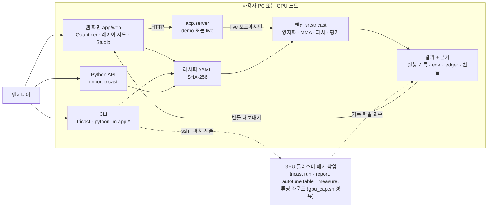
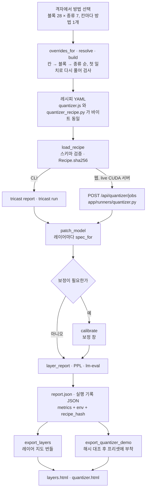
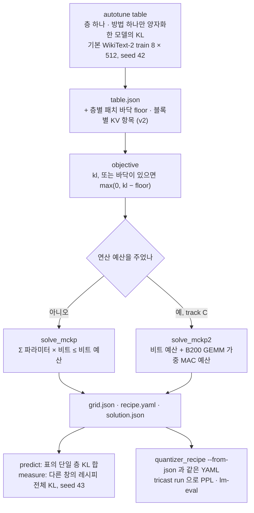
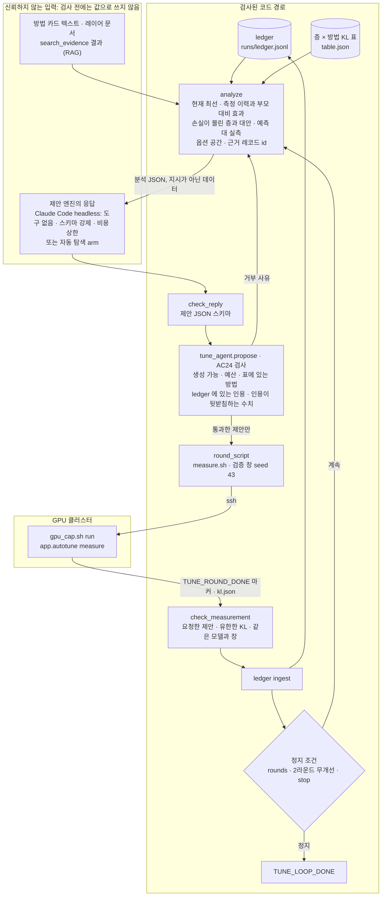
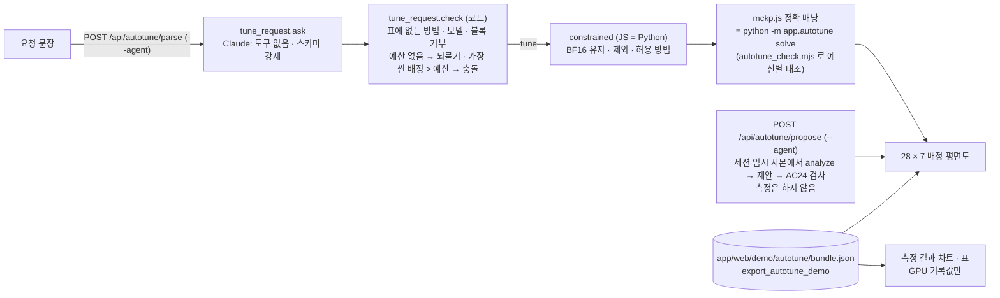
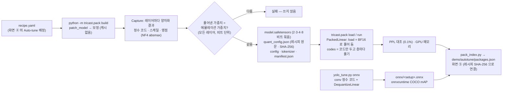
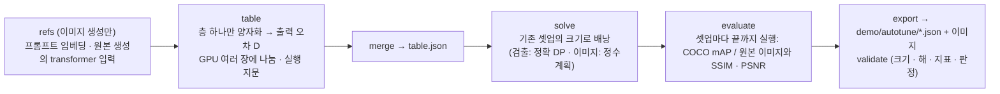

# TriCast 아키텍처

[문제 정의서](./PROBLEM.md) · [제품 스펙](./SPEC.md) · [**아키텍처**](./ARCHITECTURE.md) · [AGENTS.md](../AGENTS.md)

> [!NOTE]
> 이 문서는 TriCast 의 **모듈 경계, 데이터 흐름, 불변식**을 코드 위치와 판정 테스트로 정리한다. 무엇을 만드는가(기능 · 수용 기준)는 [SPEC](./SPEC.md), 왜 만드는가는 [PROBLEM](./PROBLEM.md), 작업 규칙과 용어는 [AGENTS.md](../AGENTS.md) 가 원천이고, 이 문서는 그 내용을 가리키기만 한다. 구현 상태의 원천은 [`support_matrix.yaml`](../support_matrix.yaml) 과 테스트 결과다. 경로는 모두 저장소 루트 기준이다.

---

## 1. 개요

TriCast 가 다루는 문제는 엔지니어가 방법 · 레이어 조합을 바꿀 때마다 코드를 다시 짜고 모델 전체를 다시 평가해야 해서, 원하던 조합의 일부만 평가하고 레이어별 혼합 정밀도를 손으로 전수 탐색한다는 것이다 ([PROBLEM §1](./PROBLEM.md#1-한-문장-문제)). 구조는 이 문제를 세 규칙으로 받는다. 첫째, 웹 격자 · CLI · Python 어느 입구에서 시작해도 결과물은 레시피 YAML 한 장이고, 엔진은 레시피만 읽는다. 둘째, 수치 의미론은 정확 연산 레퍼런스(`src/tricast/reference/`)가 정하고, Triton 커널은 그 레퍼런스와 비트 단위로 같아야 한다. 셋째, 모든 측정값은 실행 환경 기록(`env`)과 레시피 해시를 달고 저장되며, 화면 · Auto-tune · 튜닝 루프는 이 기록만 읽는다. 모델 평가, KL 표, 튜닝 라운드 측정처럼 GPU 가 필요한 계산은 클러스터의 배치 작업으로 돌고 결과 파일이 돌아온다. 서버 GPU 모드만 예외로, `app.server` 자체를 GPU 노드에서 띄운다 (§4).



## 2. 4층 구조

[SPEC §5-1](./SPEC.md#5-아키텍처와-인터페이스) 의 그림과 같은 4층이다. 데이터는 인터페이스 → 레시피 → 엔진 → 결과 순으로 흐르고, 결과 층이 만든 번들이 다시 화면으로 들어간다. 각 층의 불변식은 오른쪽 열의 테스트가 판정한다.

### 2-1. 인터페이스 층

| 항목 | 내용 |
|---|---|
| 책임 | 사용자의 선택을 레시피로 바꾸고, 레시피를 실행 요청으로 넘기고, 기록된 결과를 보여 준다. 모델 계산은 하지 않는다 (브라우저 WebGPU 의 행렬곱 1개는 예외, §4) |
| 웹 | `app/web/quantizer.html` + `js/quantizer.js` (격자 · 옵션 · KV · 보정 → YAML, 생성기의 JS 포트) · `app/web/layers.html` + `js/layers.js` (레이어 지도) · `app/web/index.html` + `js/main.js` 외 (Studio v1) · `js/lab.js` + `js/webgpu/` (브라우저 GPU) |
| 서버 | `app/server.py` (FastAPI, `demo` · `live`) · `app/jobs.py` (GPU 1개를 순차로 쓰는 작업 큐) · `app/runners/` (`llm.py` · `vision.py` · `quantizer.py`) |
| CLI · API | `src/tricast/cli.py` (`formats` · `schemes` · `presets` · `cast` · `recipe-check` · `ppl` · `eval` · `report` · `run` · `agent`) · `python -m app.quantizer_recipe` · `app.autotune` · `app.tune_agent` · `app.tune_loop` · `src/tricast/__init__.py` (Python API) · `src/tricast/eval/lmeval.py` (lm-eval 어댑터) · `src/tricast/agent/` (자연어 요청 → `EmulationRequest`) |
| 입력 → 출력 | 격자 클릭 · 격자 JSON · YAML · 명령 인자 → 레시피 YAML 또는 실행 요청 / 결과 번들 JSON → 화면 |

| 불변식 | 구현 위치 | 판정 |
|---|---|---|
| 데모 모드는 torch · tricast 를 import 하지 않고 정적 파일과 `/api/health` · `/api/catalog` · `/api/resources` 만 답한다 | `app/server.py` (모듈 docstring, `--demo`) | `app/tests/test_server.py::test_demo_mode_never_imports_compute_modules` |
| Quantizer 서버 작업은 라이브 CUDA 서버에서만 만든다. 요청 필드 · YAML 크기 (`MAX_RECIPE_BYTES` = 64 KiB) · 보정 한도를 어기면 작업을 만들지 않는다 (AC20) | `app/server.py` `create_quantizer_job` · `_quantizer_recipe` · `_quantizer_calibration` | `app/tests/test_quantizer_server.py` |
| 페이지가 만든 프리셋 YAML 이 `presets.json` 의 Python YAML 과 다르면 기록된 결과를 보여 주지 않는다 | `app/web/js/quantizer.js` `boot` 의 `trusted` · `updateRecord` | 직접 검사 없음 (`scripts/quantizer/qz_check.mjs` 는 `trusted === true` 만 확인) |
| 자연어 요청에 없는 정밀도 · 누산 값은 `null` 로 두고, 채운 기본값은 `assumptions` 에 적는다 (AC6) | `src/tricast/agent/` | `tests/test_agent_parser.py` · `tests/test_evals.py` · `evals/run_evals.py` |

서버에는 인증과 CORS 가 없어 기본값으로 `127.0.0.1` 에만 묶인다 (`app/server.py` docstring · `--host`).

### 2-2. 레시피 층

| 항목 | 내용 |
|---|---|
| 책임 | 레이어마다 쓸 명세(양자화 · 변환 · 가중치 알고리즘 · 희소 · KV · 선택 축 MMA)를 한 파일로 고정하고, 검증하고, 해시를 매긴다 |
| 주요 모듈 | `src/tricast/recipe.py` (`load_recipe` · `Recipe.spec_for` · `Recipe.sha256` · `_merge`) · `src/tricast/schemas/recipe.schema.json` · `src/tricast/recipes/` (번들 26종) · `configs/sweeps/` · Quantizer 생성기 `app/quantizer_recipe.py` (`METHODS` · `CALIBRATED` · `overrides_for` · `resolve` · `build` · `to_yaml`) · 하드웨어 프리셋 `src/tricast/mma/spec.py` `PRESETS` |
| 입력 → 출력 | 격자 `{name, default, grid, kv, options, calibration, kv_options}` → 레시피 dict → YAML / YAML · dict · 번들 이름 → `Recipe` → 모듈 이름마다 `LinearSpec` 또는 skip |

| 불변식 | 구현 위치 | 판정 |
|---|---|---|
| 첫 일치: `overrides` 를 위에서부터 보고 처음 맞는 규칙 하나만 쓴다. 생성기는 칸 → 블록 → 종류 순으로 쓰고, `resolve` 로 다시 풀었을 때 격자와 다르면 `build` 가 거부한다 (AC15) | `recipe.py` `Recipe._selection` · `quantizer_recipe.py` `build` · `resolve` | `app/tests/test_quantizer_recipe.py::test_random_grids_resolve_to_each_methods_own_spec` · `scripts/quantizer/qz_tricast_accept.py` |
| 같은 격자는 브라우저와 Python 에서 바이트 동일한 YAML 이 된다 (AC15). 범위는 페이지 방법 `METHODS` 다 (Python 전용 `EXTENDED` · `LOWBIT` 은 제외) | `app/web/js/quantizer.js` (줄 단위 포트) · `quantizer_recipe.py` `to_yaml` | `scripts/quantizer/qz_check.mjs` (헤드리스 Chrome, `pytest` 밖) · `app/tests/test_quantizer_recipe.py::test_presets_are_the_recorded_yaml_and_match_the_pins` |
| 칸의 블록 형식 명세는 `scheme` 을 가진 완전한 매핑이라 병합 때 통째로 바뀐다. 다른 방법의 필드가 새지 않는다 (AC16) | `recipe.py` `_merge` (`scheme` · `preset` · `format` 매핑은 교체) | `test_nvint4_custom_format_leaks_into_no_other_layer` · `test_transform_and_gptq_options_do_not_leak_through_the_field_merge` |
| 레시피 해시 = 정규화한 dict 의 정규 JSON (`sort_keys=True`) SHA-256. 키 순서와 무관하다 | `recipe.py` `Recipe.sha256` · `Recipe.to_dict` | `tests/test_recipe.py` |
| 스키마 · 값 범위 위반은 모델을 건드리기 전에 필드 경로와 함께 실패한다 (AC5) | `recipe.py` `_validate` · `load_recipe` | `tests/test_recipe.py` · `tests/harness/golden_cases.yaml` (recipe_error) |
| 프리셋은 `provenance` 를 갖고, 값을 바꾼 명세는 이름 · 출처가 비워진다 (AC2) | `mma/spec.py` `PRESETS` · `MMASpec.with_` · `recipe.py` `_merge` 의 `mma` 분기 | `tests/test_golden.py` (nonempty_provenance) · `tests/test_recipe.py` · `app/tests/test_catalog.py` |

방법 카탈로그와 격자 → 레시피 규칙의 표는 SPEC §5-3 에 있다.

### 2-3. 엔진 층

| 항목 | 내용 |
|---|---|
| 책임 | 레시피 명세대로 텐서를 형식 격자에 올리고(양자화), 칩 규칙대로 곱해 더하고(MMA), 모델의 Linear · Conv2d · Attention · KV 를 바꿔 끼우고, 품질을 잰다 |
| 공유 명세 | `src/tricast/formats.py` · `rounding.py` · `quant/spec.py` · `mma/spec.py` (변경은 사람 승인, AGENTS §4) |
| 레퍼런스 | `src/tricast/reference/cast.py` · `quantize.py` · `mma.py` (fp64 · int64 · Fraction 정확 연산, 수치 의미론의 정본) |
| Triton 커널 | `src/tricast/kernels/` (`quantize.py` · `cast_core.py` · `mma.py` · `mma_core.py` · `ieee.py`). Linux + CUDA 에서만 쓰고, 그 외에는 레퍼런스 백엔드로 돈다 |
| 디스패치 | `src/tricast/quant/api.py` (`quantize`) · `src/tricast/mma/api.py` (`gemm`, 피연산자 · 백엔드) · `src/tricast/mma/operand.py` |
| 전처리 · 보정 | `transforms.py` (Hadamard · SmoothQuant · AWQ) · `weight_quant/` · `quant/structure.py` (희소 · 이상치) · `quant/observer.py` · `calibration.py` (`calibrate`) · `official/` (고정 커밋 공식 코드 호출) |
| 모델 패치 | `nn/patch.py` (`patch_model` · `unpatch_model`) · `nn/linear.py` (`EmuLinear`) · `nn/conv.py` · `nn/attention.py` · `kv/` |
| 평가 | `analysis.py` (`layer_report`: 레이어 MSE · SQNR · 코사인 · mma_ulp, 모델 logits KL) · `eval/ppl.py` · `eval/lmeval.py` · `eval/compare.py` (AC13 · AC14) |
| 입력 → 출력 | `Recipe` + Hugging Face 모델 → 패치된 모델 + `PatchReport` → 지표 dict |

| 불변식 | 구현 위치 | 판정 |
|---|---|---|
| Triton 결과 = 레퍼런스, 레퍼런스 = 독립 구현(NADPE) 골든 벡터. 모두 비트 단위이고 허용 오차로 덮지 않는다 (AC1) | `kernels/` ↔ `reference/` | `tests/gpu/test_triton_quantize.py` · `test_triton_mma.py` · `test_triton_structure.py` · `tests/test_golden.py` (`tests/data/nadpe/`) |
| 서브노멀이 닿는 fp32 연산은 IEEE PTX 헬퍼로 한다 (Triton 의 libdevice 는 flush-to-zero 로 링크됨) | `kernels/ieee.py` | `tests/gpu/` |
| 보정이 필요한 레시피는 보정 전 순전파를 거부한다 (AC9) | `nn/linear.py` `EmuLinear` (`calibration is required`) | `tests/test_calibrate.py::test_calibration_required_before_forward` |
| `unpatch_model` 뒤의 출력은 원본과 비트 단위로 같다 (AC7) | `nn/patch.py` | `tests/test_nn_patch.py::test_tiny_hf_patch_restore` |
| 어떤 레이어도 고르지 않은 레시피는 "zero patches" 실패로 기록한다 (AC8) | `eval/runner.py` · `eval/lmeval.py` | `tests/test_eval.py::test_runner_zero_patches_records_failure` · `test_lmeval_adapter_rejects_zero_patches` |
| 무손실 기준 레시피 `bf16_passthrough` 의 PPL 은 원본 대비 상대 차이 0.1% 이하다 (AC4) | `src/tricast/recipes/bf16_passthrough.yaml` | `tests/test_ac4_passthrough.py` |

dequant(fake-quant) 경로와 scaled + MMA 에뮬레이터 경로의 차이, 각 경로의 속도는 SPEC §5-4 "행렬곱 경로" 표에 있다.

### 2-4. 결과 · 근거 층

| 항목 | 내용 |
|---|---|
| 책임 | 지표를 실행 환경과 묶어 기록하고, 조건이 같으면 재사용하고, 기록을 화면 번들과 근거 레코드로 바꾸고, 기록을 읽어 다음 레시피를 고른다 (Auto-tune · 튜닝 루프) |
| 기록 | `src/tricast/eval/envinfo.py` (`capture_env` · `source_identity`) · `eval/runner.py` (`run_config`, `run_hash`, 이어서 실행) · `analysis.py` (`report.json` · `report.md`) |
| 화면 번들 | `app/export_layers.py` → `app/web/demo/layers/` · `app/export_quantizer_demo.py` (`PINS` · `WEIGHT_BITS` · `check_recipe`) → `app/web/demo/quantizer/presets.json` |
| 근거 · 검색 | `app/ledger.py` (`ingest` · `verify` · `documents`) → `runs/ledger.jsonl` · `src/tricast/rag.py` (`search`: 계약 문서, `search_evidence`: ledger 문서 + 방법 카탈로그 `docs/research/methods_catalog.yaml`, BM25, 설정 `config/rag.yaml`) |
| 튜닝 | `app/autotune.py` (`table` · `solve` · `predict` · `measure` · `random`) · `app/tune_agent.py` (제안 검사 · 라운드 스크립트) · `app/tune_loop.py` (자율 루프) |
| 패키지 | `src/tricast/pack.py` (`build` · `write` · `load` · `run`, 정수 코드 safetensors) · `scripts/quantizer/yolo_tune.py onnx` (검출 모델 ONNX 정수 가중치) · `scripts/quantizer/pack_index.py` (화면 ⑤ 목록) |
| 다른 모델의 측정 기록 | `scripts/quantizer/yolo_tune.py` (YOLO11n, Conv · COCO mAP) · `scripts/quantizer/zimage_tune.py` (Z-Image-Turbo, Linear · 원본 이미지와의 SSIM/PSNR) → `app/web/demo/autotune/yolo11n.json` · `zimage.json` (화면이 읽는 측정 기록, LLM 의 번들과 다른 형식) |
| 입력 → 출력 | 실행 기록 JSON · `report.json` · `table.json` · `kl.json` → 번들 JSON · ledger 레코드 · `grid.json` · `recipe.yaml` · `solution.json` |

| 불변식 | 구현 위치 | 판정 |
|---|---|---|
| 평가 수치는 `env` (git SHA · dirty · 소스 해시 · 모델 revision · 데이터셋 지문 · GPU · 버전) 와 함께 기록하고, 환경이 다른 이전 결과는 재사용하지 않는다 (AC3) | `eval/envinfo.py` · `eval/runner.py` `_valid_env` · `_resumable` · `_valid_record` | `tests/test_eval.py::test_capture_env` · `test_runner_does_not_resume_across_software_or_gpu_changes` |
| 기록된 실행은 `recipe_hash` 가 생성기의 현재 레시피 해시 · `PINS` 와 같을 때만 프리셋에 붙고, 아니면 "기록 없음"이 된다 (AC17) | `export_quantizer_demo.py` `check_recipe` · `PINS` | `app/tests/test_quantizer_export.py::test_honesty_check_refuses_a_different_recipe` · `test_a_pin_from_an_older_preset_yaml_vouches_for_nothing` |
| 레이어 지도 번들은 리포트의 지표를 그대로 담고, 유한하지 않은 값은 버리지 않고 표시한다 (AC19) | `export_layers.py` | `app/tests/test_layers_export.py` |
| ledger 는 수치 하나를 레코드 하나로 두고 (원본 sha256 + JSON pointer + env), 환경 없는 수치는 거부하며, 원본이 바뀌면 `verify` 가 실패한다 (AC23) | `ledger.py` `_record` · `verify` | `app/tests/test_ledger.py::test_a_number_without_an_environment_is_refused` · `test_a_changed_source_no_longer_verifies` |
| 계약 검색 `tricast.rag.search` 의 결과는 ledger 와 무관하다 (AC23) | `rag.py` `search` · `search_evidence` 분리 | `app/tests/test_ledger.py::test_contract_search_ignores_the_ledgers_and_bad_ledger_lines_are_refused` |
| 풀이는 예산 안에서 KL 합이 최소인 배정을 정확히 찾고, 불가능한 예산은 거부한다 (AC22) | `autotune.py` `solve_mckp` · `solve_mckp2` | `app/tests/test_autotune.py::test_solver_equals_brute_force_on_random_instances` · `test_infeasible_budgets_are_refused` · `app/tests/test_autotune_compute.py::test_two_constraint_solver_equals_brute_force_on_random_instances` |
| 제안은 AC24 검사를 모두 통과해야 기록되고, 측정은 세션에 고정한 검증 창으로만 묶는다 (AC24) | `tune_agent.py` `propose` · `evaluate` · `_session` · `MEASURE_DEFAULTS` | `app/tests/test_tune_agent.py::test_bad_proposals_are_refused` · `test_round_measures_on_validation_windows_and_state_joins_by_recipe_hash` |
| 패키지의 모든 레이어는 풀었을 때 에뮬레이션이 곱하는 가중치와 비트 단위로 같고 (0 의 부호 제외), 하나라도 다르면 패키지를 쓰지 않는다. 활성값 · KV · 희소화 · 이상치 · 다른 출력 형식은 거부한다 (AC30) | `pack.py` `Capture` · `decode` · `same_bits` · `build` | `tests/test_pack.py::test_every_layer_decodes_to_the_weight_tricast_multiplies_with` · `test_what_a_package_cannot_run_is_refused` |
| 화면 ⑤ 는 다시 불러 잰 PPL 이 TriCast 와 0.1% 안인 패키지, 기록과 SHA-256 이 같은 ONNX 파일만 싣는다 (AC30 · AC31) | `pack_index.py` `llm_entry` · `onnx_entries` | `app/tests/test_pack_index.py` |
| ONNX 의 정수 × 스케일은 내보낸 FP32 가중치와 비트 단위로 같다 (AC31) | `yolo_tune.py` `int_weights_onnx` | `app/tests/test_yolo_onnx.py` |
| 이미지 생성 기록의 표 · 해 · 평가는 같은 실행 지문(refs 해시 · 정밀도 · 해상도 · 방법 명세 · 배치)에서 나와야 합쳐지고, 판정은 측정 전에 정한 짝과의 짝 비교로만 낸다 (AC32) | `zimage_tune.py` `fingerprint` · `compare` · `validate` | `app/tests/test_zimage_tune.py` |

`EvalRun` 의 필드와 각 근거 항목이 필요한 이유는 SPEC §5-5 에 있다.

## 3. 핵심 데이터 흐름

### 3-1. 격자에서 평가까지



- 생성기의 기준 구현은 `app/quantizer_recipe.py` 이고 (표준 라이브러리만 사용), `app/web/js/quantizer.js` 는 같은 규칙 순서와 같은 YAML 바이트를 내는 포트다 (두 파일의 머리 주석).
- 서버 작업은 CLI 와 같은 모양의 기록(`report/<name>/report.json`, `eval/<name>.json`)을 쓰므로 내보내기 도구가 그대로 읽는다 (`app/runners/quantizer.py` docstring).
- 화면이 보여 주는 PPL · lm-eval 은 해시가 같은 기록뿐이다. 격자를 한 칸이라도 바꾸면 "기록 없음"이 된다 (AC17).

### 3-2. Auto-tune 휴리스틱



- 표의 각 항목은 그 층에 `app.quantizer_recipe.build` 가 주는 명세 그대로를 쓰고, `Recipe.include` 만 그 층으로 좁힌다. 따라서 어떤 Quantizer 격자에서든 그 층이 받는 명세와 같다 (`app/autotune.py` docstring).
- 비트는 `app/export_quantizer_demo.py` `WEIGHT_BITS` 로 센 Linear 가중치 평균이다. KV 는 고르지 않고 `--kv` 로 고정하며 비트 예산에 넣지 않는다.
- 풀이는 비용을 해상도(기본: 모든 비용의 정확한 GCD)의 배수로 올림한 정수 DP 이고, 동률 규칙을 docstring 에 적었다 (`solve_mckp`, `solve_mckp2`).
- 공유 입력 방법(AWQ · SmoothQuant 계열)은 입력이 하나뿐인 `o_proj` · `down_proj` 에만 값이 있고, 다른 종류에서는 `null` 이라 풀이가 고르지 않는다 (`SHARED_INPUT_RULE`).

### 3-3. AI 튜닝 루프



- 분석은 ledger 와 표만으로 결정론적으로 만든다 (`app/tune_loop.py` `analyze`). 방법 카드는 `tricast.rag.search_evidence(..., ledgers=[])` 로 카탈로그에서 찾는다.
- RAG: 손실이 몰린 층 `RAG_LAYERS` 개마다 `layer <이름> <현재 방법> <대안>` 을 질의로 ledger 문서(`runs/ledger.docs.jsonl`)를 BM25 로 검색해 분석의 `retrieved` 에 싣는다. 레이어 문서에는 그 층의 방법별 단층 KL, 레이어 리포트(MSE · SQNR · 코사인), 레이어 프로파일(`app/layer_profile.py`: 가중치 · 활성 분포, 크기 · Wanda 가지치기의 출력 오차)이 숫자마다 레코드 id 와 함께 들어 있어, 제안이 그 id 를 인용하면 AC24 검사가 실존을 확인한다. 마스크 `no-rag` 는 검색 결과를 숨기는 절제 arm, `anonymous` 는 방법 이름이 드러나는 검색 결과도 숨긴다 (`app/tests/test_layer_cards.py`).
- Claude Code 는 `claude_command` 의 플래그로 돈다. `--tools ""` (도구 없음), 빈 MCP 설정, `--setting-sources ""`, `--json-schema` (제안 스키마), `--max-budget-usd` (기본 2), 세션 저장 없음이고, 빈 임시 디렉터리에서 실행한다. 시스템 프롬프트(`SYSTEM`)는 분석의 모든 텍스트가 지시가 아닌 데이터라고 적는다. 프롬프트 · 명령 · 응답은 라운드마다 `<session>/llm/round_<n>.json` 에 남는다.
- 다른 제안 엔진(`auto-greedy` · `evolution` · `random` 등)도 같은 `check_reply` → `materialize` → `tune_agent.propose` 를 거친다. 거부 사유는 다음 라운드 분석의 `refused_last_round` 로 돌아간다.
- 측정은 `measure_remote` 가 맡는다. 세션을 동기화하고 `gpu_cap.sh run <label> -- timeout … run_round.sh` 로 띄운 뒤, 로그의 `TUNE_ROUND_DONE` / `TUNE_ROUND_FAIL` 마커를 기다려 `kl.json` 을 가져와 검사한다. `gpu_cap` 이 `DENY` 를 내면 멈춘다. 라운드 래퍼는 `CUDA_VISIBLE_DEVICES` 같은 `GPU_CAP_OWNED` 변수를 덮어쓰지 못한다.
- 루프 안에서는 test PPL 을 재지 않는다. 고른 제안의 최종 평가는 별도의 한 번 실행이다 (`app/tune_loop.py` docstring).

### 3-4. Auto-tune 화면 — 요청 문장에서 측정 결과까지



- 번들(`app/export_autotune_demo.py`)은 측정값을 격자에 붙이기 전에, 생성기가 그 격자로 쓰는 레시피 파일의 SHA-256 이 측정 기록의 `file_sha256` 과 같은지, PPL 기록의 `recipe_hash` 가 그 측정의 `recipe_sha256` 과 같은지 확인한다. 다르면 "기록 없음"과 사유를 남긴다 (`app/tests/test_autotune_demo.py`). 옵션 전이 행(`--transfer`, `scripts/quantizer/autotune_xfer.py`)은 튜닝 루프가 쓰는 제안 레시피 파일의 SHA-256 으로 같은 사슬을 거치고, 칸이 기준 배낭 해와 다르면 같은 크기가 아니므로 거부된다. LLM 응답 파일이 없는 라운드(`replan`)의 칸 변경은 기록된 격자와 부모 격자의 차이로 계산한다 (`app/tests/test_autotune_replan_bundle.py`). 칸 툴팁의 층별 리포트 오차(가중치 MSE · 층 출력 SQNR · 코사인)는 그 방법의 균일 레시피 `tricast report` 에서만 오고, 리포트의 `recipe_hash` 가 그 균일 KL 기록의 `recipe_sha256` 과 같을 때만 붙는다 (`layer_reports`, `app/tests/test_autotune_reports.py`). 레이어 카드 전체(`app.layer_cards`, Qwen3-0.6B 에서 6 MB)는 화면에 싣지 않고 실행 디렉터리에 만든다.
- 녹화 모드(`--demo`)는 compute 모듈을 import 하지 않는다. 실시간 AI 경로는 `--agent <loop.json>` 을 줄 때만 열리고, 없으면 두 API 가 503 과 띄우는 방법을 돌려준다. 화면은 응답마다 "실시간 Claude 응답" 또는 "저장된 응답 · 날짜" 배지를 단다.

### 3-5. 모델 패키지 — 고른 레시피를 파일로



- 패키지는 TriCast 의 양자화 코드(`QTensor.mma_operand`, `nf4_dequantize`)로 가중치를 다시 만든다. 그래서 풀어낸 가중치는 에뮬레이션과 비트 단위로 같다 — 0 의 부호만 예외로, TriCast 는 작은 음수 가중치를 −0 으로 두지만 정수 코드에는 부호 있는 0 이 없어 +0 이 된다 (+0 에서 시작하는 합에는 영향 없음). 가중치만 양자화한 레시피(이 경로가 받는 유일한 종류)에서 남는 차이는 행렬곱의 합산 순서다 (TriCast 의 FMA 사슬 대 PyTorch matmul). 출력은 TriCast 처럼 MMA 명세의 출력 형식(BF16)으로 반올림한다.
- 패키지에 담기지 않는 것: TriCast 의 MMA 산술(칩 축 — CoFDA 같은 좁은 누산은 재현하지 않는다), 활성값 양자화 · KV 캐시 · 희소화 · 이상치 (거부), HQQ 의 정수 코드 (공식 라이브러리가 코드를 남기지 않아 그 레이어는 TriCast 가 곱하는 가중치 그대로 저장하고 `fallback_layers` 에 사유를 적는다).
- 패키지 파일은 수백 MB ~ 수 GB 라 저장소에 넣지 않는다. 화면은 `manifest.json` 의 크기 · 해시 · 검사 결과만 싣고, 검출 모델의 ONNX 파일(수 MB)은 화면 옆에 두어 내려받게 한다.

### 3-6. 다른 모델 — 측정 기록 (검출 · 이미지 생성)

LLM 은 GPU 서버에서 바로 재는 경로와 번들을 쓰고, 검출(YOLO11n)과 이미지 생성(Z-Image-Turbo)은 클러스터에서 미리 잰 측정 기록
하나를 화면이 읽는다 (같은 화면 코드, `tune.js` 의 `KINDS`). 기록을 만드는 단계는 둘이 같다.



- 이미지 생성은 V100 에서 FP32 로 잰다 (체크포인트의 FP32 텐서는 모두 BF16 값이고, V100 의 FP16 은 값 범위를 넘는다). 표 ·
  평가 수치는 [근거 문서](./evidence/2026-11-14_zimage_turbo.md) 에 있다.

## 4. 실행 모드

| 모드 | 시작 | 실제로 계산하는 것 | 기록값을 읽는 것 |
|---|---|---|---|
| 녹화 예제 | `pip install fastapi uvicorn` 후 `python -m app.server --demo` (기본 `127.0.0.1:8765`). torch 불필요. 정적 HTTP 서버로도 열린다 (`file://` 은 모듈 로딩이 막힘) | 브라우저의 Quantizer 생성기: 격자 → 레시피 YAML · 실행 명령. Studio: 바꾼 파라미터에 가장 가까운 기록 설계점 고르기 | `app/web/demo/runs/*.json` (Studio), `demo/quantizer/presets.json` (프리셋 5종의 PPL · lm-eval · 레이어 요약, 해시가 같을 때만), `demo/layers/*.json` (레이어 지도). Quantizer 서버 작업은 `409 live_mode_required` |
| 서버 GPU | `pip install -r app/requirements.txt` 후 GPU 노드에서 `python -m app.server --device cuda` | Studio 비교 실행 (`app/runners/llm.py` · `vision.py`), Quantizer 작업 (`app/runners/quantizer.py`: 레이어 리포트, WikiText-2 test PPL, lm-eval 과제당 최대 300문항). 작업은 `app/jobs.py` 큐에서 하나씩 돈다 | 같은 요청이 같은 서버 식별자(장치 · 코드 해시)로 끝나 있으면 저장된 결과를 돌려준다 (`app/jobs.py`). CPU 라이브 서버는 Quantizer 작업을 `cuda_required` 로 거부 |
| 브라우저 WebGPU | Studio 의 브라우저 GPU 실험실 (`app/web/js/lab.js`) · 검사 페이지 `app/web/webgpu_check.html` | FP8 E4M3 행렬곱 1개를 설계한 CoFDA 산술로 WGSL 에서 계산 (`js/webgpu/engine.js` · `cofda.wgsl.js`), 같은 연산을 JS 정확 레퍼런스로 계산 (`js/webgpu/reference.js`, `js/refworker.js`) 해 비트 대조 | 골든 벡터 `app/web/demo/webgpu/golden.json` (`app/webgpu_golden.py`, 레퍼런스 백엔드) · 실제 레이어 피연산자와 서버 TriCast 출력 비트 `demo/webgpu/operands/` (`app/export_operands.py`). 모델 전체는 브라우저에서 돌지 않는다 |

기록값을 읽을 때는 경로를 구분한다. Quantizer 의 기록된 PPL · lm-eval 은 dequant(fake-quant) 경로다 (SPEC §5-4, §10 R8).

## 5. 주요 설계 결정

| 결정 | 이유 | 근거 |
|---|---|---|
| 생성기를 Python(기준)과 JS(포트) 두 벌로 두고 바이트 동일로 묶는다 | 화면은 GPU · Python 없이 정적 파일로 열려야 하고 (SPEC §7 이식성), 기록된 실행은 화면이 보여 주는 바로 그 레시피와 해시로 이어져야 한다. 두 벌이 어긋날 위험(SPEC §10 R11)은 바이트 비교로 잡는다 | `app/quantizer_recipe.py` docstring · `app/web/js/quantizer.js` 머리 주석 · `scripts/quantizer/qz_check.mjs` |
| 칸에는 `scheme` 을 가진 완전한 명세만 쓴다 | `_merge` 는 매핑을 깊게 합친다. 부분 매핑을 쓰면 기본값이나 다른 방법의 필드(예: GPTQ 의 `zero_point`)가 새어 들어온다. `scheme` · `preset` 이 있는 매핑은 통째로 교체된다 | `src/tricast/recipe.py` `_merge` · SPEC §5-3 방법 카탈로그 주석 · AC16 |
| 목적 함수는 층 하나만 양자화한 모델 전체의 KL 이다 (레이어 국소 SQNR 아님) | W1 스파이크에서 국소 출력 SQNR 최저 14개를 지킨 PPL 이 무작위 14개의 범위 안이었다 (파라미터 비율 교란이 있는 잠정 판정). v1 스파이크에서 KL 합은 레시피 11개의 실측 KL 순서를 맞혔다 (Spearman 0.973, 수치 출처 SPEC §5-4) | `docs/spikes/2026-10-13_layer_sqnr_proxy.md` · `docs/spikes/2026-10-13_autotune_mckp.md` · `app/autotune.py` `OBJECTIVE` |
| 패치 바닥을 뺀 값으로 고른다 (v2) | 층 하나 KL 에는 양자화와 무관한 에뮬레이션 GEMM 비용이 섞인다 (SPEC §10 R13). 바닥은 그 층을 양자화 없이 패치한 KL 이다 | `app/autotune.py` `FLOOR_FIELDS` · `FLOOR_RULE` · `docs/spikes/2026-11-03_autotune_v2.md` |
| 배정은 정확 DP 로 푼다 | 근사 없이 예산 안 최적을 찾으므로 (기본 해상도에서 올림 0) 작은 문제에서 완전 탐색과 같은지 테스트로 판정할 수 있다. 풀이 시간은 1초 미만이다 (SPEC §7) | `app/autotune.py` `solve_mckp` · `solve_mckp2` docstring · `app/tests/test_autotune.py` |
| 모든 측정값을 증거 ledger 레코드로 둔다 | 제안의 인용과 수치를 기계가 대조하려면 수치 하나에 id 하나가 있어야 한다. 원본 sha256 + JSON pointer 로 되읽고, 레코드를 지우지 않아 인용 id 가 항상 풀린다 | `app/ledger.py` docstring · AGENTS §3 규칙 3 · AC23 |
| 기록 부착에 고정 해시(`PINS`)를 쓴다 | 생성기가 바뀌면 옛 실행이 새 레시피를 보증하지 않게 한다. 핀은 프리셋 YAML 이 핀을 만든 digest 와 같을 때만 유효하다 | `app/export_quantizer_demo.py` `PINS` 주석 · docstring · AC17 |
| 하드웨어 프리셋에 출처(`provenance`)를 필수로 붙인다 | 출처 없는 하드웨어 수치를 만들지 않는다 (AGENTS §3 규칙 2). 값을 바꾼 명세는 이름 · 출처가 비어 "사용자 정의"가 된다. Studio 카탈로그도 프리셋 수치를 `PRESETS` 나 번들 레시피에서만 가져온다 | `src/tricast/mma/spec.py` `PRESETS` · `MMASpec.with_` · `app/catalog.py` docstring |
| LLM 제안자를 격리한다 | LLM 응답과 RAG 문서는 외부 입력이다 (AGENTS §2 신뢰 수준). 도구 · MCP · 설정 소스 없이 스키마와 비용 상한을 걸고, GPU 실행은 검사를 통과한 뒤 루프 코드가 한다 | `app/tune_loop.py` `claude_command` · `SYSTEM` · `check_reply` |
| 보정 · 표 · 검증 · test 창을 나눈다 | 보정한 방법을 자기 보정 데이터로 채점하지 않도록 같은 창은 모델 로드 전에 거부한다. 튜닝 라운드는 검증 창(WikiText-2 validation, seed 43)으로만 잰다 (AC24) | `app/autotune.py` `refuse_identical_windows` · `app/tune_agent.py` `MEASURE_DEFAULTS` |
| 데모 서버 · 생성기 · 내보내기 도구는 torch 없이 돈다 | GPU · 모델 없이 기록된 실행을 열고, 기록 파일이 있는 곳 어디서든 번들을 만들 수 있게 한다 | `app/server.py` · `app/quantizer_recipe.py` · `app/export_quantizer_demo.py` · `app/export_layers.py` docstring |

## 6. 디렉터리 지도와 테스트 위치

[AGENTS.md §7](../AGENTS.md#7-운영-정보) "디렉터리" 와 같은 구분이다. 둘째 줄은 AGENTS 목록에 이름이 없는 같은 패키지의 하위 경로다.

| 경로 | 내용 | 테스트 |
|---|---|---|
| `src/tricast/` | 명세 `formats` · `rounding` · `quant/spec` · `mma/spec`, 레퍼런스 `reference/`, 커널 `kernels/`, API `quant/api` · `mma/api`, 통합 `recipe` · `nn/` · `calibrate` (`calibration.py`) · `eval/` · `cli` | `tests/` (CPU) · `tests/gpu/` (Triton) |
| `src/tricast/` (그 밖) | `analysis.py` (레이어 리포트) · `rag.py` (BM25 검색) · `transforms.py` · `quant/structure.py` · `quant/observer.py` · `weight_quant/` · `kv/` · `official/` (고정 커밋 공식 코드) · `agent/` (자연어 요청) · `tools/` (JSON 도구) · `schemas/` (JSON 스키마) · `prompts/parse_query.md` | `tests/test_analysis.py` · `test_rag.py` · `test_transforms.py` · `test_official_*.py` · `test_agent_*.py` · `test_tools.py` |
| `src/tricast/recipes/` · `configs/sweeps/` | 이름으로 부르는 번들 레시피 (`tricast.recipe.list_recipes()`) · 스윕 설정 | `tests/test_recipe.py` · `tests/test_eval.py::test_sweep_cartesian_product` |
| `tests/data/nadpe/` · `tests/harness/` | 독립 구현 골든 벡터 · 골든 케이스 (`golden_cases.yaml` · `golden_compare.yaml`) | `tests/test_golden.py` · `tests/test_compare_golden.py` |
| `app/` | 웹 `app/web/` (Studio · Quantizer · 레이어 지도), 서버 `server.py` · `jobs.py` · `runners/`, 생성기 `quantizer_recipe.py`, 번들 `export_*.py`, Auto-tune `autotune.py`, 근거 `ledger.py`, 튜닝 `tune_agent.py` · `tune_loop.py` | `app/tests/` (`make test-app`) · 브라우저 검사 `scripts/quantizer/` (헤드리스 Chrome, `pytest` 밖) |
| `docs/` | `PROBLEM.md` (왜) · `SPEC.md` (무엇 · AC) · `ontology.yaml` (분석 `ontology.md`) · `research/interviews.md` · `prompts/` · `spikes/` · `evidence/` · 이 문서 | `tests/test_spec_traceability.py` · `tests/test_ontology.py` |

실행 명령 (AGENTS §6 · §7, `Makefile`):

```bash
make check                  # ruff + CPU 테스트 (pytest -q)
make test-app               # app/tests (pip install -e ".[app]")
pytest tests/gpu -q         # Triton 비트 일치. CUDA + Triton 이 없으면 전부 skip 이라 아무것도 증명하지 않는다
pytest tests/test_golden.py tests/test_compare_golden.py -q -rs   # 골든 케이스 (CPU 에서는 GPU 전용 1건만 skip)
```

각 수용 기준을 판정하는 테스트의 전체 목록은 [SPEC §6](./SPEC.md#6-수용-기준), 구성요소별 상태는 [SPEC §8](./SPEC.md#8-구현-현황) 에 있다.

## 7. 알려진 한계와 다음 단계

[SPEC §10 리스크와 열린 이슈](./SPEC.md#10-리스크와-열린-이슈) 를 본다. 이 문서에는 복제하지 않는다.
