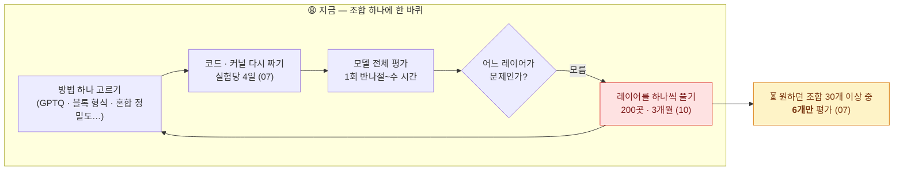
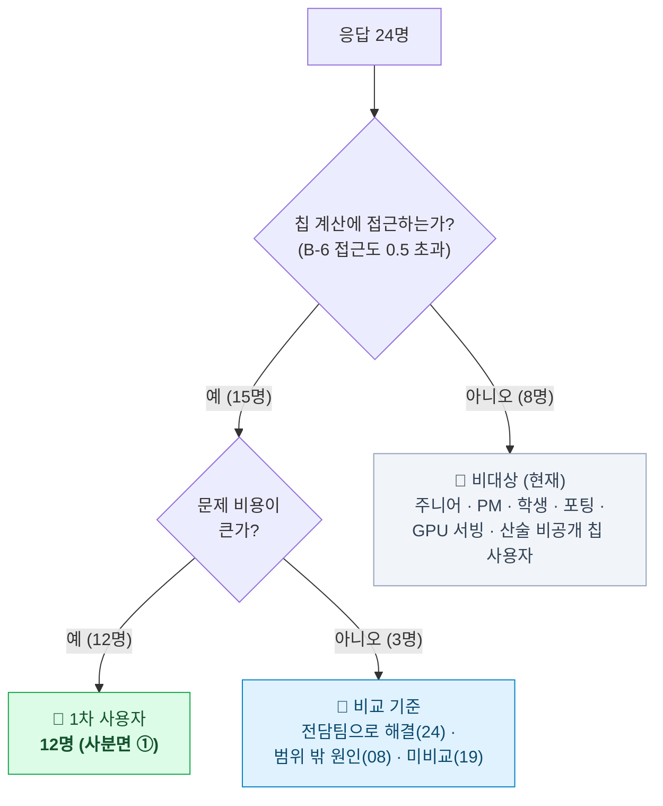
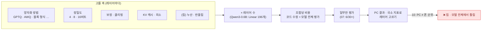
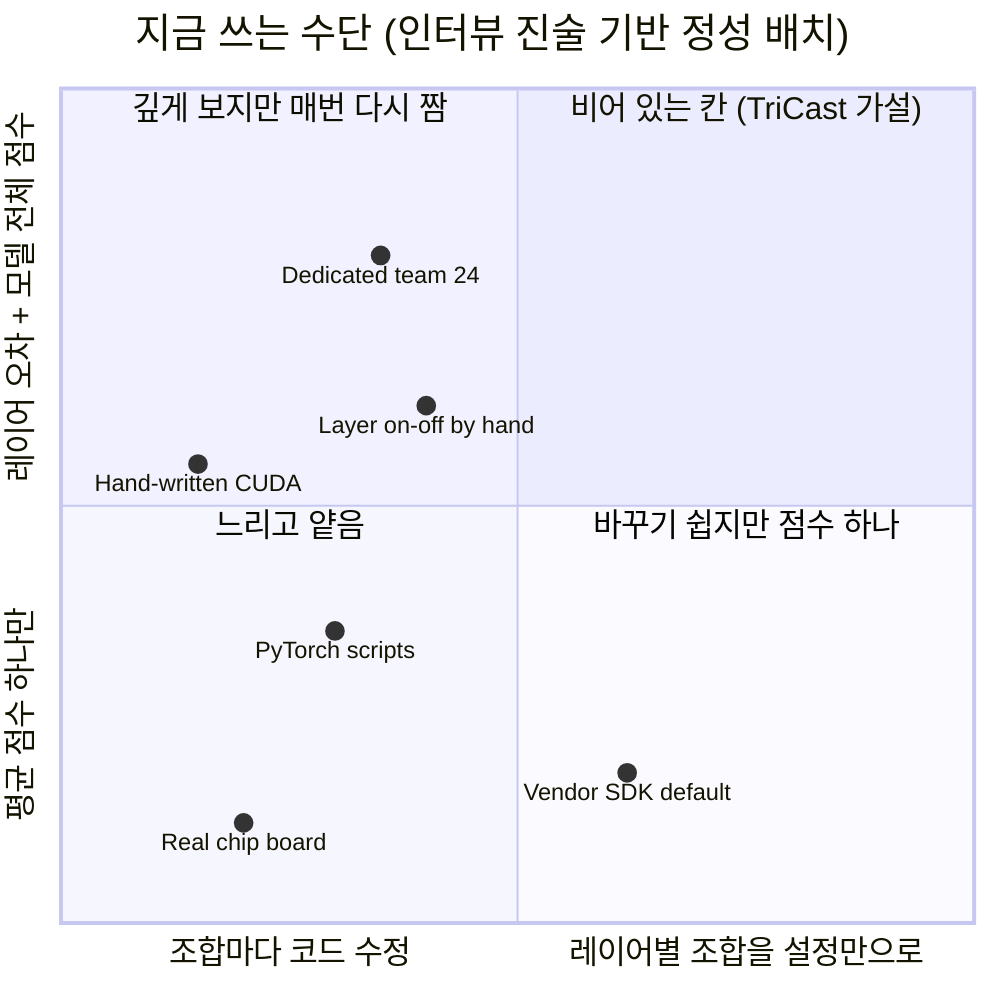
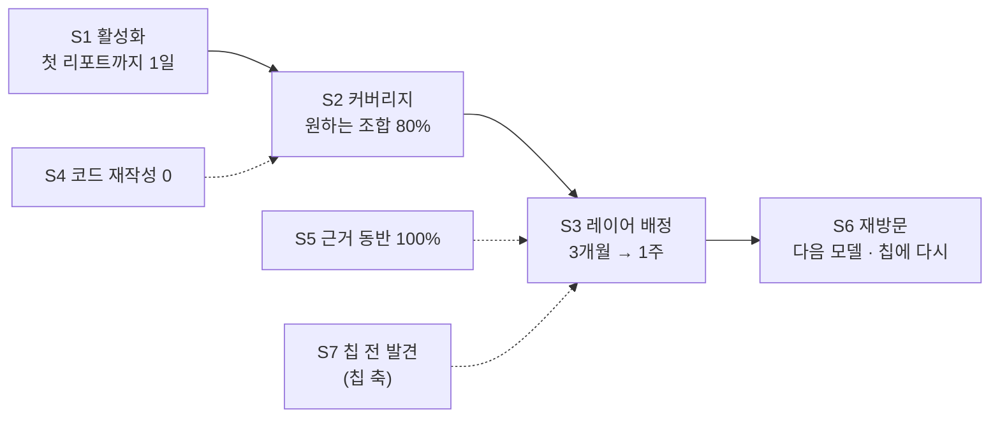

# 🧭 TriCast 문제 정의서

**Problem Definition** · v2.0 · 2026-10-13

`근거: 인터뷰 28건 (응답 24)` `레이어 전수 탐색 · 조합 일부만 평가 15명 중 6명` `원하던 조합 중 평가 20% 이하 (07)` `코드 기준 quantizer_develop`

[**문제 정의서**](./PROBLEM.md) · [제품 스펙](./SPEC.md) · [인터뷰](./research/interviews.md) · [온톨로지](./ontology.md)

---

> [!NOTE]
> **이 문서는 무엇인가요?** TriCast가 풀려는 문제가 **무엇이고, 누구의 문제이며, 정말 존재하는지**를 증거로 정리한 문서입니다. 무엇을 만들지는 [제품 스펙](./SPEC.md)에, 원자료는 [인터뷰](./research/interviews.md)에 있습니다.

> [!IMPORTANT]
> **v2.0 개정 (2026-10-13)** — v1.0 은 "PC 의 흉내 계산이 칩의 계산 규칙을 따라 하지 못한다"를 문제로 세웠습니다. 같은 인터뷰 28건을 다시 읽으면, 원인을 특정하지 못한 사람들이 가장 오래 쓴 시간은 **레이어별 혼합 정밀도 · 보정 · 재학습을 손으로 전수 탐색하는 일**(페인 P3, 3주~3개월)이었고, 설계 단계에서는 원하던 조합의 일부만 평가했습니다 (P9). v2.0 은 이 **"레이어마다 방법 · 정밀도를 고르고 확인하는 비용"** 을 1차 문제로 올립니다. PC 결과와 칩 결과가 어긋나는 문제(v1 — 로그 10 의 PC ↔ 폰 순위 불일치 포함)는 레시피의 **칩 산술 축**이 맡습니다. fake-quant(dequant) 결과만으로는 그 유형을 풀 수 없습니다. 인터뷰 기록은 바꾸지 않았고, v1 의 판정(§4-1)도 그대로 둡니다.

> [!TIP]
> **🔰 양자화가 처음이라면** — AI 모델은 숫자 수억 개(Qwen3-0.6B 는 약 6억 개)로 이루어져 있고, 보통 숫자 하나를 16비트로 적습니다. **양자화**는 이 숫자를 4비트나 8비트처럼 더 짧게 적어 모델을 작게 만드는 일입니다 — 3.14159265 를 3.14 로 적는 것과 같습니다. 16비트를 4비트로 줄이면 저장 공간이 약 ¼ 이 되어 폰이나 전용 칩에 들어가고 더 싸게 돌지만, 값이 조금씩 틀려 답의 품질이 떨어질 수 있습니다. 어떻게 줄이느냐(**양자화 방법**)가 수십 가지이고, 모델 안의 계산 단계(**레이어**)마다 잘 맞는 방법이 다르다는 것이 이 문서의 출발점입니다.

## 📌 한 줄 요약

**양자화 모델을 배포하거나 칩을 설계하는 엔지니어는 레이어마다 어떤 양자화·희소 방법과 정밀도를 쓸지 정해야 하는데, 원인을 모르는 채 방법이나 레이어 하나를 바꿀 때마다 코드를 다시 짜고 모델 전체를 다시 돌려야 해서, 원하던 조합의 일부만 평가하고 레이어를 하나씩 풀어 보는 데 몇 주에서 몇 달을 씁니다.**

### 🍱 쉽게 말하면 — "칸마다 다른 양념"

> 도시락(**모델**)에는 칸(**레이어**)이 수백 개 있고, 양념(**양자화 방법**)도 수십 가지입니다. 어느 칸에 어떤 양념이 맞는지는 칸마다 다릅니다. 그런데 양념 하나를 바꿔 볼 때마다 도시락 전체를 새로 싸서(**코드 수정 + 모델 전체 평가**) 맛을 봐야 한다면, 몇 가지 조합만 맛보고 포기하거나 한 칸씩 바꿔 보며 몇 달을 보내게 됩니다.
>
> TriCast는 "칸마다 양념을 적은 카드(**레시피**)"를 화면에서 클릭으로 만들고, 그 카드로 **칸별 맛(레이어 오차)과 도시락 전체 맛(PPL · 벤치마크)** 을 한 번에 보여 주려는 도구입니다.

---

## 1. 한 문장 문제

> **양자화 방법과 레이어별 정밀도를 정해야 하는 엔지니어(칩 연산기 설계·NPU 컴파일러·검증·FAE·온디바이스·양자화 연구)가, 방법·레이어 조합을 바꿀 때마다 코드를 다시 짜고 모델 전체를 다시 평가해야 해서, 원하던 조합의 일부(07: 30개 이상 중 6개)만 평가하고, 원인을 특정하지 못한 채 레이어별 혼합 정밀도·보정·재학습을 손으로 전수 탐색하는 데 몇 주에서 몇 달(3주~3개월)을 쓴다.**

| 요소 | 내용 | 근거 |
|---|---|---|
| **누가** | 칩에 올릴 양자화 모델의 방법·정밀도를 정하거나, 칩 연산기의 비트 수를 정하는 엔지니어와 양자화 연구자 | 사분면 ① 12명 ([인터뷰 B-6](./research/interviews.md#b-6-누가-1차-사용자인가--사분면-분석)) |
| **무엇을 못 해서** | 방법·레이어 조합을 **코드 수정 없이** 바꾸고, 레이어별 오차와 모델 수준 점수(PPL · 벤치마크)를 **같은 조건으로 한 번에** 비교하지 못함 | 로그 02, 07, 10, 11, 13 |
| **어떤 대가를** | 원하던 조합의 20% 이하만 평가, 조합당 커널 수정 4일, 레이어 200곳 전수 탐색 3개월, 레이어 켜고 끄기 5주, 재학습 4회, 고객과 한 달씩 수동 조정 | 로그 07, 09, 10, 12, 13 |

---

## 2. 대상과 비대상

대상 집단은 v1 과 같습니다. 칩 계산에 직접 접근하는 사람들이 조합 탐색 비용도 가장 크게 말했기 때문입니다 (§4-1).

23번(양자화 경험 없음)은 분류에서 제외. 칩 계산 접근도는 인터뷰 B-6의 점수 — 0.5 초과(01–13 · 19 · 24)에는 '모델 최적화 (칩 계산은 간접)' 0.55 도 들어간다.

### 🎯 1차 사용자 — 레이어마다 방법과 정밀도를 정하는 사람

| 유형 | 하는 일 | 대표 로그 | 이들에게 문제가 되는 순간 |
|---|---|---|---|
| **칩 설계·사전 검증 연구자** | 칩이 나오기 전에 연산기 비트 수·누산 방식·희소 비율을 정함 | 01, 02, 07 | 조합 하나 바꿀 때마다 흉내 커널을 다시 짜서, 원하던 조합의 일부만 돌림 |
| **NPU 컴파일러·검증 엔지니어** | 모델을 자사 칩에 올리고 결과가 맞는지 확인 | 03, 06 | 어느 레이어를 어떤 정밀도로 둘지 칩에 올려 봐야 앎 |
| **FAE (고객 지원 엔지니어)** | 고객 모델을 자사 칩에 올리도록 도움 | 09 | 레이어별 정밀도를 고객과 한 달씩 손으로 맞춤 |
| **온디바이스·임베디드 엔지니어** | 가전·카메라·셋톱·모바일 칩에 직접 변환해 올림 | 04, 05, 10, 12 | 레이어를 하나씩 풀어 보거나 재학습을 반복 (회당 반나절~3일) |
| **양자화 연구자 · 서빙 개발자** | 보정·스케일·KV 캐시 양자화를 레이어 단위로 조정 | 11, 13 | 설정마다 코드를 고치고, 레이어를 켜고 끄며 몇 주 |

### 🚫 비대상 (현재)

| 비대상 | 이유 | 로그 |
|---|---|---|
| 칩 계산 규칙이 **공개되지 않은** 칩의 사용자 | 방법 선택은 도울 수 있지만, 칩에서의 결과를 미리 맞출 수는 없음 — 칩 축을 쓸 수 없음 | 14, 16 (+27) |
| GPU 서빙만 하는 엔지니어 · API 사용자 | 양자화가 "다운로드 옵션"이라 고를 일이 없음 | 22, 23 |
| 흔한 구조를 벤더 툴 기본값으로 충분히 처리하는 팀 | 문제 없음 (이틀, −0.6%p) | 21 |
| 칩 계산에 접근하지 않는 역할 (주니어 · PM · 학생 · 포팅 담당) | 차이를 봐도 방법을 바꿀 위치가 아님 | 15, 16, 17, 18 |
| 비트 정확 모델 **전담팀**을 이미 둔 대기업 | 사람으로 해결 중 — 대신 그 비용(세대당 18인월)이 TriCast의 **비교 기준** | 24 |

---

## 3. 증거

### 3-0. 행동 증거 한눈에 — 무엇을 했고, 무엇을 치렀고, 어떻게 돌아갔나

의견이나 바람이 아니라 응답자가 **이미 한 일**만 모았다. 따옴표는 [인터뷰 로그 표](./research/interviews.md#b-3-전체-로그-28건)의
원문, `코드체`는 같은 행의 오픈 코딩 태그다. "있으면 쓰겠다"류 의향 발언은 증거에서 뺐다 (인터뷰 B-9). v2 는 조합·레이어 탐색에
쓴 시간이 드러나는 로그를 위에 두었다.

| 로그 | 행동 (무슨 일이 있었나) | 지출 (시간 · 인력) | 우회 | 원문 |
|:-:|---|---|---|---|
| 07 | 문서에 없는 누산 방식을 실험으로 거꾸로 추정하며 조합을 골라 돌림 `역추정` | 조합 하나에 커널 수정 · 재검증 `실험당4일` | 원하는 조합의 일부만 실행 | "sweep하고 싶은 조합은 서른 개가 넘는데 실제로 돌린 건 여섯 개입니다" |
| 10 | 원인을 못 찾아 레이어를 하나씩 풀어 봄 `200곳전수탐색` | `반나절루프` × 반복 = `3개월` | 레이어별 수동 탐색 | "PC 결과랑 폰 결과가 순위부터 안 맞는다는 거예요" |
| 13 | 긴 문맥에서만 실패해 레이어를 켜고 끄며 실험 `레이어별on/off` | 실험 1회 수 시간, 합계 `5주` | 절감 폭을 계획의 절반으로 줄임 | "컨텍스트가 8k 토큰을 넘는 요청에서만 답이 문맥을 놓쳤습니다" |
| 09 | 고객과 레이어별 정밀도를 손으로 맞춤 `수동혼합정밀도` | 문의 `분기20건`, 고객과 한 달씩 조정 | 느린 C 모델로 확인 `C모델느림` | "원인은 아는데 빨리 보여 드릴 수단이 없으니까요" |
| 12 | 칩 결과를 PC 에서 재현 못 해 재학습 반복 `QAT4회` | 재학습 4회 (회당 3일) | 클리핑 조정 `클리핑튜닝` | "박스에서 나온 숫자를 PC에서 똑같이 만들어 볼 수가 없다는 거요" |
| 11 | 설정마다 코드를 고쳐 다시 검증 `수작업코드` | 2개월 실험이 무의미해짐 `실험무효` | 보정 · 스케일 튜닝 `보정·스케일튜닝` | "FPGA 쪽은 반올림을 버림으로 하는데, 그걸 제 코드에 반영한 게 한참 뒤였어요" |
| 02 | 설계 변수를 바꿀 때마다 검증 커널 수정 `커널재작성` | 변수 하나당 커널 한 벌 | — | "비트 폭 하나 바꾸고, 희소 비율 하나 틀고, 이상치 보존 방식 하나 수정할 때마다 CUDA 커널을 다시 깎아야 합니다" |
| 03 | GPU 흉내로 잰 PPL 이 보드에서 무너짐 `PPL12→30+` | C 모델로 문장마다 확인 `C모델20분` | 누산 부분만 CUDA 로 다시 짬 `CUDA재작성` | "fake-quant는 … 내적은 fp32로 더하니까, 그 손실이 시뮬레이션에 아예 안 잡혀요" |
| 14 | 칩 벤더를 바꾸며 다시 튜닝 `벤더교체` | `3주재튜닝` | 위험을 안고 발주 `발주리스크` | "벤더가 내부 산술을 공개 안 하거든요" |
| 05 | 칩이 지원하지 않는 스케일 단위를 변환 툴이 경고 없이 바꿈 `벤더툴무경고` | 보드에 구워 확인 `보드40분루프` | — | "칩이 채널별 스케일을 지원 안 해요. 텐서 하나에 스케일 하나" |
| 24 | 칩 세대마다 비트 정확 모델을 먼저 만듦 `비트정확모델선행` | 전담 인력 `전담6명` | 사람으로 해결 | "칩 세대가 바뀔 때마다 여섯 명이 석 달을 씁니다" |

**문제를 겪지 않는 집단** — 같은 질문에 문제가 없었거나 문제를 다룰 위치가 아니었던 응답자도 그대로 남겼다 (§2 비대상의 근거).

| 로그 | 왜 문제가 없었나 | 원문 |
|:-:|---|---|
| 21 | 흔한 INT8 구조라 벤더 기본값으로 충분 `기존도구충분` | "정확도가 0.6%p 떨어졌는데 벤더 문서에 적힌 범위 그대로였습니다" |
| 22 | 칩에 올리지 않고 GPU 서빙만 함 `GPU서빙만` | "저한테 양자화는 그냥 다운로드 옵션이에요" |
| 19 | 칩 출력과 비교해 본 적이 없음 `칩비교미실시` | "'달랐던 경험이 없다'가 아니라 '달랐는지 모른다'가 정확한 답이겠네요" |
| 15 | 원인을 파고들 역할이 아님 `역할상비접근` | "양자화 때문이었는지도 확실하지 않습니다" |

### 3-1. 사용자 증거 (인터뷰 로그 번호 필수)

- **조합을 다 돌리지 못한다**: *"sweep하고 싶은 조합은 서른 개가 넘는데 실제로 돌린 건 여섯 개입니다"* — 후보마다 커널을 새로 짜서 실험 1개에 4일, 설계 공간의 20% 이하만 탐색 (로그 07, 페인 P9)
- **레이어를 하나씩 풀어 본다**: 레이어 200곳을 3개월 (로그 10), 레이어를 켜고 끄며 5주 (로그 13), 고객과 한 달씩 수동 혼합 정밀도 (로그 09), 재학습 4회 (로그 12) — 페인 P3 "원인을 특정하지 못해 레이어별 혼합 정밀도·보정·재학습을 전수 탐색" 에 6명 (09 10 11 12 13 14)
- **방법·설정을 바꿀 때마다 코드를 다시 짠다**: *"비트 폭 하나 바꾸고, 희소 비율 하나 틀고, 이상치 보존 방식 하나 수정할 때마다 CUDA 커널을 다시 깎아야 합니다"* (로그 02, 01, 03, 07, 11, 24 — 페인 P2)
- **PC 에서 잰 레이어 순위가 칩에서 맞지 않는다 (환경 간 불일치)**: 로그 10 의 요약 "PC에서 한 민감도 분석이 칩에서 쓸모없음" — PC 의 흉내 계산으로 고른 레이어 배정이 칩에서 틀릴 수 있다는 진술. 이 유형은 fake-quant 만으로는 풀 수 없고 칩 산술 축이 필요하다 (§3-5 ⑤)
- **평균 점수로는 안 보이는 실패가 있다**: 긴 문맥에서만 문맥을 놓침 (로그 13), 작은 물체만 놓침 (로그 05) — 페인 P12. 과제별 점수와 레이어별 오차를 따로 봐야 함
- **비교 기준이 없어 결론이 안 난다**: *"누구 책임인지 가릴 기준이 없다는 거죠"* (로그 16, 06, 18 — 페인 P7). 같은 레시피 · 같은 환경 기록으로 남기지 않으면 조합끼리 비교할 수 없음
- **칩의 계산 규칙도 조합의 한 축이다 (v1 의 문제, 유지)**: 원인을 찾은 9명 모두 개발 환경과 칩의 계산 차이(누산기 · 반올림 · 수 형식 변형 · 스케일 단위)를 짚음 ([인터뷰 B-4 Q3 원인 유형 표](./research/interviews.md#q3--어떻게-해결했나요--원인을-찾은-9명-오래-헤맨-5명-모르는-6명))

### 3-2. 문제의 구조 — 조합은 곱으로 늘고, 국소 지표로는 고를 수 없다

> [!IMPORTANT]
> **조합은 축의 곱으로 늘어나는데, 한 조합을 재는 데 드는 비용은 그대로입니다.** 그래서 사람들은 PC 에서 잰 값으로 후보를 줄이는데, 로그 10 은 그 순위가 칩에서 맞지 않았다고 말합니다. TriCast 는 (1) 조합을 코드 대신 **레시피 한 장**으로 바꾸고, (2) 레이어별 오차와 **모델 전체 점수**를 같은 레시피 · 같은 환경 기록으로 함께 내며, (3) 칩의 계산 규칙을 아는 경우 같은 레시피에 **칩 산술 축**을 켜 PC ↔ 칩 차이를 줄입니다. 기록된 Quantizer 결과(dequant)는 (3) 을 쓰지 않았습니다. 이것이 "레이어 격자 → 레시피 → 레이어 지도 + PPL · lm-eval" 설계의 근거입니다.

### 3-3. 비용 증거

| 비용 | 값 | 로그 |
|---|---|---|
| 탐색한 설계 공간 | 원하던 30개 이상 중 **6개** (≤ 20%) | 07 |
| 조합 하나를 재는 비용 | 커널 수정 4일 (07) · 반나절 (폰, 10) · 수 시간 (긴 문맥, 13) · 3일 (재학습, 12) · 40분 (보드, 05) · 20분/문장 (C 모델, 03) | 07 10 13 12 05 03 |
| 레이어 전수 탐색 기간 | 3개월 (10) · 5주 (13) · 한 달씩 (09) · 2개월 실험 무효 (11) · 3주 재튜닝 (14) | 09 10 11 13 14 |
| 원인 규명 · 재튜닝 · 지연 기간 | **중앙값 30일**, 평균 36.7일, 범위 10~90일 (n=11), 합계 404일 | 03 05 06 09 10 11 12 13 14 16 18 |
| 우회로 인한 영구 손실 | 절감 폭 계획의 절반 · 정확도 96% → 91%로 출시 · 토큰당 속도 −30% | 13 12 08 |
| 사람으로 푸는 비용 | 칩 세대마다 6명 × 3개월 = **18인월** | 24 |

### 3-4. 기존 대안의 빈칸

사람들이 지금 쓰는 수단을 "레이어마다 다른 방법을 코드 수정 없이 바꿀 수 있나 × 레이어 오차와 모델 전체 점수를 함께 보나"로 놓으면, **둘 다 되는 칸이 비어 있습니다.**

| 수단 | 왜 빈칸을 못 채우나 | 로그 |
|---|---|---|
| 직접 짠 CUDA 커널 · PyTorch 스크립트 | 조합 · 세대마다 다시 짜고 다시 검증 (4일/실험) | 01 02 03 07 11 |
| 벤더 SDK 기본값 | 바꾸기는 쉽지만 일부 규칙을 경고 없이 바꾸고, 레이어별 근거가 없음 | 05 08 21 |
| 실제 칩 · 보드 | 정확하지만 1회 40분~반나절, 어느 레이어 탓인지 보이지 않음 | 05 10 12 |
| 레이어 수동 on/off | 레이어별로 보지만 조합 하나에 모델 전체를 다시 돌림 → 몇 주~몇 달 | 09 10 13 |
| 전담팀 | 가능하지만 세대당 18인월 — 대부분의 회사는 감당 못 함 | 24 |

인터뷰에 나오지 않은 기존 도구(NVIDIA ModelOpt, llm-compressor 등 양자화 방법 라이브러리)와의 비교는 사용자 증거가 아니므로 [스펙 §10](./SPEC.md#10-리스크와-열린-이슈)에서 다룹니다.

### 3-5. 제품 데이터로 본 문제의 크기 (TriCast 저장소 측정값)

> [!NOTE]
> 아래는 **사용자 증거가 아니라** TriCast 로 잰 값입니다. "레이어마다 방법을 바꾸면 결과가 크게 달라지고, 국소 지표로는 고를 수 없다"는 인터뷰 진술(로그 07 · 10 · 13)이 **측정 가능한 현상**인지 확인하는 용도로만 씁니다. 조건: Qwen3-0.6B (revision `c1899de`), 커밋 `ab489f1` (수정 없는 트리). ① · ③ 의 Quantizer 프리셋은 값을 BF16 으로 되돌린 뒤 넉넉한 누산(CoFDA F=23)으로 곱하고 (`mma_input: dequant`, 칩 산술 아님), ② 는 번들 레시피 `mxfp4_w_a` (누산 프리셋 `nvidia_blackwell_fp4`) 위에서 쟀습니다 — 두 경로의 MXFP4 PPL 은 소수 넷째 자리까지 같습니다 (33.9409). 실행 기록과 해시는 [측정 기록](./evidence/2026-10-13_quantizer_runs.md)에 있습니다.

**① 4비트 중심 레시피라도 방법과 레이어 배치에 따라 PPL 이 25.98 ~ 33.94** — WikiText-2 test 전체 (298,862 토큰), A100

| 레시피 (Quantizer 프리셋) | 무엇을 했나 | 가중치 평균 비트 (계산값) | PPL | 원본 대비 |
|---|---|:-:|:-:|:-:|
| 원본 (BF16) | — | 16 | 20.97 | — |
| `qd_mixed` | AWQ + NVFP4 기본, 블록 0 · 27 BF16, 나머지 `o_proj` MXFP8, 나머지 `down_proj` GPTQ INT4 (활성값 16비트), KV KIVI 2비트 | 5.72 | **25.98** | +23.9% |
| `qd_nvfp4` | 전 레이어 NVFP4 (W · A) | 4.50 | 26.16 | +24.8% |
| `qd_nvint4` | 전 레이어 NVINT4 (NVFP4 구조, INT4 원소) | 4.50 | 27.95 | +33.3% |
| `qd_mxfp4_ends_bf16` | 전 레이어 MXFP4, 블록 0 · 27 만 BF16 | 5.09 | 29.69 | +41.6% |
| `qd_mxfp4` | 전 레이어 MXFP4 (W · A) | 4.25 | 33.94 | +61.9% |

가중치 평균 비트 = Linear 196개의 (원소 비트 + 스케일 · 영점 비트 ÷ 묶음 크기) 를 파라미터 수로 가중 평균한 값. 임베딩 · 활성값 · KV 캐시는 넣지 않았다. 가장 좋은 `qd_mixed` 는 비트도 가장 많이 쓴다 — 크기와 품질을 함께 봐야 하는 이유다.

**② 국소 오차가 큰 레이어를 지키는 것이 답이 아니었다** — MXFP4 에서 Linear 14개(196개 중 7%)만 BF16 로 남기는 같은 **개수** 예산 ([스파이크](./spikes/2026-10-13_layer_sqnr_proxy.md))

| 지킨 레이어 14개 | 지킨 파라미터 비율 | PPL | 원본과의 차이(12.97) 중 회수한 몫 |
|---|:-:|:-:|:-:|
| 첫 · 마지막 블록 (0 · 27) | 7.14% | **29.69** | 32.8% |
| 무작위 14개 × 5회 | 6.67 ~ 8.33% (평균 7.19%) | 평균 32.58 (31.85 ~ 33.38) | 10.5% |
| 레이어 국소 출력 SQNR 이 가장 낮은 14개 | 5.48% | 33.12 — 무작위 범위 안 | 6.3% |

블록 0 · 27 은 국소 SQNR 로는 오히려 덜 망가진 쪽인데 지켰을 때 가장 많이 회복했습니다. 적어도 이 모델 · 이 형식에서는 국소 오차 순위가 모델 전체 효과를 예측하지 못했습니다 (로그 10 의 PC ↔ 폰 불일치와는 다른 종류의 불일치). 단, 국소 SQNR 로 고른 14개는 지킨 파라미터가 무작위 평균보다 약 24% 적어 이 비교는 그쪽에 불리합니다 — 파라미터를 맞춘 재판정은 스파이크의 재도전 조건입니다.

**③ 벤치마크로 보면 — lm-eval 5과제 (과제마다 앞 300문항), H100 NVL**

| 레시피 | ARC-e | ARC-c | PIQA | WinoGrande | HellaSwag | 평균 |
|---|:-:|:-:|:-:|:-:|:-:|:-:|
| 원본 (BF16) | 56.0 | 33.7 | 67.7 | 60.3 | 50.3 | **53.6** |
| `qd_mixed` | 54.3 | 31.0 | 68.3 | 53.0 | 50.7 | **51.5** |
| `qd_nvfp4` | 51.3 | 28.7 | 60.7 | 50.7 | 47.0 | 47.7 |
| `qd_nvint4` | 44.7 | 29.0 | 64.0 | 54.0 | 46.7 | 47.7 |
| `qd_mxfp4` | 41.7 | 28.3 | 61.3 | 56.7 | 44.3 | 46.5 |
| `qd_mxfp4_ends_bf16` | 44.3 | 28.3 | 61.7 | 46.7 | 49.0 | 46.0 |

WinoGrande 는 `acc`, 나머지는 `acc_norm`. n = 300 이면 과제별 표준오차가 약 2.6~2.9점입니다. PPL 순서(ends_bf16 이 mxfp4 보다 좋음)와 평균 순서가 뒤집힌 차이(0.47점)는 이 흔들림 안이지만, 그 뒤집힘을 만든 것은 WinoGrande 한 과제의 10점 차(46.7 vs 56.7, 차이의 표준오차 약 4.1점)입니다. 과제별 점수를 평균과 함께 봐야 하는 이유입니다 (페인 P12).

**④ 손으로 다 해 보면 드는 비용 (계산값)** — 레이어 하나씩만 방법을 바꿔 보는 가장 단순한 탐색도 Linear 196개 × 다른 선택 9가지(Quantizer 의 방법 9종 + BF16 유지 중 기본을 뺀 것) = **1,764회** 평가입니다. TriCast 의 현재 경로로는 위 ①의 PPL 1회가 A100 에서 914~1,070초라 약 450~520 GPU 시간(A100 1장으로 19~22일)이고, 원본 모델 속도(17.1초)로 잴 수 있다고 쳐도 약 8.4 GPU 시간입니다. 현재 경로가 원본보다 53~63배 느린 것 자체가 제품 과제입니다 ([스펙 §10 R4](./SPEC.md#10-리스크와-열린-이슈)). 조합(레이어 쌍 이상)으로 가면 곱으로 늘어납니다. 측정값이 아니라 위 측정 시간에서 얻은 추정입니다.

**⑤ 칩 산술 축 (v1 근거, 유지)** — 같은 FP8 이라도 누산 설정이 다른 레시피에 따라 Llama-3.2-1B 의 WikiText-2 PPL 이 **+1.3% (Hopper 프리셋, F = 13)** 에서 **×14.5 (`fp8_f7_lowacc`, F = 7)** 까지 갈립니다 (`support_matrix.yaml` — ×14.5 는 F = 7 하나만의 효과로 볼 수 없다고 적혀 있음). 칩에 올릴 사용자에게는 이 축도 레이어 조합의 하나로 들어갑니다.

---

## 4. 반증 조건

문제 정의서에는 두 층의 주장이 있습니다. 각각 **"무엇이 관찰되면 이 주장을 버릴지"** 를 미리 정해 둡니다.

### 4-1. 문제의 실재 (인터뷰 증거로 지금 판정)

- **주장 (v2)**: 칩 계산에 접근하는 엔지니어는 양자화 방법 · 레이어 조합을 바꿔 평가하는 비용 때문에, 원인을 특정하지 못한 채 레이어별 혼합 정밀도 · 보정 · 재학습을 손으로 전수 탐색하거나(P3, 3주~3개월) 원하던 조합의 일부만 평가한다(P9).
- **반증 조건**: 칩 계산에 접근하는 대상자 중 이 비용을 말한 사람이 **30% 미만**이면 문제 정의를 기각하고 대상 또는 문제를 다시 씁니다 (v1 과 같은 기준).

| 판정 항목 | 판정 기준 (P3 전수 탐색 ∪ P9 일부만 탐색) | 참고 (+ P2 조합 · 세대마다 코드 재작성, 비교 기준 24 제외 — v1 성격 포함) |
|---|:-:|:-:|
| 대상자 (칩 계산 접근도 0.5 초과, 23번 제외) | 15명 | 15명 |
| 해당 사례 | 6명 (07 09 10 11 12 13) | 9명 (01 02 03 07 09 10 11 12 13) |
| 비율 | **40%** | 60% |
| 기준 30% | ✅ 통과 — **유지** | (판정에 쓰지 않음) |

> [!NOTE]
> 응답 24명 전체로 넓히면 판정 기준은 7명(14 포함, 29%)으로 **30% 에 못 미칩니다**. 즉 v2 의 문제는 **칩에 올릴 모델을 직접 만지는 사람들(칩 계산 접근도 0.5 초과)의 문제로만 성립**합니다. 대상을 이 집단으로 자른 근거는 행동입니다 — P3 · P9 에 든 7명 중 6명이 이 집단이고 (밖의 1명은 계산 규칙이 비공개인 칩을 쓰는 14), 이 집단 밖의 다른 응답자는 양자화를 "다운로드 옵션"(22)이나 벤더 기본값(21)으로 쓰거나 원인을 다룰 위치가 아니었습니다(15 16 17 18). v2 프로토콜([인터뷰 A-2](./research/interviews.md#a-2-보완한-프로토콜-v2--5문항--다음-인터뷰부터-사용))로 인터뷰를 이어 갈 때도 같은 30% 기준으로 판정합니다.

**v1 주장 (보존)** — "칩의 계산 규칙을 직접 다루는 엔지니어는 개발 환경이 칩 계산을 재현하지 못해 칩 투입 후에야 품질 차이를 발견하고 원인 규명 · 재튜닝에 1주 이상을 쓴다": 같은 15명 중 엄격 8명(53%, 03 05 06 09 10 11 12 13) · 넓은 13명(87%, 01–13) → **유지**. v2 에서 칩 산술은 레시피의 선택 축으로 남습니다.

### 4-2. 해결 가설 (제품 사용 관찰로 이후 판정)

- **가설**: *레이어마다 방법을 격자에서 골라 레시피 한 장을 만들고, 같은 레시피로 레이어별 오차와 모델 전체 점수(PPL · lm-eval)를 환경 기록과 함께 받는 것*이, 원하던 조합 중 실제로 평가하는 비율을 높이고 레이어별 정밀도를 정하는 기간을 줄인다.
- **반증 조건**: 원하는 방법이 TriCast 에 있는 사용자가 결과를 받고도 ① 조합을 바꾸려고 자체 스크립트 · 커널을 다시 짜거나, ② 레이어를 하나씩 켜고 끄는 전수 탐색을 TriCast 밖에서 처음부터 다시 하면 가설을 기각합니다.
- **따로 세는 경우** (가설 실패로 치지 않음)

| 상황 | 무엇의 문제로 세나 | 연결 |
|---|---|---|
| 원하는 방법이 아직 없음 (Wanda · SparseGPT · AdaRound · TurboQuant 등 예정 항목) | **범위(커버리지)** 문제 | [스펙 §8](./SPEC.md#8-구현-현황) |
| 원인이 레시피 범위 밖 (LUT 근사, 비공개 계산 규칙) | **범위** 문제 | 로그 08, 14 |
| TriCast 결과가 실제 칩과 비트 단위로 다름 (칩 축을 쓴 경우) | **프리셋 · 엔진 품질** 문제 | [스펙 AC1 · AC2](./SPEC.md#6-수용-기준) |
| 격자 · 레시피 작성 자체에 막힘 (스키마 오류 등) | **사용성** 문제 | [스펙 AC5](./SPEC.md#6-수용-기준) |

### 4-3. 이미 판정한 하위 가설 (제품 데이터)

| 하위 가설 | 판정 규칙 | 결과 | 판정 |
|---|---|---|:-:|
| 레이어 국소 출력 SQNR 이 가장 낮은 레이어를 지키면, 같은 개수의 무작위 선택보다 PPL 이 낮다 | 국소 SQNR 로 고른 14개의 PPL 이 무작위 14개보다 낮아야 채택 | 33.12 vs 무작위 5회 평균 32.58 (31.85 ~ 33.38) — 단, 지킨 파라미터 5.48% vs 무작위 평균 7.19% | ❌ **기각** — 무작위와 구별되지 않음 (파라미터 차이라는 교란 변수가 있어 잠정) |

기각의 결과로, 자동 튜닝(예정)은 국소 지표가 아니라 **모델 전체 지표(KL · PPL)** 를 목적 함수로 씁니다 ([스파이크](./spikes/2026-10-13_layer_sqnr_proxy.md) §6).

---

## 5. 성공의 정의 (행동 지표)

말이 아닌 **행동**으로 잽니다. 기준선은 인터뷰에서 가져왔고, 목표는 초기 목표입니다.

| # | 지표 | 정의 (행동) | 기준선 (인터뷰) | 초기 목표 |
|:-:|---|---|---|---|
| S1 | **활성화** | 격자에서 첫 레시피를 만들어 첫 레이어 리포트와 첫 모델 점수(PPL 등)를 받기까지 걸린 시간 | — (해당 수단 없음) | **1일 이내** |
| S2 | **조합 커버리지** | 평가하고 싶던 조합 중 실제로 평가한 비율 | 07: 20% 이하 (6/30+) | **80% 이상** |
| S3 | **레이어 배정 확정 시간** | 레이어별 방법 · 정밀도를 정하기 시작한 시점 → 배포할 레시피 확정까지 | 3개월 (10) · 5주 (13) · 한 달 (09) | **1주 이내** |
| S4 | **코드 재작성 0** | 방법 · 레이어 조합을 바꿀 때 직접 짠 스크립트 · 커널 수 | 조합마다 1회 (4일, 07) | **0회** (레시피 수정만) |
| S5 | **근거 동반률** | 공유된 결과 중 실행 환경(git SHA · 모델 revision · 레시피 해시)이 함께 있는 비율 | 16 "누구 책임인지 가릴 기준이 없다는 거죠" · 18 | **100%** ([AC3](./SPEC.md#6-수용-기준)) |
| S6 | **재방문 (리텐션)** | 다음 모델 · 칩 리비전 때 기존 레시피를 고쳐 다시 평가한 비율 | — | **70% 이상** |
| S7 | **칩 투입 전 발견율** (칩 축 사용자) | 칩에서 발견된 차이 중, TriCast 로 미리 재현됐던 비율 | 0% — 칩 배포 사례는 모두 칩 투입 후 발견 | **50% 이상** |

---

## 6. 범위 밖으로 명시한 문제

| 문제 | 왜 범위 밖인가 | 로그 |
|---|---|---|
| 칩 계산 규칙이 공개되지 않은 경우의 칩 결과 예측 | 규칙을 모르면 흉내 낼 수 없음. 역공학은 하지 않음 (방법 선택 자체는 도울 수 있음) | 14, 16, 27 |
| 활성함수 표(LUT) 근사 | 현재 레시피 항목에 없음 → 다음 버전 후보 | 08 |
| 칩 · 저정밀 커널의 속도 · 전력 · 면적 | TriCast 는 **품질과 계산 결과**를 재는 도구이며 성능 시뮬레이터가 아님. fake-quant 는 속도를 말해 주지 않음 | 01, 02 (설계 목적은 공유) |
| 칩 컴파일러 · 배포 자동화 | 칩 벤더의 영역 | 05 (벤더 툴) |
| 측정 수단이 없는 팀의 일반 품질 관리 | 양자화와 무관한 원인(프롬프트, 샘플링)일 수 있음 | 17, 20 |

## 7. 열린 질문

1. 모델 전체 지표로 레이어를 고르면 평가 횟수가 많다 (§3-5 ④). 보정 데이터의 짧은 KL 로 PPL 순서를 얼마나 맞출 수 있나? → 자동 튜닝 설계의 첫 실험
2. 인터뷰에 GPTQ · AWQ 같은 **방법 이름**은 나오지 않았다 ([온톨로지 §7-1](./ontology.md#7-1-코드에는-있지만-인터뷰-근거가-없는-어휘)). 사람들이 실제로 고르는 방법의 목록은 무엇인가? → v2 프로토콜에 질문 추가
3. 이미 있는 양자화 방법 라이브러리(ModelOpt · llm-compressor)를 쓰는 팀에게, 레이어 지도 · 칩 산술 축 · 환경 기록이 바꿀 만한 차이인가?
4. 비공개 칩 사용자(사분면 ②: 14, 16, 18)를 위한 2차 제품이 필요한가? — 예: 후보 규칙을 자동으로 바꿔 가며 칩 결과와 맞춰 보는 기능

---

출처: 팀 인터뷰 기록 28건 (「TriCast 인터뷰 사례 모음집」) · TriCast 저장소 코드 `github.com/Youngmin17/TriCast` — `app/quantizer_recipe.py`, `src/tricast/**`, `support_matrix.yaml` · 측정 기록 [docs/evidence/2026-10-13_quantizer_runs.md](./evidence/2026-10-13_quantizer_runs.md).
