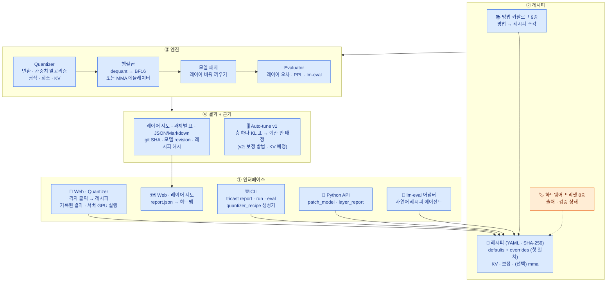
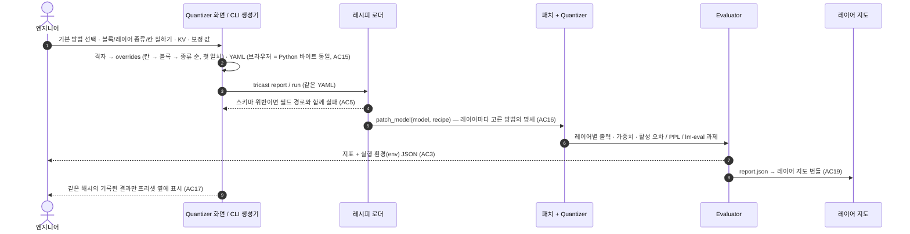
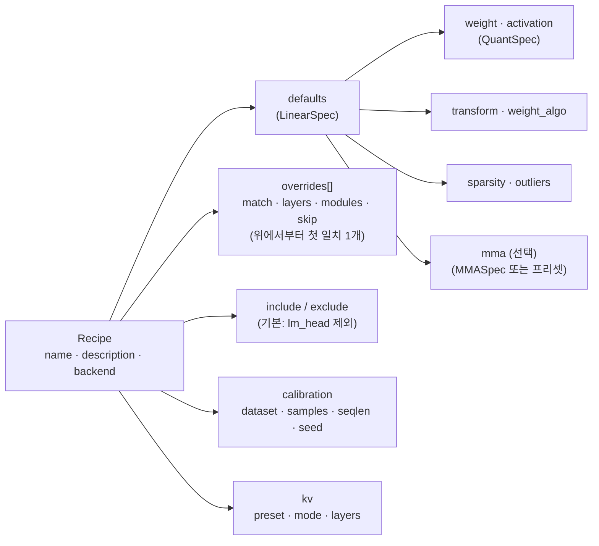
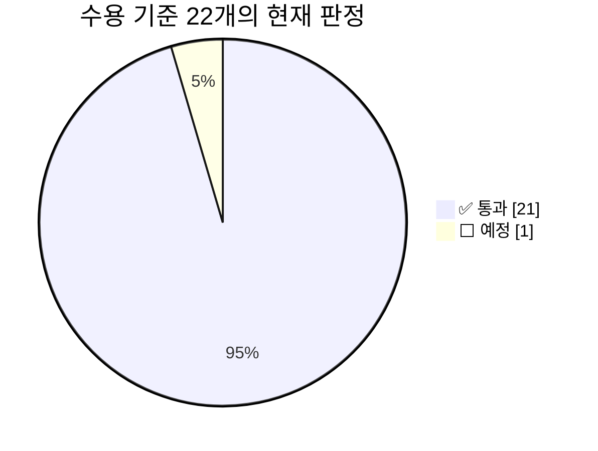
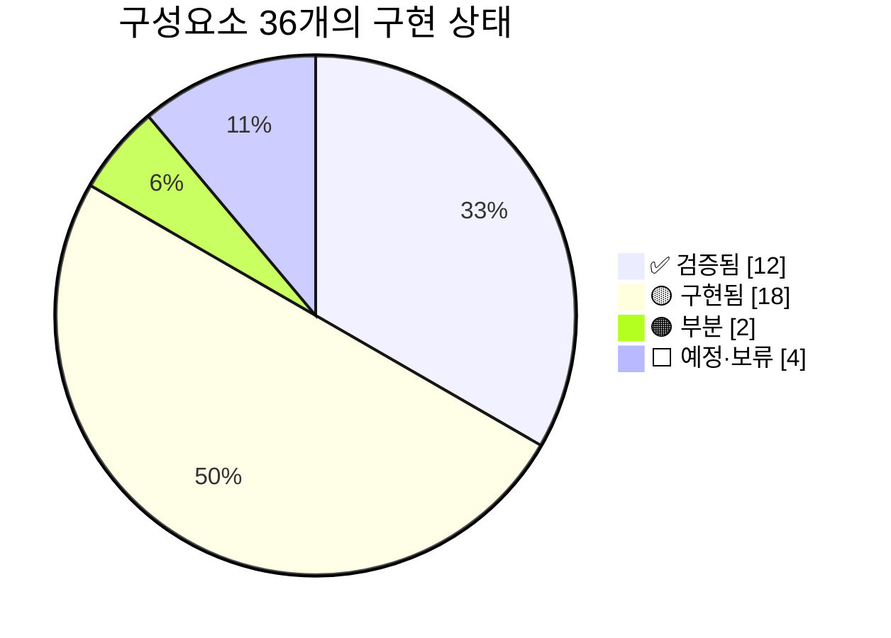
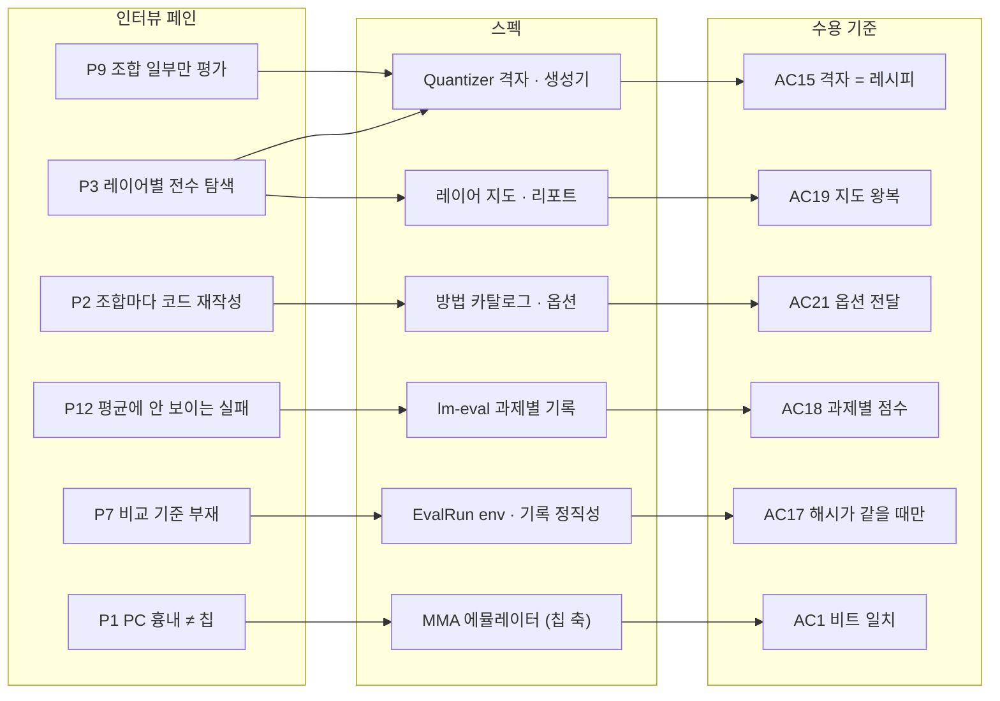

<div align="center">

# 📐 TriCast 제품 스펙 (SDD)

**Spec-Driven Development** · v2.0 · 2026-10-13

`양자화 방법 9종 × 레이어 격자 28×7` `레이어 지표 MSE·SQNR·코사인` `lm-eval 5과제 E2E` `번들 레시피 26종` `NADPE 벡터 1,716/1,716 비트 일치`

[문제 정의서](./PROBLEM.md) · [**제품 스펙**](./SPEC.md) · [인터뷰](./research/interviews.md) · [온톨로지](./ontology.md)

</div>

---

> [!NOTE]
> **이 문서는 무엇인가요?** TriCast를 **무엇으로 만들지** 정한 단일 기준 문서입니다(스펙 주도 개발). 구조는 아키텍처 그림의 4층(인터페이스 → 레시피 → 엔진 → 결과)을 그대로 따르고, 각 항목의 **구현 상태는 저장소 코드와 `support_matrix.yaml`, 실행 기록에서 확인한 사실**만 적었습니다.
>
> 상태 표시: ✅ 검증됨 (테스트 증거 있음) · 🟡 구현됨 (코드 + CPU 테스트) · 🟠 부분 · ⬜ 예정·보류

> [!IMPORTANT]
> **v2.0 개정 (2026-10-13)** — TriCast 의 중심을 "칩 계산 흉내" 에서 **"레이어마다 양자화 방법을 골라 바로 평가하는 Quantizer"** 로 옮겼습니다 ([문제 정의서 v2.0](./PROBLEM.md)). 칩의 계산 규칙(누산 · 반올림 · 형식 변형)은 같은 레시피의 **선택 축**으로 남고, v1 의 수용 기준 AC1–AC14 는 번호와 판정 방법을 바꾸지 않았습니다. 새 기능의 기준은 AC15 부터입니다.

## 📌 한 줄 요약

**레이어마다 양자화 방법을 화면의 격자에서 고르면 (현재 Qwen3-0.6B) TriCast가 레시피 한 장을 만들고, 그 레시피로 모델을 돌려 레이어별 오차(MSE · SQNR · 코사인)와 모델 점수(PPL · lm-eval 과제별)를 실행 환경 기록과 함께 돌려줍니다. 웹 · CLI · Python 어디서 시작해도 같은 레시피, 같은 해시입니다.**

> 🍱 **쉽게 말하면**: 도시락 칸(레이어)마다 양념(양자화 방법)을 클릭으로 정하면 양념 카드(레시피)가 나오고, 그 카드대로 만든 도시락의 칸별 맛(레이어 오차)과 전체 맛(PPL · 벤치마크), 그리고 "어떤 카드 · 어떤 재료로 만들었는지" 영수증(실행 환경)을 함께 주는 장치입니다. 가게 오븐(칩)의 굽는 규칙도 카드에 적을 수 있습니다.

---

## 1. 문제

양자화 모델을 배포하거나 칩 연산기를 설계하는 엔지니어가 레이어마다 어떤 양자화 방법과 정밀도를 쓸지 정해야 하는데, 방법 · 레이어 조합을 바꿀 때마다 코드를 다시 짜고 모델 전체를 다시 평가해야 해서 **원하던 조합의 일부(07: 30개 이상 중 6개)만** 평가하고, 원인을 특정하지 못한 채 레이어별 혼합 정밀도 · 보정 · 재학습을 손으로 전수 탐색하는 데 **3주~3개월**을 쓴다. PC 에서 잰 레이어 순위가 칩에서 맞지 않는 경우도 있는데(로그 10), 이 유형은 fake-quant 결과만으로는 풀 수 없고 레시피의 칩 산술 축이 맡는다. (상세: [PROBLEM.md](./PROBLEM.md))

## 2. 타깃 사용자

| 구분 | 누구 | 근거 |
|---|---|---|
| 🎯 **1차** | 칩에 올릴 모델의 양자화 방법 · 레이어별 정밀도를 정하는 NPU 설계 · 검증 · 컴파일러 엔지니어, FAE, 온디바이스 엔지니어, 양자화 연구자 · 서빙 개발자 | 인터뷰 사분면 ① 12명 · 칩 계산 접근 15명 중 6명이 레이어 전수 탐색 · 조합 일부만 평가를 말함 (PROBLEM §4-1 판정 기준, 응답 24명 전체로는 7명 · 29%) |
| 📏 비교 기준 | 비트 정확 모델 전담팀을 둔 조직 (세대당 18인월) · 이미 있는 양자화 방법 라이브러리 (§10 R9) | 로그 24 · 제품 조사 |
| 🚫 비대상 | GPU 서빙만 하는 엔지니어, 칩 계산에 접근하지 않는 역할(PM · 주니어 · 학생), 칩 축이 필요한데 계산 규칙이 비공개인 칩의 사용자 | 로그 14 16 21 22 23 · 15 17 18 |

## 3. 핵심 기능 (한 문장)

> **레이어별 방법 고르기** (웹 격자 · YAML · Python) → **레시피 한 장** (SHA-256) → **레이어 오차 지도 + PPL · lm-eval 과제별 점수** (같은 실행 환경 기록) → **Auto-tune** (크기 예산 → 층별 방법, v1) — 칩의 누산 · 반올림 규칙은 같은 레시피의 선택 축

## 4. 범위

| ✅ 포함 | ❌ 비포함 |
|---|---|
| 양자화 방법 — RTN · GPTQ · AWQ · SmoothQuant · MXFP4 · MXFP8 · NVFP4 · NVINT4 · INT8 · BFP (MSFP12), 방법별 옵션 (그룹 크기 · 반올림 · 스케일 방법 · 변환 값 · 보정) | 실제 칩 RTL·사이클 단위 시뮬레이션 |
| 레이어별 방법 지정 — Quantizer 격자 (블록 × 레이어 종류 × 칸) → 레시피 `overrides`, `skip` (BF16 유지) | 칩 속도·전력·면적 예측 (저정밀 커널의 실제 속도 포함 — 품질만 잰다) |
| 모델 패치 (Linear · Conv2d · Attention · KV 캐시 — KIVI 2·4비트 · FP8), 희소성 (N:M · 비정형) · 이상치 보존, 원상 복구 | 계산 규칙이 비공개인 칩의 역공학 (로그 14) |
| 수 형식 정의 (float / int / pow2, 사용자 정의 ExMy·intN) | 활성함수 표(LUT) 근사 (로그 08 — 다음 버전 후보) |
| 칩 산술 축 (선택) — MMA 누산 에뮬레이션 (CoFDA·GDFS·FP32 FMA·FP64·정수), **Tensor Core가 아닌 CUDA core에서** | Tensor Core 네이티브 실행 경로 |
| 하드웨어 프리셋 (출처·검증 상태 필수) | 출처 없는 하드웨어 수치 (모르면 "미검증") |
| 평가 — 레이어별 MSE · SQNR · 코사인 · logits KL, PPL, lm-eval 과제별 점수 · 표본 수, 검출 + 실행 환경 기록 | 칩 컴파일러·배포 |
| 인터페이스 — 웹 (Quantizer · 레이어 지도 · Studio), CLI, Python API, lm-eval 어댑터, 자연어 레시피 에이전트 | 모델 학습 파이프라인 (QAT는 STE 수준만) |

> **Auto-tune v1** 은 구현됐다 (보정 없는 방법 7가지 · Qwen3-0.6B · 가중치 비트 예산, [스파이크](./spikes/2026-10-13_autotune_mckp.md) 채택). 보정 방법 · KV 를 넣는 v2 는 예정.
>
> ⬜ **포함하되 아직 없는 것** (§8): Auto-tune v2 (보정 방법 · KV 항), Wanda · SparseGPT, AdaRound, TurboQuant, OMMX. 문서에서 결과가 아니라 **예정**으로만 표시합니다 (화면에는 아직 언급이 없습니다). TurboQuant · OMMX 는 사용자가 요청한 후보로, 정의 · 참고 문헌은 아직 정하지 않았습니다.

---

## 5. 아키텍처와 인터페이스

### 5-1. 전체 구조 — 레시피 하나로 고르기부터 평가까지



<sub>색: 파랑 = 구현됨(하위 기능마다 검증 · 구현 · 예정이 섞임 — 수 형식 · 반올림 · MMA 에뮬레이터는 ✅, 변환 · GPTQ · KV 는 🟡, §8 참고) · 주황 = 부분 (프리셋 출처는 8/8, 실제 칩 확인은 일부) · 점선 = 예정</sub>

**데이터가 흐르는 순서 (Quantizer 한 번)**



### 5-2. ① 인터페이스 계층

> 🍱 **쉽게 말하면**: 같은 레시피를 만드는 출입구가 여럿입니다. 처음 쓰는 사람은 **웹 격자를 클릭**하고, 반복 실험은 CLI, 연구 코드는 Python, 기존 벤치마크는 lm-eval 로 들어옵니다. 어디서 만들어도 레시피 해시가 같습니다.

**Web · Quantizer** (`app/web/quantizer.html`, `python -m app.server` 또는 정적 서버)

| 기능 | 입력 | 출력 | 상태 |
|---|---|---|:-:|
| 방법 고르기 | 기본 방법 1개 + 칸별 방법 (9종 + BF16 유지) | 방법 이름 · 비트 · 보정 필요 여부 표시 | 🟡 |
| 레이어 칠하기 | 블록 28 × 레이어 종류 7 (`q`·`k`·`v`·`o`·`gate`·`up`·`down`), 블록 줄 · 종류 열 · 칸 단위 | 레시피 `overrides` (칸 → 블록 → 종류 순서, 첫 일치) | 🟡 |
| 방법별 옵션 | 그룹 크기 · 반올림 · 스케일 방법 · 백분위 · 변환 값(α · grid) · GPTQ damp · act_order | 바뀐 값만 레시피 조각에 반영, 범위 밖 값은 거부 | 🟡 |
| KV · 보정 | KV `none` · `kivi2` · `kivi4` · `kv_fp8` (잔여 창) / 보정 dataset · samples · seqlen · seed · sequential | 레시피 `kv` · `calibration` (보정이 필요한 방법이 있을 때만) | 🟡 |
| 레시피 내보내기 | — | YAML 미리보기 · 복사 · 내려받기 + 실행 명령 | 🟡 |
| 기록된 결과 | 프리셋 5종 (`qd_mxfp4` · `qd_mxfp4_ends_bf16` · `qd_nvfp4` · `qd_nvint4` · `qd_mixed`) | PPL · lm-eval 5과제 · 레이어 요약 — **같은 해시일 때만** (AC17) | 🟡 |
| 모델 | Qwen3-0.6B (블록 28 × 레이어 종류 7) 전용 — 격자 크기 · 기록된 결과 · 서버 실행 모두 이 모델 | — | 다른 모델은 ⬜ 예정 (§10 R12) |
| 서버 GPU 실행 | `POST /api/quantizer/jobs` `{name, yaml, tasks, limit, calibration}` | 작업 id → `GET /api/quantizer/jobs/{id}` 로 PPL · 레이어 리포트 · lm-eval | 🟠 (CPU 테스트만, GPU 실행 미검증 — §10 R7) |

**Web · 레이어 지도** (`app/web/layers.html`)

| 기능 | 입력 | 출력 | 상태 |
|---|---|---|:-:|
| 번들 만들기 | `tricast report` 의 `report.json` 들 → `python -m app.export_layers` | `app/web/demo/layers/` (방법별 레이어 지표, 출처 해시) | 🟡 |
| 지도 보기 | 지표 (출력 SQNR · MSE · 코사인 · 가중치/활성 SQNR) · 색 기준 (절대값 · 같은 레이어 Δ · 방법 안 Δ) | 방법 × Linear 196 히트맵, 커서로 레이어 하나의 모든 방법 값과 적용 형식 | 🟡 |

**TriCast Studio** (FastAPI, `python -m app.server`) — v1 기능 유지

| 엔드포인트 | 입력 | 출력 | 상태 |
|---|---|---|:-:|
| `GET /api/health` | — | `{"status": "ok", "mode", "device"}` | 🟡 |
| `GET /api/catalog` | — | 누산 알고리즘 파라미터 공간 · 프리셋(출처·검증 상태) · 형식 · 모델 · 작업 | 🟡 |
| `GET /api/resources` | — | GPU · 대기열 · 캐시된 모델 | 🟡 |
| `POST /api/runs` · `GET /api/runs/{id}` | `{task, model, mma, format, baseline, input}` | `{status, baseline, emulated, metrics, env, evidence, recipe.yaml}` | 🟡 |
| 브라우저 GPU 실험실 (`#webgpu`) | FP8 행렬곱 1개 설계 | WebGPU 결과를 JS 정확 레퍼런스·서버 결과와 **비트 대조** | 🟡 |

- 모드 3종: 예시 데이터(GPU 없이 기록된 실행 탐색) · 서버 GPU(실시간, 라이브 모드에서만) · 브라우저 GPU
- 비교 기준 2종: `native`(원본 모델) · `same_quant_fp64`(같은 형식 + FP64 누산 → **누산만의 효과** 분리)

**CLI** (`tricast …` · `python -m app.quantizer_recipe`)

| 명령 | 입력 | 출력 | 상태 |
|---|---|---|:-:|
| `python -m app.quantizer_recipe --preset qd_mixed` · `--from-json grid.json` · `--write-presets DIR` | 프리셋 이름 또는 격자 JSON (화면의 "격자 저장"과 같은 형식) | 레시피 YAML — 화면과 바이트 동일 | 🟡 |
| `formats` · `schemes` · `presets` | — | 등록된 수 형식 20 · 양자화 방식 27(+`bfp<m>_b<n>`) · 프리셋 8 목록 | 🟡 |
| `recipe-check <이름\|경로>` | 레시피 | 통과 또는 필드 경로가 담긴 오류 | 🟡 |
| `report --model M --recipe R` | 모델·레시피 | 레이어별 MSE·SQNR·코사인·mma_ulp + 모델 logits KL · top-1 (JSON·Markdown) | 🟡 |
| `python -m app.autotune table` → `solve --budget-bits 9/2` → `predict` · `measure` | 모델 · 크기 예산 (가중치 평균 비트, 분수 가능) · KV | 층 × 방법 KL 표 → 예산 안 배정의 Quantizer 격자 · 레시피 · 근거(solution.json) | 🟡 (v1, AC22) |
| `run <config.yaml>` | 레시피 목록 + `tasks: {ppl, lm_eval: {tasks, batch_size, limit}}` | `runs/<UTC>/` 에 레시피별 결과 + `summary.md` + env, 같은 조건이면 이어서 실행 | 🟡 |
| `ppl` · `eval --tasks …` | 모델 · 레시피 · lm-eval 과제 | PPL · 과제별 점수 + 데이터셋 지문 | 🟡 |
| `cast` · `agent "<자연어>"` | 형식 · 값 / 자연어 요청 | 형식 눈금 위 값 / `EmulationRequest` JSON (모르는 값은 `null` + `assumptions`) | 🟡 |

**Python API** (`import tricast`)

| 함수 | 입력 | 출력 | 상태 |
|---|---|---|:-:|
| `patch_model(model, recipe, include_conv2d=False)` | Hugging Face·torchvision 모델, 레시피 | `PatchReport {patched, skipped, layers, kv, unused_overrides}` | 🟡 |
| `unpatch_model(model)` | 패치된 모델 | 원래 모듈로 복구 | ✅ |
| `calibrate(model, recipe, tokenizer)` | 보정이 필요한 레시피 | 보정 통계·데이터셋 지문 | 🟡 |
| `layer_report(model, recipe, texts=…)` | 패치 전 모델 | 레이어별 오차 + 모델 KL·top-1 | 🟡 |
| `quantize(x, spec)` · `gemm(a, b, spec)` | 텐서, 방식 이름 · `QuantSpec` / `MMASpec` · 프리셋 | `QTensor` / 칩 규칙대로 누산한 결과 | ✅ |
| `patch_attention(model, AttentionSpec)` | Llama·Qwen3 (eager) | QK·PV 행렬곱도 에뮬레이트 | ✅ |
| `app.quantizer_recipe.build(name, default, grid, kv=…)` · `resolve(...)` · `to_yaml(...)` | 격자 | 레시피 dict · 레이어별 해석 결과 · YAML | 🟡 |

**연동**

| 연동 | 사용법 | 상태 |
|---|---|:-:|
| lm-eval 어댑터 | `python -m tricast.eval.lmeval --model tricast --model_args pretrained=…,recipe=… --tasks …` · `tricast run` 의 `tasks.lm_eval` | 🟡 (과제 메타데이터 기록 ✅, 5과제 E2E 기록 있음) |
| 자연어 레시피 에이전트 | Claude API 구조화 출력 또는 오프라인 파서 → 스키마 검증 → 레시피 | 🟡 (오프라인 ✅, 실제 API 경로 미검증) |

### 5-3. ② 레시피 계층

> 🍱 **쉽게 말하면**: 레시피는 "어느 칸에 어떤 양념을, (선택) 어떤 오븐 규칙으로"를 적은 **설정 카드**입니다. 코드를 고치지 않고 카드만 바꾸면 다른 조합이 됩니다. 인터뷰의 "비트 폭 하나 바꾸고, 희소 비율 하나 틀고, 이상치 보존 방식 하나 수정할 때마다 CUDA 커널을 다시 깎아야 합니다"(로그 02)와 "sweep하고 싶은 조합은 서른 개가 넘는데 실제로 돌린 건 여섯 개입니다"(로그 07)의 불편을 이 계층이 없앱니다.

**레시피 구조**



**방법 카탈로그 9종** (`app/quantizer_recipe.py` · `METHODS`) — 화면 · CLI · 테스트가 같은 표를 씁니다

| 방법 | 레시피 조각 (weight · activation · transform · weight_algo) | 보정 | 비고 |
|---|---|:-:|---|
| `bf16` | 그 레이어 `skip: true` | — | 원래 정밀도 유지 |
| `gptq_int4` | `int4_g128_zp` · 없음 · `none` · `gptq` | 필요 | W4A16, 그룹 128, 영점 |
| `awq_nvfp4` | NVFP4 · NVFP4 · `{kind: awq, share_inputs: true}` · `rtn` | 필요 | |
| `smoothquant_nvfp4` | NVFP4 · NVFP4 · `{kind: smoothquant, alpha: 0.5}` · `rtn` | 필요 | |
| `nvfp4` | NVFP4 · NVFP4 · `none` · `rtn` | — | 블록 16, UE4M3 + FP32 2단 스케일 |
| `nvint4` | `{scheme: nvfp4, format: int4}` × 2 · `none` · `rtn` | — | NVFP4 구조 그대로, 원소만 INT4 (±7) |
| `mxfp4` · `mxfp8` | `mxfp4` · `mxfp8_e4m3` (W · A) · `none` · `rtn` | — | OCP MX, 블록 32, E8M0 |
| `int8` | `int8_row` (W · A) · `none` · `rtn` | — | |
| `bfp12` | `msfp12` (W · A) · `none` · `rtn` | — | MSFP12 블록 부동소수점 |

<sub>블록 형식 조각은 모두 `mma_input: dequant` (BF16 로 되돌린 뒤 행렬곱) 이고, 칸에는 항상 `scheme` 을 가진 **완전한 명세**를 넣습니다 — 기본값과 깊게 합쳐질 때 다른 방법의 필드(예: GPTQ 의 `zero_point`)가 새어 들어오지 않게 하려는 규칙입니다 (AC16).</sub>

**격자 → 레시피 규칙**

| 규칙 | 내용 |
|---|---|
| 순서 | 칸(블록 · 종류 하나) → 블록 줄 → 종류 열 순으로 `overrides` 를 쓴다. 로더는 위에서부터 **처음 맞는 규칙 하나**만 쓰므로, 좁은 규칙이 넓은 규칙을 이긴다 |
| 묶기 | 같은 방법의 칸은 블록 목록 문자열(`"0,27"`, `"3-5"`) 하나로 묶는다 |
| 기본값과 같은 칸 | 규칙을 만들지 않는다 (불필요한 override 0) |
| 자기 검사 | `resolve()` 가 첫 일치 규칙을 다시 돌려 196개 레이어가 모두 고른 방법의 명세와 같은지 확인한다 |
| 보정 · 해시 | 보정이 필요한 방법이 하나라도 있을 때만 `calibration` 을 쓴다. YAML 은 키 순서가 고정이라 같은 격자 = 같은 SHA-256 |

**예시 — `qd_mixed` (Quantizer 프리셋, 레시피 SHA-256 `11b6ac487694…`)**

```yaml
name: qd_mixed
defaults:                                   # 기본: AWQ 스케일 + NVFP4 (W · A)
  weight: {scheme: nvfp4, mma_input: dequant}
  activation: {scheme: nvfp4, mma_input: dequant}
  transform: {kind: awq, share_inputs: true}
  weight_algo: rtn
overrides:                                  # 위에서부터 첫 일치 하나
  - layers: "0,27"                          # 첫 · 마지막 블록은 BF16 유지
    skip: true
  - match: "*.self_attn.o_proj"             # 블록 0·27 을 뺀 모든 o_proj 는 MXFP8
    weight: {scheme: mxfp8_e4m3, mma_input: dequant}
    activation: {scheme: mxfp8_e4m3, mma_input: dequant}
    transform: none
    weight_algo: rtn
  - match: "*.mlp.down_proj"                # 블록 0·27 을 뺀 모든 down_proj 는 GPTQ INT4 (W4A16)
    weight: int4_g128_zp
    activation: null
    transform: none
    weight_algo: gptq
kv: {preset: kivi2, mode: fakequant}        # KV 캐시 KIVI 2비트
exclude: [lm_head]
calibration: {seed: 42}
```

**칩 산술 축 — 인터뷰의 원인을 레시피로 적으면** (선택 축, 모두 `load_recipe` 로 검증)

| 로그 | 인터뷰에서 들은 원인 | 레시피 한 줄 |
|:-:|---|---|
| 03 | 32개씩 묶어 좁은 누산기에 넣고 하위 비트를 버림 | `mma: {algorithm: cofda, chunk_size: 32, f_bits: 9}` |
| 04 · 11 | 칩은 반올림 대신 아래 비트를 버림 | `weight: {scheme: int8_row, rounding: rtz}` |
| 05 | 채널별이 아닌 텐서 하나에 스케일 하나 | `weight: {scheme: int8_tensor}` |
| 06 | 같은 E4M3인데 최대값 240, 서브노멀은 0으로 | `format: "e4m3:fnuz:bias=8:nosub"` |
| 07 | GPU 세대마다 다른 누산 방식 | `mma: nvidia_hopper_fp8` ↔ `nvidia_ada_fp8` ↔ `nvidia_blackwell_fp8` |
| 02 | N:M 희소 + 이상치 따로 보존 | `sparsity: {kind: "n:m", n: 2, m: 4}` · `outliers: {fraction: 0.005, format: bf16}` |
| 10 · 14 | 앞쪽 2블록과 끝 블록만 8비트 | `overrides: [{layers: "0,1,-1", weight: {scheme: int8_row}}]` |
| 12 | 클리핑 기준 상위 99.99% | `activation: {scheme: int8_tensor, scale: {method: percentile, percentile: 99.99}}` |
| 13 | 앞쪽 레이어 KV 캐시만 8비트 | `kv: {preset: kv_fp8, layers: "0-7"}` |
| 08 | 활성함수를 256칸 표에서 찾음 | ⛔ 레시피 항목 없음 (범위 밖) |

**하드웨어 프리셋 8종** (`src/tricast/mma/spec.py` · `PRESETS`)

| 프리셋 | 누산 방식 | 핵심 값 | 출처 | 실제 칩 확인 |
|---|---|---|---|---|
| `nvidia_ada_fp8` | CoFDA | F=13, 묶음 16 | NADPE (MICRO'26) [[N1]](#참고-자료) | ⬜ 예정 |
| `nvidia_hopper_fp8` | CoFDA | F=13, 묶음 32 | NADPE | 🟠 H200 WGMMA 141건 중 **140건 일치** (1건: 0 부호·서브노멀 경계 차이) |
| `nvidia_blackwell_fp8` | CoFDA | F=25, 묶음 32 | NADPE | ⬜ 보류 (하드웨어 없음) |
| `nvidia_blackwell_fp4` | GDFS | G=6, F=35, 그룹 16, 타일 64 | NADPE | ⬜ 보류 (하드웨어 없음) |
| `deepseek_fp8_promote128` | CoFDA + FP32 승격 | F=13, 묶음 32, 128마다 승격 | DeepSeek-V3 보고서 §3.3.2 [[D1]](#참고-자료) | ⬜ 출처 기반 |
| `fp32_fma` | IEEE FP32 FMA | K 순서 | 정의 (하드웨어 주장 아님) | — |
| `fp64` | FP64 FMA → FP32 1회 반올림 | 수치 기준 | 정의 | — |
| `int_exact` | 정수 정확 합 | — | 정의 | — |

> [!IMPORTANT]
> **출처가 없으면 프리셋도 없습니다.** 프리셋 값을 사용자가 바꾸면 이름과 출처가 자동으로 비워져 "사용자 정의 가상 설계"로 표시됩니다(AC2).

**번들 레시피 26종** (`src/tricast/recipes/`) — 분류

| 분류 | 개수 | 레시피 |
|---|:-:|---|
| FP8 GPU 세대별 | 5 | `hopper_fp8_w8a8` `ada_fp8_w8a8` `blackwell_fp8_w8a8` `deepseek_fp8_block` `fp8_2of4_sparse` |
| FP8 누산기 축소 실험 | 2 | `fp8_f7_lowacc` `fp8_f7_decoupled` |
| FP8 정적 스케일 (EMA · history observer) | 2 | `fp8_ema_static` `fp8_delayed_history` |
| 4·6·8비트 블록 형식 (MX·NV·MSFP) | 10 | `mxfp4_w_a` `mxfp6_w_a` `mxfp8_w_a` `mxfp4_rht` `nvfp4_w_a` `nvfp4_4o6` `nvfp4_awq_shared` `nvfp4_smoothquant` `nvfp4_outliers` `msfp12_bfp` |
| 정수 · GPTQ | 3 | `int8_row_w8a8` `w4a16_g128_zp_gptq` `w4a16_gptq_sequential` |
| 레이어 혼합 · KV | 2 | `mixed_first_last_bf16` `kivi2_kv` |
| 기준선 | 2 | `bf16_passthrough` `fp64_reference` |

<sub>Quantizer 프리셋 5종(`qd_*`)은 패키지 레시피가 아니라 생성기가 만드는 레시피입니다 (`python -m app.quantizer_recipe --write-presets DIR`).</sub>

### 5-4. ③ 엔진 계층

#### Quantizer — "숫자를 정한 형식으로 바꾸기"

> 🍱 **쉽게 말하면**: 긴 소수를 짧은 자릿수로 바꾸는 단계입니다. 몇 자리로 줄일지(**형식**), 몇 개 숫자가 같은 확대 비율을 공유할지(**스케일 단위**), 애매한 값을 어느 쪽으로 보낼지(**반올림**), 바꾸기 전에 값을 고르게 펴 둘지(**변환**)를 정합니다.

| 축 | 지원 값 | 인터뷰 근거 | 상태 |
|---|---|---|:-:|
| 수 형식 | float: fp32 · tf32 · bf16 · fp16 · fp8 4종(e4m3 · e5m2 · fnuz 2종) · fp6 2종 · fp4 · ue4m3 + 사용자 정의 `eXmY[:ieee\|fn\|fnuz\|none][:bias=N][:nosub]` / int: int8 · int4 · int2 · uint8 · uint4 · mxint8 · mxint4 + `intN[:full][:frac=F]` / pow2: e8m0 — **등록 20종** | 06 07 13 | ✅ |
| 반올림 | `rne` (짝수 쪽) · `rna` (0에서 먼 쪽) · `rtz` (버림) · `rup` · `rdn` · `sr` (확률적) | 04 09 11 | ✅ |
| 스케일 단위 | `tensor` · `row` (`channel`·`token` 동의어) · `group` · `block` | 05 11 | ✅ |
| 스케일 방법 | `absmax` · `pow2_floor` · `pow2_ceil` · `mse` · `percentile`, Four Over Six (`mse` + `search: [1.0, 1.5]`, 방식 이름 `nvfp4_4o6`), 2단계 스케일(NVFP4) | 11 12 | ✅ |
| 블록 형식의 원소 바꾸기 | `{scheme: nvfp4, format: int4}` — 블록 구조 · 스케일은 두고 원소 형식만 교체 (NVINT4) | — (코드 어휘) | 🟡 |
| 영점 · 정적 observer | `zero_point` none·int·float / `minmax` · `ema` · `history` · `percentile` · `mse` | 11 (보정 샘플) | 🟡 |
| 전처리 · 가중치 알고리즘 | Hadamard · 랜덤 Hadamard · SmoothQuant · AWQ / RTN · GPTQ | — (코드 어휘) | 🟡 |
| 희소성 · 이상치 | `n:m` · `unstructured` / 큰 가중치 비율·형식 따로 보존 | 02 | ✅ |
| KV 캐시 | `kivi2` · `kivi4` · `kv_fp8`, 모드 `cache` · `fakequant`, `layers` | 13 | 🟡 |
| 양자화 방식 이름 | MX 7 · NVFP4 2 · MSFP 2 · FP8 6 · INT 4 · KIVI 2 · 직접 캐스트 4 = **27종** + `bfp<m>_b<n>` | — | ✅ |
| 예정 방법 | Wanda · SparseGPT (희소), AdaRound (가중치 반올림), TurboQuant · OMMX (KV · 서빙) | — | ⬜ |

#### 행렬곱 경로 — 품질 실험용 · 칩 산술용

| 경로 | 레시피 | 무엇을 재나 | 속도 (Qwen3-0.6B, WikiText-2 전체) | 쓰는 곳 |
|---|---|---|---|---|
| **dequant** (fake-quant) | `mma_input: dequant` | 형식 · 스케일 · 변환이 만든 품질 손실 — 피연산자를 BF16 으로 되돌린 뒤 레시피 기본 누산(CoFDA F=23 — 정렬 후 23비트에서 절삭하는 누산)으로 곱함 | 레시피 1개 914~1,070초 (A100) — 원본 17.1초의 53~63배 | Quantizer 프리셋의 PPL · lm-eval, 레이어 지도의 NVINT4 · GPTQ 줄 |
| **scaled + MMA 에뮬레이터** | `mma_input: scaled` + `mma: <알고리즘·프리셋>` | 위 + 칩의 누산 · 절삭 규칙 (비트 정확) | 4창 기준: 프리셋 `nvidia_blackwell_fp4` 54초 (dequant 44초) · `mma` 를 빼서 기본 cofda F23 이 걸리면 약 1,110초 (§10 R4) | 칩 산술 축 · 칩 비교 · 레이어 지도의 나머지 7줄 (번들 레시피 — `int_exact` · `nvidia_blackwell_fp4` · `nvidia_blackwell_fp8`, Blackwell 프리셋의 칩 확인은 ⬜ 보류) |

> **결과를 읽을 때**: Quantizer 의 기록된 PPL · lm-eval 은 dequant 경로입니다 — "이 방법 배치가 품질을 얼마나 잃는가"이지 "이 칩에서 이 숫자가 나온다"가 아닙니다. 레이어 지도는 줄마다 경로가 다릅니다 (위 표). 같은 MXFP4 레시피의 PPL 이 두 경로(번들 `mxfp4_w_a` 의 scaled + GDFS, Quantizer `qd_mxfp4` 의 dequant + CoFDA F23)에서 비트까지 같았지만 (33.94094089039902), 이 모델 · 형식에서 누산 차이가 결과를 바꾸지 않았다는 관측일 뿐 경로의 정확성 논증은 아닙니다. 칩 축이 필요하면 같은 레시피에 `mma` 를 적고 `scaled` 로 다시 잽니다.

#### MMA 에뮬레이터 — "칩처럼 곱하고 더하기" (칩 산술 축)

> 🍱 **쉽게 말하면**: AI 계산의 대부분은 "곱해서 모두 더하기(내적)"입니다. 칩은 이 더하기를 **좁은 칸에서, 정해진 묶음 단위로, 작은 자릿수를 버리며** 합니다. GPU의 고정된 Tensor Core로는 이 규칙을 바꿀 수 없어서, TriCast는 **CUDA core에서 규칙 하나하나를 직접 계산**합니다.

| 알고리즘 | 무엇을 흉내 내나 | 주요 파라미터 (허용 범위) | 레퍼런스 | Triton |
|---|---|---|:-:|:-:|
| `cofda` fused | 묶음마다 정렬·절삭 후 누산기와 함께 합산 (NVIDIA FP8 계열) | `f_bits` 1–48 · `chunk_size` ≥1 · `norm_rounding` rtz/rne | ✅ | ✅ |
| `cofda` decoupled | 누산기를 따로 `f2_bits`로 합침 | `c_mode: decoupled` · `f2_bits` 1–48 | ✅ | ✅ |
| `cofda` + promote | 일정 간격마다 FP32로 승격 (DeepSeek-V3) | `promote_interval` = `chunk_size`의 배수 | ✅ | ✅ |
| `gdfs` | 그룹 합 → 타일 합 2단계 (Blackwell FP4 계열) | `g_bits` 1–48 · `group_size` · `k_tile` (그룹 1–8개) | ✅ | ✅ |
| `fp32_fma` | 일반 GPU SGEMM | — | ✅ | ✅ |
| `fp64` | 수치 기준 (오차 측정용) | — | ✅ | ✅ |
| `int_exact` | 정수 정확 합 (IMMA류) | — | ✅ | ✅ |

**정확성 증거**: 독립 구현(NADPE MMA-Emu CUDA [[N2]](#참고-자료), sm_80 빌드)과 비교한 테스트 벡터 **1,716건 전부 비트 일치** (FP8 1,200 · NVFP4 172 · MXFP4 344, A100 · V100) · Triton 커널 = 레퍼런스 비트 일치 (A100 · V100 · H200).

#### 모델 패치 — "모델의 레이어를 바꿔 끼우기"

| 대상 | 방법 | 확인된 모델 | 상태 |
|---|---|---|:-:|
| Linear | `nn.Linear` → `EmuLinear`, `lm_head`는 기본 제외, 레이어마다 레시피 규칙의 명세 | Llama · Qwen3 (projection·MLP 7개/블록) | 🟡 (연산자 통합 ✅) |
| Conv2d | 켜야 동작 (`include_conv2d=True`), 그룹마다 `EmuLinear`로 낮춤 | ResNet18 (Conv 20 + Linear 1) · YOLO11n (Conv 88) | ✅ 40개 조합 비트 일치 |
| Attention QK · PV | 켜야 동작 (`patch_attention`), softmax는 원래대로 FP32 | Llama · Qwen3 (Transformers 4.55.2 eager) | ✅ 행렬 47건 + 생성 20토큰 |
| KV 캐시 | KIVI 배치(키는 채널, 값은 토큰), 최근 토큰 잔여 창 / `fakequant` 모드 (PPL 용) | 작은 Llama·Qwen · Qwen3-0.6B (`qd_mixed`) | 🟡 |
| 음성 (Whisper) | — | — | ⬜ 예정 (근거: 로그 04 · 16 · 18) |
| 원상 복구 | `unpatch_model` — 원본 출력과 비트 동일 | Llama · Qwen3 · ResNet18 · YOLO11n | ✅ |

#### Evaluator — "품질과 오차 재기"

| 평가 | 지표 | 데이터 | 상태 |
|---|---|---|:-:|
| 레이어 오차 리포트 | 레이어별 출력 · 가중치 · 활성 MSE · SQNR(dB) · 최대 절대오차 · 상대 Frobenius · 코사인 (`sqnr_db` · `cosine`) + 모델 logits KL · top-1 일치 · **mma_ulp** | 임의 텍스트 (W1: WikiText-2 train 8 × 512 토큰) | 🟡 (Qwen3-0.6B × 9방법 기록) |
| 언어모델 PPL | 토큰 perplexity (GPTQ 관례, 2048 창) | WikiText-2 · C4 · Pile | 🟡 (Qwen3-0.6B 프리셋 5종 · Llama-3.2-1B 전체 측정 기록) |
| lm-eval | 과제별 점수 + 표본 수 (`acc_norm` — ARC-e · ARC-c · PIQA · HellaSwag, `acc` — WinoGrande) | HellaSwag · ARC · PIQA · Winogrande · CoQA · LAMBADA 등 | 🟡 (5과제 × 300문항 × 레시피 6개 기록) |
| 객체 검출 | AP50-95 · AP50 / 상자 짝짓기(IoU ≥ 0.5) | COCO val2017 5,000장 | ✅ 측정 완료 |
| 이미지 분류 | top-1 · top-5 · KL | ImageNet-1k | ⬜ 보류 (인가된 데이터 필요) |
| 음성 | WER | — | ⬜ 예정 |

> **국소 지표와 전체 지표를 나눠 읽습니다**: 레이어 리포트의 SQNR 은 *그 레이어의 출력이 얼마나 망가졌나*이고, 그 레이어를 지켰을 때 *모델 전체가 얼마나 좋아지나*와 다릅니다 — W1 스파이크에서 국소 SQNR 하위 14개를 지킨 PPL(33.12)은 무작위 14개 5회(31.85~33.38) 안이었습니다 — 단, 그 14개는 지킨 파라미터가 무작위 평균보다 약 24% 적었습니다 ([스파이크](./spikes/2026-10-13_layer_sqnr_proxy.md)). 그래서 Auto-tune 의 목적 함수는 모델 전체 지표(층 하나만 줄인 모델의 KL)이고, v1 스파이크에서 그 합이 레시피 11개의 실측 KL 순서를 맞혔습니다 (Spearman 0.973).

### 5-5. ④ 결과 + 근거 계층

> 🍱 **쉽게 말하면**: 점수만 주지 않고 "**어떤 코드, 어떤 모델 버전, 어떤 레시피, 어떤 GPU**로 잰 점수인지"를 영수증처럼 함께 남깁니다. 인터뷰의 "누구 책임인지 가릴 기준이 없다는 거죠"(로그 16), "원인을 모르니 리스크를 숫자로 못 올리잖아요"(로그 18)에 대한 답입니다.

**평가 기록 (`EvalRun`) 필드** — 필드 이름은 `src/tricast/eval/runner.py` 기준, 값은 Quantizer W2 PPL 실행(`qd_nvint4`, A100)에서 발췌, `…`는 생략. lm-eval 기록(W3, H100)은 같은 모양에 `metrics.lm_eval` 과 `dataset_fingerprints.lm_eval` 이 들어가는 별도 기록입니다

```jsonc
{
  "status": "complete",                    // complete | failed
  "recipe_hash": "ba9c8928b96f…",           // 레시피 정규 JSON 의 SHA-256
  "run_hash": "<모델·레시피·코드·GPU·버전을 묶은 실행 식별자>",
  "metrics": { "ppl": { "ppl": 27.9498, "n_tokens": 298862, "dataset_fingerprint": "…" } },
  "patch_report": { "patched": [["model.layers.1.self_attn.q_proj", "…"]], "skipped": ["lm_head"] },
  "env": {
    "git_sha": "ab489f17cdc0…", "git_dirty": false,
    "model_id": "Qwen/Qwen3-0.6B", "model_sha": "c1899de289a0…",
    "versions": { "torch": "2.8.0+cu128", "transformers": "4.55.2", "lm_eval": "0.4.13" },
    "gpu_names": ["NVIDIA A100-SXM4-80GB"], "cuda": "12.8",
    "dataset_fingerprints": { "ppl": "…" }
  },
  "wall_time_s": "…"
}
```

| 근거 항목 | 왜 필요한가 |
|---|---|
| `git_sha` · `git_dirty` · `src_sha256` | 어떤 코드로 잰 숫자인지 (수정 중이면 소스 해시) |
| `model_sha` | 같은 이름의 모델이라도 버전이 다르면 다른 숫자 |
| `recipe_hash` | 레시피 내용이 같으면 키 순서와 관계없이 같은 해시 — 격자가 같으면 같은 해시 |
| `dataset_fingerprints` | 평가·보정 데이터가 같은지 (PPL · lm-eval 각각) |
| `versions` · `gpu_names` · `cuda` | 로그 07처럼 "같은 코드인데 GPU 세대가 다르면 다른 숫자"를 가려내기 위해 |

**기록된 결과의 정직성 규칙** — Quantizer 화면은 기록된 실행을 프리셋 옆에 붙일 때 **그 실행의 `recipe_hash` 가 지금 생성기가 같은 격자로 만드는 레시피의 해시와 같을 때만** 붙입니다 (`app/export_quantizer_demo.py` 의 고정 해시표). 생성기가 바뀌어 해시가 달라지면 결과는 사라지고 "기록 없음"으로 표시됩니다 (AC17). 사용자가 격자를 한 칸이라도 바꾸면 그 레시피에는 기록된 결과가 없다는 것을 화면에 그대로 씁니다.

---

## 6. 수용 기준

각 기준은 EARS 문형 "[조건]일 때, TriCast는 [동작]한다"로 쓰고, 조건 유형을 [ ]에 표시했습니다. **모든 기준은 테스트나 측정으로 판정합니다.** AC1–AC14 는 v1.0 그대로이고, AC15–AC22 가 Quantizer 개편의 기준입니다 (판정 테스트는 `app/tests/` 와 `scripts/quantizer/`).

| AC | 유형 | 수용 기준 (EARS) | 판정 방법 (테스트 · 측정) | 현재 결과 | 인터뷰 |
|:-:|:-:|---|---|---|:-:|
| **AC1** | 상시 적용 | TriCast는 **항상** Triton 커널의 양자화·누산 결과를 정확 연산(fp64·int64·Fraction) 레퍼런스와 **비트 단위로 일치**시킨다 — 차이를 허용 오차로 덮지 않는다. | `tests/gpu/test_triton_quantize.py` · `test_triton_mma.py` · `test_triton_structure.py` · `tests/data/nadpe/` | ✅ GPU 896 통과 (H200) · NADPE 1,716/1,716 | 03 06 09 |
| **AC2** | 상시 적용 | TriCast는 **항상** 하드웨어 프리셋에 출처와 검증 상태를 붙이고, 사용자가 프리셋 값을 바꾸면 이름·출처를 비워 "사용자 정의"로 표시한다. | `tests/test_golden.py` (nonempty_provenance) · `tests/test_recipe.py` · `tests/test_agent_request.py::test_all_presets_preserve_datapath_and_provenance` · `app/tests/test_catalog.py` | ✅ 8/8 프리셋 출처 보유 | 06 07 |
| **AC3** | 이벤트 기반 | 평가가 끝나면, TriCast는 지표를 실행 환경(git SHA · 소스 해시 · 모델 revision · 데이터셋 지문 · 레시피 해시 · GPU · 버전)과 함께 기록하고, 환경이 바뀐 이전 결과는 재사용하지 않는다. | `tests/test_eval.py::test_capture_env` · `test_runner_resume_invalidates_source_or_model_revision` · `test_runner_does_not_resume_across_software_or_gpu_changes` | ✅ CPU 통과 | 07 16 18 |
| **AC4** | 상시 적용 | TriCast는 **항상** 무손실 기준 레시피(`bf16_passthrough`)로 패치한 모델의 PPL을 원본 모델 대비 상대 차이 **0.1% 이하**로 유지한다. | `tests/test_ac4_passthrough.py` (CPU 레퍼런스 백엔드, 손실 레시피가 한계를 넘는지 대조 포함) · 골든 케이스 `e2e_bf16_passthrough_ppl` (GPU) · `configs/e2e/qwen3_0.6b_ppl_a.yaml` (`native_baseline: true`로 원본과 같은 조건 실행) · 한계값 `AC4_relative_PPL_limit: 0.001` (`support_matrix.yaml`) | ✅ Llama-3.2-1B: **0.0044%** (9.7564 → 9.7569) | 06 |
| **AC5** | 예외 대응 | 레시피가 스키마나 값 범위를 어기면, TriCast는 모델을 건드리기 **전에** 실패하고 위반한 필드 경로를 오류에 담는다. 예: `defaults.mma.f_bits: 60 is greater than the maximum of 48` | `tests/harness/golden_cases.yaml` (recipe_error 5건) · `tests/test_recipe.py` | ✅ | 11 |
| **AC6** | 예외 대응 | 자연어 요청에 정밀도·누산 파라미터가 없으면, 에이전트는 그 값을 지어내지 않고 `null`로 두며, 채운 기본값은 `assumptions`에 적는다. | `evals/run_evals.py` · `tests/test_evals.py` · `tests/test_agent_parser.py` | ✅ 30문항 · 140필드 정확, **지어낸 값 0건**, 모호성 8/8 질문 (오프라인 파서) | 04 07 (P5: 사양을 모르면 역추정 — 모르는 값을 지어내지 않음) |
| **AC7** | 이벤트 기반 | `unpatch_model` 요청이 오면, TriCast는 원래 모듈을 되돌려 원본과 **비트 단위로 같은 출력**을 낸다. | `tests/test_nn_patch.py::test_tiny_hf_patch_restore` · `scripts/e2e/validate_model_families.py` | ✅ Llama · Qwen3 · ResNet18 · YOLO11n | 16 |
| **AC8** | 예외 대응 | 레시피가 어떤 레이어도 선택하지 않으면, TriCast는 원본 모델을 조용히 평가하지 않고 "zero patches" 실패로 기록한다. | `tests/test_eval.py::test_runner_zero_patches_records_failure` · `test_lmeval_adapter_rejects_zero_patches` | ✅ | 19 |
| **AC9** | 상태 기반 | 보정이 필요한 레시피(GPTQ · AWQ · SmoothQuant · 정적 observer)가 **보정되지 않은 동안**, TriCast는 모델 실행을 거부한다. | `tests/test_calibrate.py::test_calibration_required_before_forward` · `test_direct_calibration_lifecycle_cannot_bypass_guard` | ✅ | 11 |
| **AC10** | 이벤트 기반 | `tricast report` 요청이 오면, TriCast는 레이어별 MSE · SQNR · 코사인 · mma_ulp와 모델 logits KL · top-1 일치율을 JSON과 Markdown으로 낸다. | `tests/test_analysis.py` · `tests/test_analysis_ulp.py` | ✅ CPU 통과 | 01 02 03 07 |
| **AC11** | 선택 기능 | `include_conv2d=True`가 켜진 경우, TriCast는 Conv2d를 그룹별 행렬곱으로 낮춰 같은 레시피로 흉내 내고, 꺼진 경우 Conv2d를 "비활성"으로 보고한다. | `scripts/e2e/validate_model_families.py` | ✅ 8개 형태 × 5개 레시피 = 40건 비트 일치 | 05 14 |
| **AC12** | 선택 기능 | 음성 모델(Whisper)이 선택된 경우, TriCast는 같은 레시피로 패치하고 WER을 평가한다. | (테스트 예정) | ⬜ 예정 | 04 16 18 |
| **AC13** | 이벤트 기반 | 두 평가 기록의 PPL 비교를 요청하면, TriCast는 상대 차이 (PPL_emu − PPL_base 의 절댓값 ÷ PPL_base) 와 그 값이 한계(기본 0.1%, 요청으로 지정 가능) 이하인지를 내고, 에뮬레이션 PPL이 NaN · inf 이면 상대 차이 inf 의 불합격으로 낸다. | `tests/test_compare_golden.py` · `tests/harness/golden_compare.yaml` (AC13: 정상 3 · 경계 8) | ✅ 골든 11/11 ([위임 기록](./prompts/delegation_compare.md)) | 06 16 18 |
| **AC14** | 예외 대응 | 비교할 두 기록이 비교 조건을 어기면 — PPL 지표가 없거나, 모델 revision · 데이터셋 지문 · 평가 토큰 수가 다르거나 비어 있거나 (토큰 수는 0 보다 큰 정수), 기준 PPL이 유한한 양수가 아니거나, 에뮬레이션 PPL이 숫자가 아니거나, 한계가 유한한 0 이상의 수가 아니면 — TriCast는 판정하지 않고 위반한 필드 경로를 담아 거부한다. | `tests/test_compare_golden.py` · `tests/harness/golden_compare.yaml` (AC14: 금지 16) | ✅ 골든 16/16 ([위임 기록](./prompts/delegation_compare.md)) · `scripts/e2e/summarize.py` 가 이 판정으로 비교 가능 여부를 가림 | 06 15 16 18 |
| **AC15** | 이벤트 기반 | 격자(블록 × 레이어 종류 × 칸)에서 방법을 고르면, TriCast는 첫 일치 규칙으로 해석했을 때 모든 Linear 레이어가 그 칸에 고른 방법(과 옵션)의 단독 명세와 같아지는 레시피를 만들고, 브라우저 화면과 Python 생성기는 같은 격자에 **바이트 단위로 같은** YAML 을 낸다. | `app/tests/test_quantizer_recipe.py::test_random_grids_resolve_to_each_methods_own_spec` · `test_random_option_states_resolve_to_each_variants_own_spec` · `test_presets_are_the_recorded_yaml_and_match_the_pins` · `scripts/quantizer/qz_check.mjs` (헤드리스 Chrome — 프리셋 5 · 무작위 격자 300 · 옵션 상태 300) · `scripts/quantizer/qz_tricast_accept.py` (tricast 로더 수용) | ✅ 앱 테스트 통과 · `QZ_CHECKS[static] 71/71` · `QZ_TRICAST_ACCEPT_OK` (레시피 100 · 레이어 19,600) | 02 07 10 13 |
| **AC16** | 상시 적용 | TriCast는 **항상** 한 칸에 고른 방법의 명세에 기본값이나 다른 방법의 필드(영점 · 변환 값 · GPTQ 값 등)가 섞이지 않게 한다 — 블록 형식 칸은 `scheme` 을 가진 완전한 명세로 쓰고, 변환 · 가중치 알고리즘은 옵션을 바꾼 경우 모든 필드를 적은 매핑으로 쓴다 (옵션이 없으면 `none` · `rtn` 축약형). | `app/tests/test_quantizer_recipe.py::test_nvint4_custom_format_leaks_into_no_other_layer` · `test_transform_and_gptq_options_do_not_leak_through_the_field_merge` | ✅ CPU 통과 | 05 (변환 툴이 경고 없이 규칙을 바꿈) |
| **AC17** | 상태 기반 | 기록된 실행의 레시피 해시가 생성기가 같은 격자로 만드는 레시피의 해시와 **다른 동안**, Quantizer 번들을 만드는 도구(`app/export_quantizer_demo.py`)는 그 실행을 프리셋 결과로 붙이지 않고 화면은 "기록 없음"으로 보인다 — 같은 실행이 두 번 기록됐거나 레이어 리포트가 격자와 어긋난 경우도 거부한다. | `app/tests/test_quantizer_export.py::test_honesty_check_refuses_a_different_recipe` · `test_a_pin_from_an_older_preset_yaml_vouches_for_nothing` · `test_committed_bundle_agrees_with_the_generator_and_the_pins` · `test_report_layers_must_follow_the_grid` · `test_a_run_recorded_twice_is_refused` | ✅ CPU 통과 · 커밋된 번들 = 생성기 · 고정 해시 5/5 | 16 18 |
| **AC18** | 이벤트 기반 | lm-eval 기록을 붙이면, TriCast는 과제별 점수 · 지표(`acc` / `acc_norm`) · 표본 수 · 표준오차와 BF16 원본 대비 차이(점)를 함께 내고, 원본과 문항 수 · 설정이 다르거나 지표가 빠진 기록은 붙이지 않고 거부 사유를 남긴다. | `app/tests/test_quantizer_export.py::test_lmeval_runs_attach_with_points_against_bf16` · `test_bad_lmeval_runs_are_refused` | ✅ CPU 통과 · 기록 6개 (5과제 × 300문항) 부착 | 05 12 13 21 |
| **AC19** | 이벤트 기반 | 레이어 리포트를 레이어 지도 번들로 내보내면, 번들은 리포트의 모든 레이어와 지도에 쓰는 지표 값(출력 · 가중치 · 활성 SQNR · MSE · 코사인 등 — `mma_ulp.n` · `nonfinite_mismatch` 는 내보내지 않음)을 그대로 담고, 유한하지 않은 값(inf · NaN)은 버리지 않고 표시한다. | `app/tests/test_layers_export.py::test_every_exported_metric_round_trips` · `test_nonfinite_metrics_are_flagged_not_dropped` · `scripts/quantizer/cdp_check.mjs` (헤드리스 Chrome) | ✅ CPU 통과 · `CDP_CHECKS 44/44` | 01 03 10 13 |
| **AC20** | 예외 대응 | 서버 GPU 실행 요청이 데모 모드나 CPU 라이브 서버로 오거나, 요청 필드 · YAML 크기가 한도를 어기거나 보정이 필요한 레시피의 보정 설정(samples ≤ 512, seqlen ≤ 4096)이 한도를 어기면, 서버는 작업을 만들지 않고 고칠 내용을 담아 거부한다. | `app/tests/test_quantizer_server.py::test_demo_mode_refuses_with_how_to_start_a_gpu_server` · `test_live_cpu_server_refuses` · `test_bad_requests_say_what_to_fix` · `test_oversized_yaml_is_refused` · `test_bad_calibration_settings_say_what_to_fix` · `test_a_recipe_calibration_beyond_the_server_limits_is_refused` | ✅ CPU 통과 (거부 경로) · GPU 에서 실제 실행은 **미검증** (§10 R7) | 11 |
| **AC21** | 선택 기능 | 방법별 옵션(그룹 크기 · 반올림 · 스케일 방법 · 변환 값 · GPTQ 값 · observer · KV 잔여 창 · 보정)이 지정된 경우, TriCast는 그 값을 해석된 레이어 명세(`patch_model` 이 쓰는 `spec_for`)까지 그대로 전달하고 보정 설정은 실행(보정 창)까지 전달하며, 그 방법에 해당하지 않거나 범위 밖인 옵션은 무시하지 않고 거부한다. | `app/tests/test_quantizer_recipe.py::test_every_option_field_reaches_the_resolved_spec` · `test_options_that_do_not_apply_or_are_out_of_range_are_refused` · `app/tests/test_quantizer_runner.py::test_a_static_observer_calibrates_with_the_requested_windows` | ✅ CPU 통과 (옵션 필드 18개) | 11 12 |
| **AC22** | 이벤트 기반 | 크기 예산(Linear 가중치 평균 비트)이 주어지면, Auto-tune 은 층 × 방법 KL 표에서 예산을 넘지 않으면서 KL 합이 최소인 배정을 정확히 찾고 (작은 문제에서 완전 탐색과 같음, 예산이 불가능하면 거부), 그 배정을 Quantizer 격자 · 레시피로 내며 모든 층이 고른 방법의 단독 명세를 받는다. | `app/tests/test_autotune.py::test_solver_equals_brute_force_on_random_instances` · `test_infeasible_budgets_are_refused` · `test_solved_grid_resolves_to_each_chosen_methods_own_spec` · `test_tiny_table_is_complete_deterministic_and_resumable` · `test_tiny_solve_predict_and_measure` | ✅ CPU 통과 · GPU 스파이크 채택 (C2 ρ 0.973, 4.50 비트 PPL 25.53 < 균일 NVFP4 26.16) | 07 09 10 13 |



> AC20 은 거부 경로만 통과입니다 — 서버 GPU 에서 작업이 실제로 끝까지 도는지는 아직 확인하지 않았습니다 (§10 R7).

---

## 7. 비기능 요구

| 분류 | 요구 | 현재 근거 |
|---|---|---|
| **정확성** | 레퍼런스는 정확 연산만 사용 (fp64 · int64 · Fraction). 서브노멀이 닿는 FP32 연산은 IEEE PTX 헬퍼로 (Triton 기본 라이브러리는 서브노멀을 0으로 만듦) | `src/tricast/reference/` · `kernels/ieee.py` |
| **결정론** | 시드 고정, 동률 규칙 명시 (예: 희소화는 낮은 인덱스 우선, 격자 규칙은 칸 → 블록 → 종류). 같은 입력에 결과가 흔들리면 완료 아님 | `quant/structure.py` · 러너 `seed` · `app/quantizer_recipe.py` |
| **재현성** | 같은 실행 식별자(`run_hash`)면 결과 재사용, 하나라도 바뀌면 새로 실행. 같은 격자 → 같은 YAML → 같은 레시피 해시 (브라우저 = Python) | AC3 · AC15 |
| **정직성** | 기록된 결과는 해시가 같을 때만 보여 주고, 예정 기능은 결과 자리에 두지 않음 | AC17 · §4 |
| **처리량 (Quantizer)** | Qwen3-0.6B WikiText-2 전체 PPL (298,862 토큰): dequant 프리셋 레시피 1개 **914~1,070초** (A100) · lm-eval 5과제 × 300문항: 원본 74초, MXFP4 372초, NVFP4 1,304초, NVINT4 1,355초, `qd_mixed` 1,584초 (H100 NVL) · 레이어 리포트 (8 × 512 토큰): 방법당 198~510초 (V100) · Auto-tune 표 (196층 × 6방법, 8 × 512 토큰) 668초 (A100) / 1,455초 (V100), 풀이 1초 미만 | [측정 기록](./evidence/2026-10-13_quantizer_runs.md) |
| **처리량 (칩 산술 축)** | A100에서 CoFDA F=13 **0.15 TMAC/s** (NADPE 0.15와 동급) · Qwen3-0.6B 디코드 1스텝 **101 ms** · Qwen3-0.6B WikiText-2 전체 PPL 평가 (`hopper_fp8_w8a8`) **14.8분** — 스파이크 합격선 30분 이내 | `support_matrix.yaml` · [스파이크](./spikes/cuda_core_bit_exact_emulation.md) |
| **체감 속도** | 48토큰 생성: Qwen3-0.6B **13.7초** (원본 2.6초, 5.2배) · Llama-3.2-1B **7.6초** (원본 1.2초, 6.2배) — A100 | `app/web/demo/runs/*.json` |
| **이식성** | Python ≥ 3.10, torch ≥ 2.4. Triton 커널은 Linux + CUDA GPU (A100 · H200 · V100에서 레퍼런스와 비트 일치 확인), 그 외에는 레퍼런스로 동작. Quantizer 화면과 레이어 지도는 정적 파일이라 GPU 없이 열림 | `pyproject.toml` · `app/web/` |

> [!TIP]
> **인터뷰와 비교하면 (조건이 같지 않은 규모 비교)**: 로그 07 은 조합 하나에 **4일**, 로그 10 은 확인 1회에 **반나절**이었습니다. TriCast 는 같은 모델 전체 PPL 을 레시피 하나에 **약 15~18분**, 상식 벤치마크 5과제(각 300문항)를 레시피 하나에 **6~26분**(원본은 74초)에 잽니다 — 같은 모델 · 같은 칩이 아니므로 "자릿수가 다르다" 수준으로만 읽어 주세요.

---

## 8. 구현 현황

| 계층 | 구성요소 | 상태 | 근거 |
|---|---|:-:|---|
| 인터페이스 | Web · Quantizer (격자 · 방법별 옵션 · KV · 보정 · 기록된 결과) | 🟡 | `app/tests/test_quantizer_*.py` · 브라우저 검사 71/71 |
| | Web · 레이어 지도 | 🟡 | `app/tests/test_layers_export.py` · 브라우저 검사 44/44 |
| | 서버 GPU 실행 (`/api/quantizer/jobs`) | 🟠 | CPU 테스트 (거부 · 큐 · 결과 형태)만, GPU 실행 미검증 |
| | TriCast Studio (v1 화면) | 🟡 | `app/` · `app/tests/test_server.py` |
| | 브라우저 WebGPU 실험실 | 🟡 | FP8 행렬곱 1개 비트 대조 |
| | Python API `quantize` · `gemm` | ✅ | Triton = 레퍼런스 |
| | Python API `patch_model` | 🟡 | `tests/test_nn_patch.py` |
| | CLI | 🟡 | `tests/test_cli.py` |
| | lm-eval 어댑터 · `run` 의 `tasks.lm_eval` | 🟡 | 과제 메타데이터 기록 ✅ · 5과제 × 레시피 6 E2E 기록 |
| | 자연어 레시피 에이전트 | 🟡 | 오프라인 ✅ · 실제 API 미검증 |
| 레시피 | 스키마 · 검증 · 해시 · 레이어 규칙 | 🟡 | `tests/test_recipe.py` |
| | Quantizer 생성기 (방법 9종 · 격자 → 레시피) | 🟡 | AC15 · AC16 · AC21 |
| | 하드웨어 프리셋 8종 | 🟠 | 출처 8/8 · 실제 칩 확인 Hopper 부분 |
| Quantizer | 수 형식 | ✅ | 격자 전수 비교 |
| | 반올림 6종 | ✅ | microxcaling 대조 |
| | 스케일 (단위 · 방법 · 2단계) | ✅ | |
| | 영점 · 정적 observer (EMA 포함) | 🟡 | CPU |
| | 전처리 (SmoothQuant · AWQ · Hadamard) · GPTQ | 🟡 | GPTQ 오차 < RTN |
| | 희소성 · 이상치 | ✅ | A100 · V100 |
| | KV 캐시 | 🟡 | CPU (작은 모델) · Qwen3-0.6B `fakequant` PPL 기록 |
| | Wanda · SparseGPT · AdaRound · TurboQuant · OMMX | ⬜ | 예정 — 코드 없음 |
| MMA (칩 산술 축) | CoFDA (fused · decoupled · promote) | ✅ | NADPE 벡터 |
| | GDFS | ✅ | NADPE 벡터 |
| | FP32 FMA · FP64 · 정수 | ✅ | |
| 모델 패치 | Linear | 🟡 | 연산자 통합 ✅ |
| | Conv2d | ✅ | 40건 |
| | Attention QK · PV | ✅ | 47 + 생성 |
| | 원상 복구 | ✅ | 4개 모델 |
| | Whisper | ⬜ | — |
| Evaluator | PPL | 🟡 | 측정 기록 |
| | 객체 검출 (COCO) | ✅ | 5,000장 |
| | 이미지 분류 (ImageNet) | ⬜ | 데이터 보류 |
| | 음성 (WER) | ⬜ | — |
| | 레이어 오차 · ULP | 🟡 | CPU · Qwen3-0.6B 9방법 리포트 |
| 결과 · 튜닝 | 실행 환경 기록 · JSON/Markdown | 🟡 | AC3 |
| | Auto-tune v1 (층 하나 KL 표 + 다중 선택 배낭, 보정 없는 방법 7가지) | 🟡 | `app/tests/test_autotune.py` · 스파이크 채택 (C1 · C2 · C3), C4 미달 |



**규모** (v1.0 기준 Python 줄 수, 2026-10-08): 라이브러리 `src/` **11,004줄** · 테스트 **12,811줄** · 웹 앱 4,761줄 + JS 2,915줄 · 검증 스크립트 5,843줄. Quantizer 개편으로 앱 테스트는 161 → **308** 통과 (2026-10-13, 로컬 CPU).

---

## 9. 추적성 — 인터뷰에서 테스트까지



| 인터뷰 페인 | 로그 | 스펙 위치 | AC | 테스트 |
|---|---|---|:-:|---|
| P3 레이어별 전수 탐색 (v2 의 주 문제) | 09 10 11 12 13 14 | §5-2 Quantizer 격자 · 레이어 지도 · §5-3 `overrides` · `report` | AC15 · AC19 · AC10 · AC22 | `app/tests/test_quantizer_recipe.py` · `app/tests/test_layers_export.py` · `app/tests/test_autotune.py` · `tests/test_nn_patch.py::test_layer_selectors_skip_and_report` |
| P9 설계 공간의 일부만 탐색 | 07 | §5-2 격자 · §5-3 방법 카탈로그 · `run` 스윕 | AC15 · AC21 | `app/tests/test_quantizer_recipe.py::test_random_grids_resolve_to_each_methods_own_spec` · `tests/test_eval.py::test_sweep_cartesian_product` |
| P2 조합·세대마다 코드 재작성 | 01 02 03 07 11 24 | §5-3 레시피 · 방법 옵션 · 스윕 | AC5 · AC16 · AC21 | `tests/test_recipe.py` · `app/tests/test_quantizer_recipe.py::test_every_option_field_reaches_the_resolved_spec` |
| P12 평균에 안 보이는 실패 | 05 13 | §5-4 Evaluator (lm-eval 과제별) · KV 캐시 · 검출 평가 | AC18 | `app/tests/test_quantizer_export.py::test_lmeval_runs_attach_with_points_against_bf16` · `tests/test_kv_generation.py` |
| P7 비교 기준 부재 | 06 16 18 | §5-5 EvalRun · 기록 정직성 · `same_quant_fp64` · `tricast.eval.compare` | AC3 · AC4 · AC13 · AC14 · AC17 | `tests/test_eval.py` · `tests/test_compare_golden.py` · `app/tests/test_quantizer_export.py` |
| P1 PC 흉내가 칩 계산을 재현 못 함 (칩 축) | 02–09 11 | §5-4 Quantizer · MMA | AC1 · AC10 | `tests/gpu/test_triton_mma.py` · `tests/test_analysis_ulp.py` |
| P4 정확한 도구는 느림 | 03 09 | §5-4 Triton 커널 · §7 처리량 | AC1 | `tests/gpu/` |
| P5 사양 비공개·문서 부재 | 04 06 07 14 | §5-3 프리셋 provenance | AC2 | `tests/test_golden.py` |
| P10 연산기 비트 수 사전 결정 | 01 02 07 | §5-4 `f_bits` · `g_bits` 스윕 | AC10 | `configs/sweeps/*.yaml` |

---

## 10. 리스크와 열린 이슈

| # | 리스크 | 영향 | 대응 |
|:-:|---|---|---|
| R1 | 프리셋이 실제 칩과 다를 수 있음 (Hopper 141건 중 1건 차이, 나머지 세대는 미확인) | 사용자가 프리셋을 "칩 그 자체"로 믿음 | 출처·검증 상태를 화면·리포트에 항상 표시 (AC2), 칩 확인은 user_deferred로 명시 |
| R2 | 칩 계산 규칙이 비공개인 사용자 (로그 14 16 27) | 칩 축 레시피를 쓸 수 없음 | 방법 선택은 지원, 칩 결과 예측은 비대상. 후보 규칙을 바꿔 가며 칩 결과와 맞추는 기능을 2차 후보로 |
| R3 | 활성함수 LUT · 정수 재양자화(시프트) 경로 미지원 (로그 08 · 04) | 일부 원인은 재현 불가 | 범위 밖으로 명시, 다음 버전 후보 |
| R4 | 에뮬레이션 비용 — dequant 경로도 원본보다 53~63배 느림 (PPL 914~1,070초 vs 17.1초). 블록 형식을 `scaled` 로 두고 `mma` 를 빼면 기본 누산(cofda F23)이 걸려 4창에 약 1,110초 (프리셋 지정 시 54초, dequant 44초 — `runs/20261013_quantizer_w3/qz_w2_probe.log`). KV `cache` 모드 PPL 은 토큰 단위라 매우 느림 (진행률로 잡은 추정 약 15시간, 로그 미보관) | 레이어 탐색 · 스윕 시간 (PROBLEM §3-5 ④) | 품질 실험은 `mma_input: dequant` · KV `mode: fakequant`, 칩 축은 프리셋 지정 + 이어서 실행(resume). dequant 경로를 네이티브 저정밀 커널 수준으로 빠르게 하는 일은 열린 과제 |
| R5 | N:M 압축 하드웨어의 다른 누산 순서 | 희소 결과가 칩과 다를 수 있음 | `support_matrix.yaml`에 "모델링 안 함" 명시 |
| R6 | lm-eval 표본 수 — 과제당 300문항이면 표준오차 약 2.6~2.9점 | 1~2점 차이와 순서가 흔들림: `qd_mxfp4_ends_bf16` 은 PPL 이 `qd_mxfp4` 보다 좋은데(29.69 < 33.94) 평균 점수는 0.47점 낮음(46.0 < 46.5) — 이 뒤집힘은 WinoGrande 한 과제의 10점 차(46.7 vs 56.7, 차이의 표준오차 약 4.1점)에서 나옴 | 화면에 과제별 표준오차를 함께 표시 (AC18), 결정에 쓰는 비교는 전체 문항으로 다시 잼 |
| R7 | 서버 GPU 실행 경로 미검증 — 거부 · 큐 · 결과 형태는 CPU 테스트(AC20)만 | 버튼 한 번 실행이 GPU 에서 실패하거나 기록과 다를 수 있음 | GPU 서버에서 프리셋 1개를 돌려 기록된 PPL 과 대조한 뒤 ✅ 로 올림. 그 전까지 화면 문구는 "서버 GPU 모드" 로만 |
| R8 | 기록된 Quantizer PPL · lm-eval 은 dequant (fake-quant) 경로이고, 레이어 지도는 줄마다 경로가 다름 (7줄 scaled + 칩 프리셋, 2줄 dequant) | "이 칩에서 이 숫자" 로 오해하거나 줄끼리 조건이 같다고 오해 | 문서는 §5-4 경로 표에 명시. 화면 표기는 ⬜ 예정 (지금은 YAML 미리보기에만 `mma_input` 이 보임). 칩 축이 필요하면 같은 레시피에 `mma` 를 적고 `scaled` 로 다시 |
| R9 | 이미 있는 도구 — NVIDIA Model Optimizer 는 AutoQuantize(레이어별 혼합 정밀도 자동 배정)와 NVFP4 를 [[M1]](#참고-자료), llm-compressor 는 GPTQ · AWQ · SmoothQuant · AutoRound, NVFP4 · MXFP4 와 레시피의 `targets` · `ignore` 를 제공 [[M2]](#참고-자료) | "방법 라이브러리 + 레이어 지정"만으로는 차별이 없음 | 차별을 잴 수 있는 것으로 둔다: ① 레이어 오차 지도와 PPL · lm-eval 을 같은 해시 · 환경 기록으로 (AC3 · AC17), ② 칩 산술 축 (AC1), ③ 코드 없는 격자 (AC15). 사용자에게 바꿀 만한 차이인지는 [PROBLEM §7](./PROBLEM.md#7-열린-질문) 3번으로 관찰 |
| R10 | 국소 지표로 레이어를 고르면 무작위와 구별되지 않음 (W1 스파이크) | 레이어 지도의 빨간 칸을 "지킬 레이어"로 오해 | 문서에 "국소 오차 ≠ 전체 민감도" 명시 (화면 문구는 ⬜ 예정). Auto-tune 은 모델 전체 KL 을 쓴다 — 층 하나만 줄인 모델의 짧은 순전파 1,176회 (A100 668초) 로 PPL 1,764회를 대신했다 (v1 스파이크). 스파이크의 교란(지킨 파라미터 비율 차이)은 파라미터를 맞춘 재판정으로 |
| R12 | Quantizer 가 Qwen3-0.6B 전용 (`app/quantizer_recipe.py` `BLOCKS = 28`, `app/runners/quantizer.py` 의 고정 모델) | 다른 모델 사용자는 격자를 쓸 수 없음 | 블록 수 · 레이어 종류를 모델 설정에서 읽도록 일반화 (⬜ 예정). 그 전까지 화면 · 문서에 모델을 명시 |
| R13 | Auto-tune v1 의 한계 — 표의 층 하나 KL 에 양자화와 무관한 패치 바닥(층당 약 0.0009, A100)이 섞이고, KV 항이 없고(KIVI-2 가 같은 배정의 PPL 을 23.16 → 26.15 로 올림), 보정 방법이 후보에 없음 | 예측 합이 실측의 1.4~2.1배 · KV 를 쓰는 예산에서 사람 레시피보다 나쁨 (C4 미달) | v2: 층별 바닥 차감 · KV 항 · 보정 방법 후보 ([스파이크 §6](./spikes/2026-10-13_autotune_mckp.md)) |
| R11 | 생성기가 두 벌 (Python · 브라우저 JS) | 한쪽만 고치면 레시피가 어긋남 | 바이트 동치 검사 (AC15) — 브라우저 검사는 Chrome 이 필요해 `pytest` 밖에서 돈다 (`scripts/quantizer/`) |

---

## 부록 · 용어집

| 용어 | 쉬운 설명 |
|---|---|
| **양자화 (Quantization)** | 숫자를 더 적은 비트로 적어 모델을 작게 · 싸게 만드는 것. 3.14159… 를 3.14 로 적는 것과 같고, 작아지는 대신 값이 조금씩 틀린다 |
| **레이어 (Layer)** | 모델 안의 계산 단계 하나. Qwen3-0.6B 는 블록 28개 × 블록마다 Linear 7개 = 196개 |
| **Quantizer (TriCast)** | 레이어마다 양자화 방법을 골라 레시피를 만들고 바로 평가하는 TriCast 의 화면 · 생성기 |
| **격자** | Quantizer 화면의 표 — 가로 = 레이어 종류 7개, 세로 = 블록 28개, 칸마다 방법 하나 |
| **레시피** | 레이어마다 쓸 방법과 (선택) 칩 계산 규칙을 적은 YAML 한 장. 내용이 같으면 해시가 같다 |
| **첫 일치 규칙** | 레시피의 `overrides` 를 위에서부터 보고 처음 맞는 규칙 하나만 쓰는 규칙 |
| **fake-quant (dequant)** | 값을 줄였다가 BF16 로 되돌린 뒤 레시피 기본 누산(CoFDA F=23)으로 계산 — 양자화의 품질 손실은 보이지만 칩의 누산 규칙(좁은 누산기 등)은 반영하지 않음 |
| **NVFP4 · NVINT4 · MXFP4 · MXFP8** | 블록 단위로 스케일을 공유하는 4·8비트 형식. NVFP4 는 16개마다, MX 는 32개마다 스케일 하나. NVINT4 는 NVFP4 구조에 원소만 정수 4비트 |
| **GPTQ · AWQ · SmoothQuant** | 양자화 오차를 줄이는 대표 방법 — GPTQ 는 가중치 반올림을 보정 데이터로 고르고, AWQ · SmoothQuant 는 값의 크기를 미리 고르게 펴 둔다 |
| **KIVI** | KV 캐시(생성 중에 쌓이는 중간값)를 2·4비트로 줄이는 방법 |
| **SQNR** | 신호 대 양자화 잡음 비 (dB). 클수록 원래 값에 가깝다 — 레이어 하나의 국소 지표 |
| **lm-eval** | 언어모델 벤치마크 도구. 여기서는 상식 추론 5과제(ARC 쉬움 · 어려움, PIQA, WinoGrande, HellaSwag) |
| **MMA** (Matrix Multiply-Accumulate) | 행렬 곱셈 후 더하기. AI 계산의 대부분 |
| **누산 (Accumulation)** | 곱한 값들을 계속 더해 가는 과정. 칩마다 더하는 칸의 크기와 방법이 다름 |
| **F (`f_bits`)** | 누산할 때 남겨 두는 소수 자릿수(비트). 작을수록 칩이 싸지지만 오차가 커짐 |
| **묶음 (`chunk_size`)** | 한 번에 정렬해 더하는 곱의 개수 |
| **CoFDA / GDFS** | 칩의 누산 방식을 분류한 이름 (NADPE 논문, MICRO'26 [[N1]](#참고-자료)). CoFDA는 묶음마다 이어 더하기(묶음 = K 전체면 FDA와 같음), GDFS는 그룹 합 → 타일 합 2단계 |
| **Triton** | GPU 커널을 Python으로 작성하는 도구. TriCast의 빠른 계산 엔진 |
| **레퍼런스** | 느리지만 수학적으로 정확한 계산. 빠른 커널이 맞는지 판정하는 기준 |
| **ULP** | 그 숫자 형식에서 표현할 수 있는 가장 작은 눈금 한 칸 |
| **PPL** | 언어모델이 다음 단어를 얼마나 헷갈려하는지. 낮을수록 좋음 |
| **AP50-95** | 물체 검출 정확도. 높을수록 좋음 |
| **provenance** | 프리셋 숫자의 출처와 검증 상태 |
| **EARS** | 요구사항을 "[조건]일 때, [시스템]은 [동작]한다"로 쓰는 문형 |

---

## 참고 자료

N1–E5 는 2026-10-08, M1 · M2 는 2026-10-13 에 원문 페이지(DOI·arXiv·공식 문서·저장소 README)를 직접 열어 서지와 식별자를 확인했습니다. "근거로 쓰는 곳"은 TriCast 코드에서 그 자료를 따르는 위치입니다.

**누산 모델과 하드웨어 프리셋**

| 키 | 자료 | 식별자 | 근거로 쓰는 곳 |
|---|---|---|---|
| N1 | J. Kim, C. Kim, J. Park, "Not All Dot Products Are Equal: The Hidden MMA Arithmetic Design Space Drives Cross-Architecture LLM Inference Gaps", MICRO'26 (artifact v1) | [doi:10.5281/zenodo.21505180](https://doi.org/10.5281/zenodo.21505180) | CoFDA·GDFS 정의, 프리셋 `nvidia_*` 4종의 F·G·CS·GS 값 (`mma/spec.py`) |
| N2 | IDSLab-SKKU, NADPE (MMA-Emu CUDA) · micro26-ae (artifact evaluation) | [github.com/IDSLab-SKKU/NADPE](https://github.com/IDSLab-SKKU/NADPE) · [micro26-ae](https://github.com/IDSLab-SKKU/micro26-ae) | 독립 구현 골든 벡터 `tests/data/nadpe/` (AC1), 프리셋 값 교차 확인 |
| D1 | DeepSeek-AI, "DeepSeek-V3 Technical Report", 2024, §3.3.2 | [arXiv:2412.19437](https://arxiv.org/abs/2412.19437) | `deepseek_fp8_promote128` — 128 간격 FP32 승격 (H800에서 관측; 구간 안의 F=13·CS=32는 N1의 Hopper 값) |
| P1 | NVIDIA, "Parallel Thread Execution ISA" 9.4, `mma` §9.7.16.5.14 · `wgmma.mma_async` §9.7.17.5.2 | [docs.nvidia.com](https://docs.nvidia.com/cuda/parallel-thread-execution/index.html) | 에뮬레이트 대상 명령. PTX는 FP8 누산을 "적어도 단정밀도, 순서·반올림 미규정"으로만 적으므로 F 값의 근거로 쓰지 않음 |
| I1 | IEEE Std 754-2019, "IEEE Standard for Floating-Point Arithmetic" | [doi:10.1109/IEEESTD.2019.8766229](https://doi.org/10.1109/IEEESTD.2019.8766229) | 반올림 모드 (`rounding.py`), IEEE 커널 헬퍼 (`kernels/ieee.py`), `fp32_fma` |

**수 형식과 양자화 방식**

| 키 | 자료 | 식별자 | 근거로 쓰는 곳 |
|---|---|---|---|
| F1 | OCP, "Microscaling Formats (MX) Specification" v1.0, 2023 | [opencompute.org](https://www.opencompute.org/documents/ocp-microscaling-formats-mx-v1-0-spec-final-pdf) | MXFP8·6·4, MXINT, E8M0 스케일, 블록 32 (`formats.py`, `quant/spec.py`) |
| F2 | Microsoft, microxcaling (MX 에뮬레이션 라이브러리) | [github.com/microsoft/microxcaling](https://github.com/microsoft/microxcaling) | 오라클 대조 `tests/test_microxcaling_parity.py` |
| F3 | P. Micikevicius et al., "FP8 Formats for Deep Learning", 2022 | [arXiv:2209.05433](https://arxiv.org/abs/2209.05433) | `fp8_e4m3` (fn, 최대 448) · `fp8_e5m2` |
| F4 | ONNX, "Float stored in 8 bits" · B. Noune et al., "8-bit Numerical Formats for Deep Neural Networks", 2022 | [onnx.ai](https://onnx.ai/onnx/technical/float8.html) · [arXiv:2206.02915](https://arxiv.org/abs/2206.02915) | `fnuz` 형식 (최대 240, NaN = −0 자리) |
| F5 | NVIDIA, "Introducing NVFP4 for Efficient and Accurate Low-Precision Inference", 2025 | [developer.nvidia.com](https://developer.nvidia.com/blog/introducing-nvfp4-for-efficient-and-accurate-low-precision-inference/) | `nvfp4` (블록 16, UE4M3 + FP32 2단 스케일) |
| F6 | J. Cook et al., "Four Over Six: More Accurate NVFP4 Quantization with Adaptive Block Scaling", 2025 | [arXiv:2512.02010](https://arxiv.org/abs/2512.02010) | `nvfp4_4o6` |
| F7 | B. Darvish Rouhani et al., "Pushing the Limits of Narrow Precision Inferencing at Cloud Scale with Microsoft Floating Point", NeurIPS 2020 | [proceedings.neurips.cc](https://proceedings.neurips.cc/paper/2020/hash/747e32ab0fea7fbd2ad9ec03daa3f840-Abstract.html) | `msfp12` · `msfp16` (`bfp`) |
| Q1 | E. Frantar et al., "GPTQ", ICLR 2023 | [arXiv:2210.17323](https://arxiv.org/abs/2210.17323) | `weight_algo: gptq`, C4 보정·PPL 데이터 규약 |
| Q2 | J. Lin et al., "AWQ", MLSys 2024 · G. Xiao et al., "SmoothQuant", ICML 2023 | [arXiv:2306.00978](https://arxiv.org/abs/2306.00978) · [arXiv:2211.10438](https://arxiv.org/abs/2211.10438) | `transform: awq` · `smoothquant` (`transforms.py`) |
| Q3 | S. Ashkboos et al., "QuaRot: Outlier-Free 4-Bit Inference in Rotated LLMs", 2024 | [arXiv:2404.00456](https://arxiv.org/abs/2404.00456) | `transform: hadamard` · `random_hadamard` |
| Q4 | Z. Liu et al., "KIVI: A Tuning-Free Asymmetric 2bit Quantization for KV Cache", ICML 2024 | [arXiv:2402.02750](https://arxiv.org/abs/2402.02750) | `kv: kivi2` · `kivi4` (G=32, 잔여 창 R=128) |

**평가 도구 · 데이터 · 모델**

| 키 | 자료 | 식별자 | 근거로 쓰는 곳 |
|---|---|---|---|
| E1 | L. Gao et al., "The Language Model Evaluation Harness" (EleutherAI), v0.4.13 | [doi:10.5281/zenodo.22214970](https://doi.org/10.5281/zenodo.22214970) (전체 버전: [10.5281/zenodo.5371628](https://doi.org/10.5281/zenodo.5371628)) | lm-eval 어댑터 (`eval/lmeval.py`) |
| E2 | S. Merity et al., "Pointer Sentinel Mixture Models" (WikiText), 2016 · C. Raffel et al. (C4), 2019 · L. Gao et al., "The Pile", 2020 | [arXiv:1609.07843](https://arxiv.org/abs/1609.07843) · [arXiv:1910.10683](https://arxiv.org/abs/1910.10683) · [arXiv:2101.00027](https://arxiv.org/abs/2101.00027) | PPL 데이터셋 (`eval/ppl.py`) |
| E3 | Qwen Team, "Qwen3 Technical Report", 2025 · Meta, Llama 3.2 model card | [arXiv:2505.09388](https://arxiv.org/abs/2505.09388) · [huggingface.co/meta-llama/Llama-3.2-1B](https://huggingface.co/meta-llama/Llama-3.2-1B) | 텍스트 생성 모델 (Studio, e2e) |
| E4 | Ultralytics YOLO11 · T.-Y. Lin et al., "Microsoft COCO", 2014 · K. He et al., "Deep Residual Learning", 2015 | [docs.ultralytics.com](https://docs.ultralytics.com/models/yolo11/) · [arXiv:1405.0312](https://arxiv.org/abs/1405.0312) · [arXiv:1512.03385](https://arxiv.org/abs/1512.03385) | 객체 검출 (COCO val2017) · 이미지 분류 (ResNet18) |
| E5 | P. Tillet, H. T. Kung, D. Cox, "Triton: An Intermediate Language and Compiler for Tiled Neural Network Computations", MAPL 2019 | [doi:10.1145/3315508.3329973](https://doi.org/10.1145/3315508.3329973) | GPU 커널 (`src/tricast/kernels/`) |

**비교 대상 도구 (인터뷰 밖 제품 조사)**

| 키 | 자료 | 식별자 | 근거로 쓰는 곳 |
|---|---|---|---|
| M1 | NVIDIA Model Optimizer (ModelOpt, 옛 이름 TensorRT Model Optimizer) — README 의 NVFP4 지원 · "AutoQuantize: A Fast Automatic Mixed-Precision Assignment" 소개 | [github.com/NVIDIA/Model-Optimizer](https://github.com/NVIDIA/Model-Optimizer) | §10 R9 — 자동 혼합 정밀도 배정이 이미 있는 도구 |
| M2 | vLLM project, llm-compressor — README 의 지원 알고리즘(GPTQ · AWQ · SmoothQuant · AutoRound · SpinQuant · QuIP)과 형식(W8A8 · NVFP4 · MXFP4 · MXFP8 · W4A16), 레시피 `targets` · `ignore` | [github.com/vllm-project/llm-compressor](https://github.com/vllm-project/llm-compressor) | §10 R9 — 방법 라이브러리 + 레이어 지정 |

> **인용 범위 주의** — N1은 현재 Zenodo 아티팩트 DOI만 있고 논문 정식 서지(페이지)는 아직 없습니다. `nvidia_blackwell_fp4`의 타일 64는 하드웨어 문서값이 아니라 micro26-ae `core/tiling.cuh`의 NVFP4 에뮬레이터 K 타일(BK = 64)이며, NADPE CUDA 골든 벡터와 비트 일치하는 설정입니다.

---

<sub>출처: TriCast 저장소 코드 `github.com/Youngmin17/TriCast` — `src/tricast/**`, `app/**`, `tests/**`, `configs/**`, `support_matrix.yaml` (2026-10-05 갱신) · 아키텍처 그림 "Tri-Cast 소프트웨어 구조" · 「TriCast 인터뷰 사례 모음집」. Quantizer 수치는 [측정 기록](./evidence/2026-10-13_quantizer_runs.md)이 원천입니다. v1.0 의 테스트 통과 수는 2026-10-09 geneva A100 (x86_64, torch 2.8.0+cu128, triton 3.4.0) 실행 결과입니다: lint 통과, CPU 2,274 passed · 2 skipped (GPU 숨김), GPU 스위트 + 골든 945 passed · 1 skipped, 앱 161 passed. AC1 의 H200 GPU 896 통과는 `support_matrix.yaml` 기록입니다.</sub>
